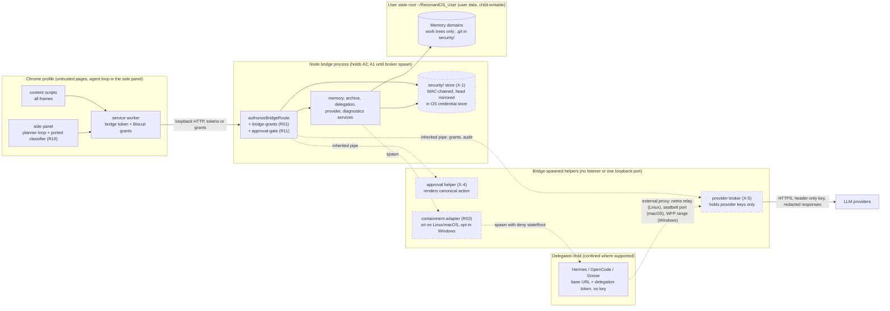
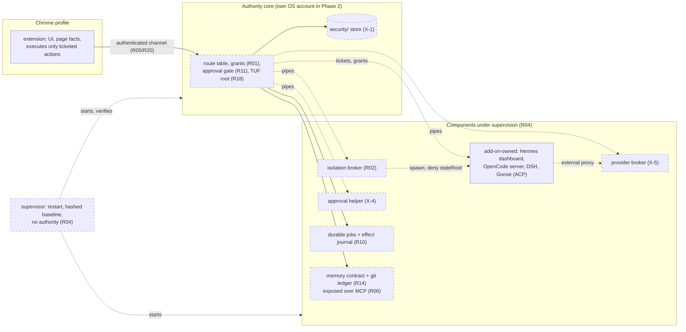
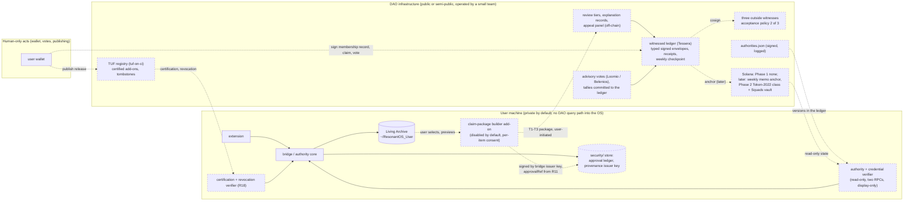

# Reference architectures and the selected path (lead, Fable 5.1, 2026-10-21)

Status: lead decision D5.1, written after X-1, X-4 and X-5 (`architecture/decisions.md`). Three reference architectures as the master prompt asks (minimal adapter, neutral baseplate, federated/composable), one rejected fourth, and the selected hybrid. Every proposed component is status D ("designed, not yet tested"); the acceptance checklists at the end of each architecture name the test that would change that (`architecture/acceptance-backlog.md`). Nothing is scored (D4.0 (3)(c)). Evidence: Stage 1 `os-map.md` sections 16-17 (coupling, seams), `capability-matrix.md`, `interaction.md` (I1-I10, E1-E10), the sixteen dossiers, the three reviews and threat model v0.2.1.

## 0. What is fixed before any architecture is chosen

- The Alpha that exists is a Chrome MV3 extension plus a loopback Node 24 bridge with 114 capability-gated routes and 2,424 deterministic tests that lock the route and capability vocabulary (`bridge-route-capability-audit.test.mjs`). The website's "neutral baseplate" is "designed on paper" (timeline discrepancy 3); no neutral core exists in code.
- Four seams were identified at Stage 1 and confirmed by every Stage 3 dossier that touched them (`os-map.md` section 17): (1) the principal and grant model in `authorizeBridgeRoute`; (2) the Hermes proxy, process launch and runtime discovery entangled in the transport layer and launcher; (3) human approval as a core-visible event; (4) one memory promotion contract.
- Four properties exist nowhere as working code and must be built: refusing a privileged route without an approval record (R11), a host-verifiable human review for knowledge promotion (R14), rollback of a desktop service to a hashed baseline (R04), per-right personhood assurance (R25) (`gate2-report.md` section 1; D2.2).
- The three Gate 3 decisions (X-1 store, X-4 helper, X-5 broker) are common to every OS architecture below; they are not what distinguishes A1 from A2. What distinguishes them is which process holds what.

## 1. A1 Minimal adapter: the hardened Alpha

Keep the shipped extension and bridge. Add narrowly scoped host modules behind flags, each a PR-sized first task from a dossier, with the three X decisions as the shared substrate. The bridge process keeps holding the bridge tokens (A2) and, until the broker spawns, provider keys (A1) in memory; new parsers of adversary input are kept out of it by the X-5 and X-4 process boundaries, and native add-ons (hypercore, Convira `.node`) are not loaded into it in this architecture.

Components added (all new files under `browser-first/host/` unless stated; dossier section 12 first PRs):

| Seam or requirement | Module (new) | Upstream reused | Flag or default |
|---|---|---|---|
| X-1 | `security-state-store.mjs`; `readDenyRootsFor` gains `stateRoot` | the Alpha's own atomic writer (`harness-registry-store.mjs`) | always on once merged (no route can reach it anyway) |
| X-4, R11 | `approval-helper/` (child process), `approval-ledger.mjs` (JSONL hash chain, Ed25519 checkpoints, `exportHead()`), `approval-gate.mjs` (`requiredApproval` route field) | pattern: CATP append-then-act, durabletask `historysigning` chain, C2SP checkpoint formats; hypercore held in reserve | gates `archive-promote` and delegation start first; off by default per route |
| X-5, R03 | `provider-broker/` (child process), `addon-delegation-service.mjs` env rewrite (base URL and token instead of key) | pattern: Aegis order of checks | on for every delegation once merged; unconfined mode labelled |
| R02 | `delegation-isolation-srt.mjs` (adapter; Linux, macOS; Windows opt-in) | `@anthropic-ai/sandbox-runtime` 0.0.81 pinned, containment only, masking rejected | `RESONANTOS_DELEGATION_ISOLATION=srt`, default unchanged until acceptance passes |
| R01 | `bridge-grants.mjs` (Biscuit mint, verify, `grant_id` revocation, stream registry, byte cap, predicate allowlist) | `@biscuit-auth/biscuit-wasm` 0.6.0 pinned, Ed25519-only root | `RESONANTOS_BRIDGE_GRANTS=biscuit`, dual mode with the static tokens |
| R18 | `addon-trust-verifier.mjs` (verify, watermark and revoked set in X-1, suspend-not-uninstall, reason class) | `tuf-js` 6.0.0 pinned, forceCache guarded by a no-network fetcher | opt-in on `/addons/install` with `registryRef`; sideload unchanged |
| R10 | `durable-jobs.mjs`, `durable-effect-journal.mjs` (`effect()` with intent, indeterminate to the human) | `openworkflow` 0.11.0 pinned, core only, concurrency 1 | additive; browser jobs move to the bridge only after acceptance F1-F9 |
| R14, R13 | `memory-git-ledger.mjs` (plain git per domain, git dirs in X-1, signed approvals via the X-4 helper, atomic JSON with recover-from-HEAD) | pattern: DataLad run records (own marker, inert `cmd`) | disabled-by-default setting; fixes the `archive-review-service.mjs:669-684` mismatch in the follow-up PR |
| R12 | `provenance-record.mjs` (SD-JWT VC, per-boot issuer key until R15, 16-byte salts, hardened verifier) | `@sd-jwt/core`, `@sd-jwt/sd-jwt-vc` 0.23.0, `@owf/token-status-list` 0.5.0 pinned | no route; builder add-on disabled by default (I1) |
| R06, R07, R29 | `agent-adapters/goose-acp.mjs` (Approve mode pinned, one-shot answers, fresh `GOOSE_PATH_ROOT`, denylist of permission-rewriting methods) | goose v1.55.0 over ACP stdio, pinned | manifest with all grants false |
| R19 | `action-classifier.js` in the extension (nanobrowser `classify.ts` port plus governance and wallet category), Block and Ask on the registrable domain, pending approval instead of terminal `blocked` | nanobrowser `f1e912d` pure modules, Apache header kept | replaces the tautological fake at `browser-page-actions.test.mjs:179-187` |
| R05 | narrow the token exemption to `/hermes-dashboard` with a per-session token, or serve the dashboard from an add-on-owned listener | none | removes the OSC-05 open prefixes from the bridge port |
| R08, R15, R04 | not in A1's first wave (no candidate for R04; R15 vault after X-1; R08 via Goose's native wire code or own adapters) | | backlog |

Trust boundaries after A1 (proposed components dashed):

Assessment on the master prompt's criteria:

| Criterion | A1 |
|---|---|
| Migration risk | Low to medium. Every change is an additive host module or a flagged branch; the route and capability vocabulary stays; the dossiers list the tests among the 2,424 that each PR touches (mostly new files, a handful of inverted assertions such as `addon-delegation-service-error-handling.test.mjs:1202-1203`). The largest edits are the `archive-write` split and the delegation env rewrite. |
| Compatibility with current code | High. The adapters match existing shapes (`createDelegationIsolationAdapter`, `wrapCommandForIsolation`, `scopedCapabilityTokenPayload`, `RESONANTOS_HERMES_BASE_URL`). |
| Minimum viable milestones | M0 (0-30 days): X-1 store, broker, approval helper gating promotion and delegation start, srt adapter behind its flag, R05 exemption narrowed. M1 (30-90 days): Biscuit dual mode, TUF verifier, approval ledger with export, effect journal, git ledger, per-boot provenance, Goose adapter, classifier port. See section 6. |
| Fault model | Bridge crash still means manual restart (OSC-42; R04 has no candidate). Broker or helper crash: gated routes refuse, delegations end; nothing runs unapproved. Store corruption or rollback: fail closed with a visible alarm. Child crash: delegation marked failed; indeterminate browser steps go to the human. |
| Security evidence | Upstream tests for containment (srt Linux and macOS suites, six CI legs), TUF conformance (107 of 108), Biscuit attenuation and expiry vectors, SD-JWT property tests, OpenWorkflow fencing on SQLite; plus the acceptance backlog, none of it run. The properties the Alpha lacks today (T21, T22, T2 echo, T7 no-duplicate) come from our layer and are "designed, not yet tested". |
| Maintenance cost | Five pinned upstreams, three with a bus factor of one or two (biscuit-wasm, openworkflow, tuf-js) and one 0.0.x API (srt); vendoring fallbacks are named in each dossier. Our own layer is about 2,000 lines of Node across the modules. |
| Developer participation | High: every item is a PR-sized task in JavaScript with a named test file; no Rust, Go or Python needed. |
| Independence from proprietary providers | Unchanged: OpenAI-compatible wire only, keys local; native Anthropic and Gemini wire code arrives through the Goose runtime or later adapters, not a hosted gateway. |
| What A1 does not achieve | The bridge process still holds A2 beside the services that parse user data; the browser half stays in the extension's trust class until execution tickets exist; level (b) tamper evidence against V2 is unavailable on one OS account; Windows stays unconfined by default. |

Acceptance checklist against threat model v0.2.1 section 4 (status for A1 as proposed; "upstream" means the wrapped library demonstrates it by test; ids refer to `acceptance-backlog.md`):

| Property family | Status under A1 | Test ids |
|---|---|---|
| Authorization (T3, T4) | designed, not yet tested: Biscuit attenuation and expiry upstream; revocation on `grant_id`, stream registry and principal facts are ours | B-a..m, B-d2 |
| Containment (T2, T3) | upstream on Linux and macOS (srt suites); Windows opt-in labelled bypassable; broker is the only reachable surface: designed, not yet tested | S-a..h, X5-b, ranked 1 (Convira A10) |
| Secrets (T2, T9) | designed, not yet tested: header-only injection, redactor, echo stub | X5-a, ranked 2 and 5 |
| Security state (T21) | designed, not yet tested; level (a) only on one account | X1-a..d |
| Approval and audit (T1, T5, T19, T22) | designed, not yet tested; (b) only against confined V3 | X4-a..e, H-1..7, D-A1..10 |
| Component surface (T3, T6) | designed, not yet tested: three helper processes, one loopback listener each at most; native add-ons kept out of the bridge | X5-d, X4-c |
| Browser gating (T1) | partly: enforcement points tested upstream in nanobrowser CI; classifier port and registrable-domain block designed; no measured injection suite yet | N-1..4 |
| Durability (T7, T8) | designed, not yet tested: effect journal; upstream fencing on SQLite | O-F1..F9 |
| Supply chain (T6) | upstream for repository and mirror rollback (conformance); local rollback survival designed | T-1..11, ranked 3 |
| Provenance (T5, T13, T20) | format upstream; attribution has no source (open by construction); per-boot key | I-a..k |
| Credentials, Governance, Accounting | not A1's scope (A3) | |
| Minimal architecture (T11, T18) | A1 keeps every A and B row of the capability matrix (nothing removed); honest status documents are an article recommendation | |

## 2. A2 Neutral baseplate: the extracted enforcement core

Progressively extract a small authority core out of the bridge and move everything that parses adversary input, launches processes or holds provider keys into separate components under proven supervision. This is the architecture the website describes and ADR-038 names (Guardian, core-only invariants); today it exists on paper only. A2 is reached from A1 by the four seams, in order, never by a rewrite.

Process layout at the end of A2:

| Process | Holds | Listens | Parses adversary input |
|---|---|---|---|
| Authority core | bridge tokens or Biscuit root key, the X-1 store, the approval gate, the route table, the TUF trusted root, the approval ledger key | one loopback listener for the extension (R20 may replace it with native messaging) | no: requests are small JSON on authenticated routes; the open proxy prefixes are gone |
| Provider broker | provider keys only | one loopback port reached through containment | yes (child HTTP), in its own process |
| Isolation broker | nothing secret; the `SandboxManager` singleton and the child process table | none (inherited pipe) | yes (srt proxy relays), in its own process |
| Approval helper | nothing persistent (Phase 2: the enrolled credential handle) | none (inherited pipe) | no |
| Add-on-owned components (Hermes dashboard, OpenCode server, DSH) | their own state | their own loopback ports, token-checked, excluded from confined children | yes, outside the core |
| Supervisor (R04) | hashed baseline of installed versions and config, outside the user root | none | no; no model in the loop |

Extraction order (os-map section 17, with the dossier evidence):

1. Seam 1 (R01) and X-1: the grant model and the store are already separable (`bridge-server.mjs` transport and `bridge-capability-tokens.mjs` have no domain policy except the embedded Hermes proxy).
2. Seam 2: lift the Hermes proxy, process launch and runtime discovery out of `bridge-server.mjs:206-310, 739-1078` and `run-bridge-minimal.mjs` into add-on-owned components with a containment mode per OS; the isolation broker and provider broker of X-5 are the first two such components.
3. Seam 3: the approval gate and ledger become core-visible events (A1 already does this); public submit, pay, grant and governance classes obtain bridge-issued execution tickets from the core, so the extension executes only what the core has recorded.
4. Seam 4: one promotion contract (A1's git ledger) exposed over the already-written MCP surface.
5. Supervision (R04): an outer supervisor per OS (systemd user unit, launchd agent, Windows service wrapper) that restarts the core and verifies a hashed baseline before start; the baseline excludes `security/` (tighten-only) so rollback never restores revoked authority (ADR-038, I6). No candidate was shortlisted for R04; Stage 2 leads are s6, runit, launchd, WinSW and ostree-style baselines (`ledger/codebases.jsonl`, R04 rows).
6. Separate OS account for the core and broker (Phase 2 of X-1 and X-5): the only local closure of tamper-evidence level (b) against V2.

Trust boundaries at the end of A2 (all new processes proposed):

Assessment:

| Criterion | A2 |
|---|---|
| Migration risk | High if attempted at once: `run-bridge-minimal.mjs` hard-wires ten services and one extension id; the Hermes iframe depends on the open proxy prefixes; 2,424 tests encode current names; Windows parity (0600, PATH, sandbox) is absent today, so a "neutral" core must define containment per OS rather than inherit POSIX assumptions (os-map section 17 risks). Medium when done seam by seam behind A1's flags. |
| Compatibility | Each seam keeps the vocabulary the audit tests lock; the extension's startup dependence on static tokens is retired only in dual mode. |
| Minimum viable milestones | M2 (90-180 days): seam 1 extraction, isolation broker process, execution tickets for submit-class actions, Phase 2 approval helper. M3 (6-12 months): supervisor with hashed baseline, separate-account core, DSH and OpenCode on a reverse channel. |
| Fault model | Supervised restart of the core with a verified baseline; components restart independently; authority never survives a restart without re-verification; the store's head mirror detects rollback. |
| Security evidence | Structural: the Component surface property holds by process layout rather than by discipline; level (b) tamper evidence against V2 becomes available with the separate account. All of it designed, not yet tested, plus the same upstream evidence as A1. |
| Maintenance cost | Higher: four to six long-lived processes per OS, supervisor units per OS, a Rust or Go dependency only if DSH or Goose containment demands it (none today). |
| Developer participation | Medium: the seams are well bounded but touch the launcher and transport, which need a maintainer who knows the bridge; later seams are again PR-sized. |
| Independence from proprietary providers | Improved: the broker is the one place keys live and the one place wire formats are added. |
| What A2 does not achieve | It does not replace the browser half or make the DAO exist; it does not solve Windows no-admin confinement (that remains a measurement, ranked test 1); R25 personhood stays uninspected. |

Acceptance checklist (delta from A1):

| Property family | Status under A2 |
|---|---|
| Component surface | designed, not yet tested: structural separation; test: each process's listeners enumerated and compared with the table above (X5-d extended) |
| Security state | designed, not yet tested: level (b) against V2 with the separate-account core (test X1-b expected to pass under A2) |
| Approval and audit | designed, not yet tested: execution tickets extend the gate to submit, pay, grant and governance classes (N-1..4 become required) |
| Durability | designed, not yet tested: supervisor restart with baseline (no candidate; test to be written with the R04 component) |
| All others | as A1 |

## 3. A3 Federated and composable: the OS and the DAO as two systems

The DAO is not a layer of the OS. It is a separate system with explicit consent interfaces (E1-E10), the ten invariants (I1-I10) and portable data, and it stays usable without the OS as the OS stays usable without it. A3 is the OS-DAO relation under either A1 or A2; it is listed as an architecture because the master prompt asks, and because the whitepaper's "Built on Realms, opening soon" would otherwise be read as an OS feature.

Phase 1 (off-chain first, no token, no program; dao-requirements section 5; T18):

| Function | Component | Evidence and decision |
|---|---|---|
| Membership and claim ledger (R30, R23 registry) | Tessera v1.0.4 (pinned) on one Linux host with the POSIX driver, a ~200-line personality, member-signed typed envelopes `{v, type, epoch, commitment, signer_pk, sig}` with a domain-separated message, signed submission receipts, static tiles served by any host; acceptance policy `group outside 2 EA EB EC` over three non-custodian witnesses, pinned in the member verifier (D3.9); per-epoch member keys with per-epoch counts by entry type (D4.0 (3)(b)) | tessera dossier sections 6-7; adopt as dependency; Go on the operator's host only |
| Member verifier | TypeScript `tlog-verify.mjs` (inclusion, consistency, checkpoint note, policy, receipts, gossip) ported from sigstore-js with the 196 merkle vectors; shared with the OS R11 ledger | tessera first PR; also the first OS-side file |
| Claim packages (R12, E2, E3) | SD-JWT VC (`@sd-jwt/*` 0.23.0) with the Resonant `vct`, plaintext `tool`, `session`, `attribution {method:'declared'}`, disclosable artifact names; holder binding by the wallet through a domain-separated envelope; built by a disabled-by-default OS add-on, per item, previewed, logged locally (I3) | identity-common-ts dossier section 7; attribution has no source (C-6) |
| Membership credential (R22) | an off-chain signed membership record in the ledger, no token; revocation, appeal and re-binding at the registry level with the DR-06 fields; status-list bits derived only from logged revocation records; verifiers require an inclusion proof per changed index and apply a maximum status age | rewards dossier section 7 (reframed, D-4); identity-common-ts wrapper items 6-8 |
| Governance (R24) | no on-chain stack; devnet single-key artifacts retired (authorities set to none or published as superseded); advisory votes off-chain and replayable, tallies committed in the ledger; a signed, logged `authorities.json`; a read-only authority verifier in the bridge (`dao-authority-verifier.mjs`) comparing two RPC endpoints, display-only (I2) | realms dossier sections 7 and 12; D4.1 |
| Contribution accounting (R26) | a Resonant lexicon set (claim, proposal, review, accrual, paymentDecision, appeal, correction, revocation, dimension) in a local append-only ledger; reviewer = signer; one acknowledgement per contributor; export to `org.hypercerts.*` per item and opt-in, hashes and title only | hypercerts dossier sections 6-7 |
| Add-on certification (E4, E10, R18) | a TUF repository (tuf-on-ci) with root 2-of-3 minimum, 3-of-5 target, `certified` 2-of-N reviewers, keyholder list public, rotations logged in the ledger; revocation suspends with reason class and a logged user override, policy delisting never disables (D4.0 (3)(a)) | tuf-js dossier sections 7-8 |
| Votes | Loomio or Belenios as separate AGPL services (reference, not bundled) | gate2-report section 7 |

Phase 2 and 3 (only after DR-54: audit, custody policy, devnet test of the exact program): a Token-2022 credential class behind a thin Resonant issuer program with no holder-and-issuer move instruction and governed re-binding with a veto window, lifetime cap and attester independence; authorities in a Squads v4 vault V, 2-of-2 over a custodian multisig C and an outside multisig O, `time_lock >= 604800`, `config_authority` null; Phase 3 replaces C by a DAO-owned Realms instance built reproducibly from published, audited source, with the binding-vote blockers resolved (delegation zeroed, electorate authorities under the protected governance). Full key-class table in `architecture/governance-checklists.md`.

OS-DAO data flow and trust boundaries (every DAO-side component proposed; legacy devnet artifacts are superseded, not part of A3):

Assessment:

| Criterion | A3 |
|---|---|
| Migration risk | Low for the OS (one disabled-by-default add-on and two read-only verifiers). For the DAO there is nothing to migrate: no official code exists (census). The legacy devnet balances are not migrated (DR-54 Sybil and fairness question). |
| Compatibility | The OS side touches `app-command-handlers.js:687` (`/dao`), `wallet-dao-audit-markdown.js`, and adds host modules; no route semantics change. |
| Minimum viable milestones | M1: `tlog-verify.mjs` and the authority verifier with recorded fixtures (no network in tests). M3: a pilot ledger with three recruited outside witnesses, membership records and five pilot dimensions; devnet retirement; `authorities.json` v1. Later: credential class after DR-54. |
| Fault model | Witness quorum unreachable: no checkpoint published, entries stay sequenced, receipts age toward their deadline, alarm; the policy is not weakened for availability. Operator omission: receipts make it provable. RPC disagreement: `unverified`, never `meets`. |
| Security evidence | Proof-layer negatives upstream (196 merkle vectors; witness fork and rollback refusal tests; SD-JWT property tests). Omission, split view across disjoint witnesses, phantom entries and insider inflation are designed, not yet tested (tessera 3(e)-(h)); personhood (R25) and collusion resistance (R27) uninspected (D4.0 (2)). |
| Maintenance cost | One Go process plus static hosting and witness coordination (1-2 hours a week); a TUF registry with key ceremonies; the review process is human labour, the binding constraint (DR-62). |
| Developer participation | Medium: the verifier and lexicon are TypeScript; the log personality needs Go, which the team lacks; the governance work is specification and process. |
| Independence from proprietary providers | Full: static files, open C2SP formats, any RPC, no hosted service; Solana only as a later anchor. |
| What A3 does not achieve | Human/AI attribution (T13, T20) stays open by construction; phantom members from custodian-made keys are not detectable by any log (R25); the DAO's own contradictions (I-1, I-4, I-14, I-17) are the maintainers' to fix (OI-4). |

Acceptance checklist:

| Property family | Status under A3 | Test ids |
|---|---|---|
| Credentials (T15, T23) | designed, not yet tested: registry-level revocation with DR-06 fields, re-bind safeguards, status-list max age and logged tokens | I-g..k, R-2, R-3 |
| Governance (T12) | designed, not yet tested: no on-chain stack in Phase 1; insider rule; verifier | G-F1..F12, G-B |
| Accounting (T13, T16, T17, T24) | designed, not yet tested: receipts, typed counts, reviewer = signer, appeal bound | T3-e..h, Hc-1..8 |
| Provenance (T5, T13, T20) | format ready, attribution source absent (open) | I-a..k |
| Supply chain (T6) | upstream conformance; registry custody designed | T-1..11 |
| Minimal architecture (T11, T18) | designed: off-chain Phase 1 covers membership, claims, advisory votes with public auditability | pilot |

## 4. A4 (rejected): ResonantOS as a thin layer over Goose

Evaluated through the Goose dossier (R29, Fable launch, Opus rerun) and the nanobrowser R29 view. Rejected as the whole-product architecture: Goose has no browser half (no counterpart for OSC-01, 07-09, 12, 18-22), its consent model defaults to Auto and has no principal (G5 fails outside a wrap), it provides no OS containment, and its extension surface is self-declared unstable. OpenClaw carries 722 advisories and disclaims multi-tenant isolation; DSH is already wrapped and unaudited. What survives: Goose as one wrapped delegated runtime and MCP host over ACP stdio inside A1 or A2, with the adapter conditions of its dossier section 7; its inspector pipeline (results can only tighten a decision) is the pattern for the bridge's own inspectors.

## 5. Selected path: A1 now, A2 by seams, A3 as the DAO relation

Selection: the hybrid. Build A1 in the next two cycles because it delivers the three X decisions and the eleven first PRs without touching the launcher, then extract the core along the four seams (A2) once the acceptance backlog has turned "designed" into "tested" for the store, broker and helper, and run A3 as a separate programme with its own pilot. Reasons:

1. The evidence favours thin custom layers around proven upstreams, not a rewrite: the four missing properties are small (approval gate, promotion review, hashed baseline, personhood rule), and every dossier's first PR is additive.
2. The security review's ten X-1 instances and seven X-4 instances are fixed once, by substrate decisions, not per component; A1 is where that substrate lands fastest.
3. The Component surface property cannot be met by discipline alone; A2 is required for it, but only after A1's helpers exist, because they are A2's first three components.
4. The DAO cannot be an OS layer under I1 and I2; it has no code; its Phase 1 is a ledger and a review process, which A3 delivers without a token or a program (T18).

What should not be attempted in the next development cycle: a Rust core or the Chromium-family shell of ADR-037's Phase 2 (ADR-037 is accepted; its Phase 1 is what A1 hardens), on-chain binding votes or any mint (T18, DR-54), vendoring the whole nanobrowser layer with `chrome.debugger` before R21 isolates add-ons, adopting Aegis, Convira (as a whole), DataLad, hypercerts-lexicon or Realms as dependencies, running `goose serve`, enabling srt credential masking, and any attempt to make the DAO decide runtime authority.

## 6. Milestones (now, next, later) with dependencies and gates

| Window | Deliverables | Depends on | Gate (acceptance ids) |
|---|---|---|---|
| Now (0-30 days) | X-1 store and `readDenyRootsFor` extension; provider broker with echo redactor; approval helper Phase 1 gating `archive-promote` and delegation start; srt adapter behind flag on Linux and macOS; R05 proxy exemption narrowed; `archive-review-service.mjs` argument mismatch fixed | none | X1-a, X1-c, X4-a..c, X5-a..d, S-a..f |
| Next (30-90 days) | Biscuit dual-mode grants; TUF verifier with watermark in the store; approval ledger JSONL with `exportHead()`; effect journal and durable jobs (additive); git ledger with signed approvals; per-boot provenance records; Goose ACP adapter (deterministic tests); classifier port and registrable-domain Block; `tlog-verify.mjs`; authority and credential verifiers with recorded fixtures | Now | B-a..m, T-1..11, O-F1..F9, D-A1..10, I-a..k, N-1..4, G-A |
| Later (90-180 days) | Seam 1 extraction (authority core), isolation broker process, execution tickets for submit, pay, grant and governance classes, Phase 2 approval helper with user verification, Windows confinement decision from ranked tests 1 and (g) | Next; ranked tests 1, 2, 3 run | ranked 1-5, X4-d, Convira A1-A11 |
| 6-12 months | Supervisor with hashed baseline (R04) excluding `security/`; separate-account core and broker (level b); DSH and OpenCode on a reverse channel; DAO Phase 1 pilot (ledger with three outside witnesses, membership records, five dimensions, `authorities.json` v1, devnet retirement); R15 vault over the store; R25 and R27 inspections | Later | T3-1..4, Hc-1..8, G-F1..F12 |

Falsification: the selected path is wrong if (1) ranked test 2 shows the redactor cannot keep the key from an echoing upstream across encodings; (2) the approval helper cannot be made to render reliably on one of the three OSes without a GUI toolkit dependency, and the extension-page fallback also fails the no-agent-code test; (3) ranked test 1 shows the Convira backend grants ACLs through junctions and srt-win's residuals make Windows confinement unusable, in which case Windows stays unconfined and the article must say the project has no Windows containment story; (4) the X-1 head mirror in the OS credential store proves unreliable across the three stores (then the file-backed fallback is the only mode and level (a) is all that is claimed).
