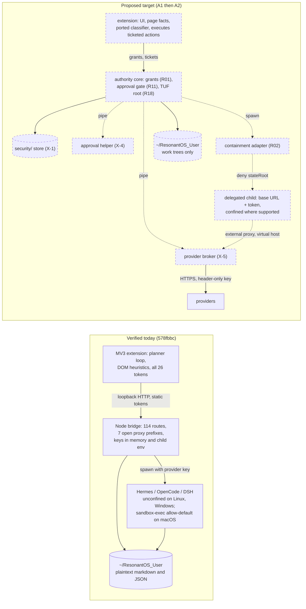
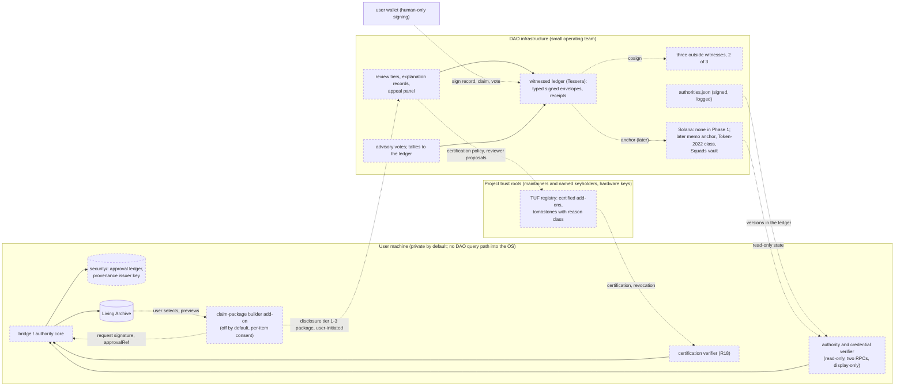

# From Existing Code to the Next Architecture: a cross-platform, multilingual open-source and research-literature strategy for ResonantOS and ResonantDAO

Research dates 2026-10-20 to 2026-10-21. ResonantOS 2.0.0-alpha inspected at commit `578fbbc3c1c854b192318b3d2163b138fb45d8bd` (branch `dev`, 2026-10-18). DAO sources fetched 2026-10-20 and 2026-10-21. Sixteen third-party codebases inspected statically at pinned commits (section 5). Nothing third-party was executed; every finding is static inspection, a read-only API or RPC read, or a document, and is labelled as such. Method, coverage and verification rates are in `APPENDIX.md`. Lead: Claude Fable 5.1 (Stages 1, 2, 4 and the architecture step), Claude Opus 5.5 (Stage 3 lead after a credit outage, D3.1); inspectors, reviewers and discovery agents as listed in the appendix. This is technical research, not legal or investment advice.

**How to read this.** R01-R30 are the research's requirements (`stage1/gaps.md`); T1-T25 threats, V1-V10 adversaries and A1-A12 assets come from the threat model (`ledger/threat-model-draft.md`); OSC-nn rows are the capability matrix of the Alpha; DR-nn are DAO requirements and I1-I10 the interaction invariants (section 2); X-1, X-4, X-5 are the three substrate decisions (section 7); BL-nn are backlog items (section 11); PoC n are experiments (section 12). "Level (a)" tamper evidence holds against other OS accounts, offline disk edits and confined children; "level (b)" holds against a process running as the same user. "srt" is `@anthropic-ai/sandbox-runtime`. Disclosure: the models that ran this research are made by the same company as sandbox-runtime; the dossier's blocker against its credential-masking mode stands and the article recommends it for containment only.

**Addendum, 2026-10-22.** T25, asset A12, risk-register row RR-31, one privacy row in 9.2 and one Next-phase roadmap item were added after the research above was finished and verified (user-approved; `session-2026-10-22-perplexity-privacy-gate.md`; dossier `dossiers/perplexity-pii-tracer.md`). They were not re-run through the Stage 3 citation checkers or the adversarial review; their evidence is cited directly, to the same file:line standard, so readers can verify it themselves.

## 1. Executive conclusion

The ResonantOS Alpha that exists is a working single-user Chrome extension plus a loopback Node bridge with careful token plumbing and 2,424 deterministic tests. The isolation, revocation and recovery properties the website describes belong to the "neutral baseplate" design, which has no code yet; the Alpha has partial forms of them (macOS-only isolation, an OpenCode revoke latch, a graceful shutdown drain). The ResonantDAO is a specification with no code. The open-source world already supplies most of the building blocks the two projects need, but not three properties: a privileged route that refuses to run without a human's approval record, a review of knowledge promotion that the host can verify, and supervised rollback of the desktop service to a hashed known-good baseline. The first two are small to build and are where the research found the design errors that would have undone the rest; the third is a 6-12 month item. Per-right personhood assurance is a fourth gap that this research did not inspect.

**Reuse now (adopt or wrap, behind flags, with the conditions in section 5):**

- `@anthropic-ai/sandbox-runtime` 0.0.81 for containment of delegated children on Linux and macOS, as containment only; its credential masking is never used (an echoing provider returns the key to the child).
- `tuf-js` 6.0.0 for signed, hash-pinned, revocable add-on manifests; 107 of 108 tuf-conformance v2.4.0 tests pass in its own CI (one optional cache test is an expected failure); conformance does not exercise the offline `forceCache` path, whose root-rotation deviation the wrapper guards with a no-network fetcher.
- `@biscuit-auth/biscuit-wasm` 0.6.0 for per-principal, expiring, attenuable grants; revocation is ours to build.
- `openworkflow` 0.11.0 core for durable browser jobs; the effect journal that stops duplicates is ours.
- `@sd-jwt/core` and `@sd-jwt/sd-jwt-vc` 0.23.0 for selective-disclosure claim packages; the format can carry a declared human/AI attribution field, and nothing produces the value yet.
- `goose` v1.55.0 as one wrapped delegated runtime and MCP host over ACP stdio, never as the product's base.
- Tessera v1.0.4 with C2SP witnessing for the DAO's off-chain Phase 1 ledger, under a 2-of-3 outside-witness policy and signed receipts.
- Patterns to reimplement in a few hundred lines each: Aegis's credential broker, nanobrowser's action gate and classifier, DataLad's run records over plain git, CATP's append-then-act ledger, durabletask's signed history chain, the Merkle-plus-revocation-marker registry from the rewards program.

**Defer or reject:** any token, mint, program or binding on-chain vote (the devnet artifacts implement a superseded model under single keys); the shared Realms instance (it runs version 3.1.7, for which no public source was found, under a 5-of-7 council with no delay and no veto); Convira's sandbox as a whole (vendor its Windows backend only after a full native review and one acceptance test); vendoring nanobrowser's `chrome.debugger` layer before add-ons are isolated; adopting Aegis, DataLad, hypercerts-lexicon or Realms as dependencies; a Rust or Chromium rewrite; "ResonantOS as a layer over Goose".

**The five decisions that unlock progress** (section 7; approved by the research owner on 2026-10-21):

1. One bridge-only, integrity-protected security-state store outside the user folder, unreachable by bridge routes and confined children (X-1). Ten of the fifteen dossiers reviewed at Gate 3 had placed revocation sets, keys, watermarks or ledgers where the adversary they defend against can write.
2. An approval ceremony in a bridge-spawned helper process that contains no agent code and that renders the canonical action, with no approval route on the bridge at all (X-4). Six dossiers had ended their approval design in a bridge route or an extension prompt that the agent's own context could reach.
3. A reverse credential broker in its own process, reached by the child as the containment layer's external proxy, with header-only injection and a response redactor (X-5).
4. Harden the existing Alpha first (A1) and extract a small enforcement core along four named seams afterwards (A2), never by rewrite.
5. Run the DAO off-chain first (A3): a witnessed public ledger, signed membership records, advisory votes, a published and logged authority file, and no token until an audit, a custody policy and a devnet test of the exact program exist.

**Strongest evidence.** The Alpha's own CI on the inspected commit (every lane green, read through the GitHub API); the Stage 1 code map with 63 classified capability claims, of which a seeded re-check of 15 found 6 partial (pointer and count slips, a 20 percent weighted error rate with partials counted as half) and none failed; 189 decision-carrying dossier citations re-opened by fresh-context reviewers at the recorded commits, 181 exact, 7 partial, 1 failed and fixed; mainnet and devnet RPC reads reproduced by two independent agents for the Solana authority findings; sandbox-runtime's CI result on the inspected commit confirmed through the Actions API.

**Weakest evidence.** Nothing was executed, so every "demonstrated" property rests on reading tests that exist in CI, and every property the Alpha lacks today (security-state tamper evidence T21, governed credential revocation T22, the echoing-provider case of key exposure T2, the no-duplicate half of crash recovery T7) is "designed, not yet tested". Windows behaviour of every containment candidate on a standard-user machine is unmeasured. On Windows today, and on any OS with the containment flag off, every delegated agent runs as the user; it can drive a native approval dialog, read the store's key from the credential store and read the broker's memory, so the local design meets tamper-evidence level (a) only, not the level (b) the threat model wants for routes that gate irreversible browser actions (T1) and approvals (T22), until the core runs under its own account (A2). Human/AI attribution has no source anywhere. R25 (personhood) and R27 (collusion resistance) were not inspected at code level. The Japanese and Korean ecosystems were probed, not swept. Every verdict that depends on a test is marked "conditional on test X" (appendix section 9), and the ranked backlog of those tests is in section 12.

## 2. The Resonant vision as engineering contracts

The project's own documents state the contracts; the research turns them into testable form. Sources: `docs/architecture/ALPHA_RUNTIME_BOUNDARY.md`, `docs/planning/02-sdk-dao-governance-roadmap.md` ("Neither an NFT nor a DAO vote becomes a runtime root credential"), ADR-008 (wallet actions human-only), ADR-022 (portable user root), ADR-038 (Guardian and core-only invariants, accepted 2026-09-15, not implemented), the whitepaper v0.6 draft (2026-08-30) and the Contribution Economy working specification v2 (`stage1/dao-requirements.md`, `stage1/interaction.md`).

**Objectives.** A local-first agent runtime that keeps the user's knowledge, keys and browser session under the user's control; delegated AI work that is bounded and attributable; a community economy that pays on verified outcomes, never on activity, and whose governance stays human.

**Invariants (I1-I10, `stage1/interaction.md` section 6).** These were adopted by the research owner at Gate 1 as working assumptions; the maintainers have not adopted them. Their provenance: I2 and I4 restate official text (the roadmap sentence above, ADR-008, the runtime boundary document); I6 restates ADR-038's certification intent; I1, I3, I5, I7, I8, I9 and I10 are derived by this research from the whitepaper, the Contribution Economy specification and ADR-022, and I3 contradicts one sentence of the DAO text ("the software logs every member action"), which the research treats as inconsistency I-14 rather than as the invariant. I1: ResonantOS is fully useful with no wallet, credential or DAO connectivity. I2: no DAO state becomes runtime authority. I3: every OS-to-DAO data flow is user-initiated, previewed, minimised and locally logged; the DAO has no query path into the OS. I4: human-only actions (wallet signing, payments, public submission, voting) are enforced at the bridge, not in UI. I5: human/AI attribution is carried from the point of work and never collapsed before the DAO applies its rules. I6: certification binds to an exact release hash, is checked at install, update and start, and revocation survives rollback. I7: evidence packages are reproducible by a third party from disclosed material. I8: money never alters OS behaviour, grants or trust tiers. I9: a sponsor's accountability gives no access to the AI member's OS data. I10: both systems keep independent audit trails.

Today I4 is a target, not a description: human-only enforcement in the Alpha is English regex heuristics in the content script with no host-side checkpoint (OSC-19, OSC-20, OSC-47). I5 has no producer: nothing in the Alpha measures a human/AI split (interaction section 12, DAO review C-6). I6 has no verifier: manifests self-declare "signed" with no signature bytes (OSC-31).

**Anti-goals.** These are the research's hard gates for candidate selection (`scoring/weights.json`, G1-G5), not project policy; the project's own stated anti-goals are the two boundary sentences quoted above. No cloud service or telemetry for the core function (hard gate G1). No silent degradation per operating system (G2). No copyleft or source-available code inside the MIT Alpha without legal review (G3). EVM-only chain components are patterns, not candidates (G4). No candidate that turns a DAO credential into runtime authority or an agent into a human-only actor (G5). No conversion of community philosophy into a technical restriction the official project has not adopted (master prompt section 9).

**Measurable acceptance criteria.** The threat model (`ledger/threat-model-draft.md` v0.2.1) names, per threat family, the property a component must demonstrate with a test, an audit or a reproducible example, and the fault that breaks it: a revoked grant refused mid-session including on open streams; a confined child that cannot reach the loopback port unless granted; a child that never sees the key, including through an echoing upstream; security state unreachable by children and add-ons, with rollback detected; a route that refuses without an approval record the agent principal cannot mint, showing the human the canonical action; no new listener without authentication; a gate outside the DOM with a measured injection suite; recovery after a crash during an uncertain side effect with no duplicate and no automatic retry; signatures verified offline with revocation surviving rollback; attribution produced by a measurement the attributed agent cannot forge; non-transferability tested at program level with governed, appealable revocation; multisig and timelock on every authority including the ones that define the electorate, with insiders at most k-1; reviewer equals signer, signed submission receipts and auditable entry counts; an off-chain Phase 1 that keeps the A and B features. Section 12 turns these into experiments; section 7 scores no proposed layer against them, by decision (D4.0).

## 3. The project today

### 3.1 Inventory

GitHub organisation ResonantOS: 8 public repositories, 0 releases, 0 forks flagged by GitHub, 1 public member. Only `2.0.0-alpha` is active (585 commits in 90 days to 2026-10-20) and licensed (MIT); the other seven carry no licence file. Organisation ResonantDAO: 0 public repositories, 0 public members (created 2026-06-04). The organisation list is incomplete: the active Augmentor source (`ManoloRemiddi/augmentor-agent`, 401 commits in 90 days) and the DAO site source (`ManoloRemiddi/ResonantDAO.com`) live in a personal account and are treated here as official-adjacent (D1.2). The only registry artifact anywhere is npm `dsh-augmentor` 0.2.13. Software Heritage holds no snapshot of any repository. Full census: `stage1/census.jsonl` (23 rows) and `census-notes.md`.

### 3.2 Actual runtime architecture

The Alpha is a Chrome Manifest V3 extension (0.1.14, Chrome 116 or later, loaded unpacked) and a Node 24 bridge started by `node run-bridge-minimal.mjs`, exposing 114 capability-gated JSON routes, one bootstrap route and an unauthenticated reverse proxy for the Hermes dashboard (`stage1/os-map.md` sections 2-5). Authentication is one static bridge token plus 26 static per-capability tokens minted per start, delivered through a generated file in the extension tree; the extension requests all 26 at startup, so one service worker holds every capability for the process lifetime (`bridge-client.js:141, 651`; OSC-02). Default deny for undeclared routes is in code and tested (`bridge-server.mjs:125-126`). Seven proxy prefixes on the bridge port need no token on loopback (`bridge-server.mjs:1160-1167, 766-786`; OSC-05).

Working and tested paths: chat through OpenAI-compatible providers with routing strategies and visible fallback; page context, inline assistant and overlays; chat and project workspaces; Agent Control click, type and scroll with a nightly real-Chrome lane; memory source intake with hashing, versioning and audited move with rollback; Hermes and OpenCode delegation with an OpenCode revoke latch; diagnostics; preferences. CI on `578fbbc` passed every `verify:alpha` lane (browser-first 2,424 tests, 2,414 pass, 10 environment skips; vitest 724) and the nightly live lane with Chrome 155 and pinned OpenCode 1.18.32. No CI lane calls a real language model; the planner is never exercised by any test (OSC-18).

### 3.3 Evidence matrix

63 capability claims classified (`stage1/capability-matrix.md`): A demonstrably implemented and exercised 9; B implemented but insufficiently proven 22; C partial 14; D design only 12; E planned 3; F unknown 1; G superseded 2. A seeded re-check of 15 rows found 9 pass, 6 partial (pointer and count slips, one status a class too low), 0 fail; all six corrections were applied.

Downgrades of the project's own "implemented" claims, each with file and line in the matrix:

| Claim | Finding | Rows |
|---|---|---|
| Living Archive promotion to the trusted wiki | Promote always throws (argument-shape mismatch between `archive-review-service.mjs:669-684` and `archive-promotion-policy.mjs:11-25`), draft and revise hit a `TypeError`, the human-approval gate reads `nextStatus` while the service passes `toStatus`, all since commit `4098e28` (2026-06-02); no test calls the service-level promote; the capability matrix says "Implemented" | OSC-24 |
| Per-site browser permissions | Enforced in the side-panel page only; `ask-before-action` and `trusted-for-safe-actions` behave identically; `blocked` does not stop navigation; bypassable by direct `tabs.sendMessage` | OSC-13 |
| Human-only boundaries and the non-bypassable public submit | Label and attribute regex heuristics in English in the content script; plain links with commit words are clickable; the live lane counts a public-submit regression as "passed with gates" | OSC-19, OSC-20 |
| Add-on isolation | `sandbox-exec` on macOS only with an allow-default profile; `contract-only` (unconfined) on Linux and Windows; the persisted execution opt-in is bypassable per request; provider API keys are injected into Hermes child environments (`addon-delegation-service.mjs:1770-1780`) and OpenCode child environments (`:2221-2248, 2331`) | OSC-32, OSC-33, OSC-16 |
| Signed add-on manifests | Eight manifests carry `"signed": true` with no signature bytes, hash or verifier | OSC-31 |
| Anthropic and Google providers | Presets exist; every upstream call is OpenAI-style `chat/completions`; no Messages or Gemini wire code | OSC-15 |
| MCP, A2A, SKILL.md | A standalone stdio MCP example not wired into the bridge; no A2A code; zero `SKILL.md` files | OSC-48 to OSC-50 |

Capabilities the Alpha lacks entirely that the research needs: grant expiry, revocation, delegation attenuation, multi-principal isolation, a host-verifiable approval ledger (OSC-43 to OSC-47); crash recovery (OSC-42) is partial, a graceful drain on SIGINT and SIGTERM with no supervisor.

### 3.4 Released versus planned

No `main` branch, no GitHub release, one tag (`archive/pr-198-blackboard-experiment`); `package.json` says `2.0.0-beta.1` (prepared 2026-08-22, never tagged). `docs/STATUS.md` calls itself the source of truth and is stale by about 190 commits; it never mentions the vendored Augmentor (`apps/augmentor`, imported 2026-09-14, tested nowhere) or the harness subsystem with host-signed receipts (PRs #469-#490, #534). The website's "neutral baseplate" is "designed on paper"; the Alpha and the baseplate are different generations (`stage1/timeline.md`, 16 registered discrepancies). GitHub lists a `verify` workflow with no file in any ref. The SDK shim cites ADR-055 and ADR-056 that do not exist.

### 3.5 DAO implementation confidence

Specification only (D). The membership portal says "Design page, not live yet"; the whitepaper's three cited architecture documents and the Symbiotic Licence page return 404 (status F, D1.4). No official program, IDL, program ID or token mint exists publicly. Legacy devnet artifacts of a superseded model exist: a Token-2022 NonTransferable `$RCT` mint (about 1,001,139 supply), an SPL `$RES` mint with supply 1,000,008,000 above the stated plan and a live mint authority, five zero-supply sector mints, and an upgradeable program `HMthR7...VcoG` whose upgrade authority is one wallet; nothing on testnet or mainnet (`stage1/dao-requirements.md` section 8, re-read by the verifier). 62 requirements derived (DR-01 to DR-62). The Q4 2026 mainnet target has no artifact behind it.

### 3.6 Inconsistencies the maintainers should resolve

Seventeen DAO inconsistencies are registered (`dao-requirements.md` section 7); the serious ones: `$RES` earned for calls and Discord participation versus "outcome, never activity" (I-1); "contribution is measured on-chain" versus ledger-first (I-2); three incompatible contribution ladders (I-4, DR-40); "the software logs every member action" versus the project's opt-in evidence principle (I-14); human-only governance with a self-declared human/AI split, no per-sponsor agent cap and no delegation rule (I-17). Absent from the official texts: vote delegation rules, emergency powers, upgrade and admin key policy, revocation of human credentials, key recovery, membership privacy.

Four open items were held for this article by the research owner's decision (D1.3, D1.4), none sent: **OI-1** one repository in the organisation commits a database file whose table names suggest member records; the research did not open the rows, they may be demo seed data, and the detail goes privately to the owner rather than into this article. **OI-2** the Living Archive promotion path cannot execute while the capability matrix lists it as implemented. **OI-3** `apps/augmentor` is vendored as MIT 0.1.33 while the upstream relicensed on 2026-09-23 to "MIT with Augmentor Resale Restriction"; legal review needed. **OI-4** a request to republish the three whitepaper-cited architecture documents and the Symbiotic Licence text. Section 13 gives the suggested wording and who decides.
## 4. The external landscape

Stage 2 searched 36 platform categories (34 named sites and indexes plus general web search and university GitLab instances) in seven languages with 1,155 discovery records and 1,298 recorded empty or blocked searches, merged into 586 unique codebases (185 candidates, 279 leads, 104 excluded, 18 counterexample-only; `ledger/codebases.jsonl`, `coverage-matrix.md`). The grouped map, by area, with the strategy differences that matter:

**Authorization (R01).** Two families: object-capability tokens the holder can attenuate offline (Biscuit, UCAN, macaroons) and central policy engines (Cedar, OPA, Casbin). Biscuit is the only Node-embeddable one with an open spec, 38 conformance vectors and an Eclipse Foundation home; Cedar has first-class principals but no holder attenuation. Mid-session revocation with a test exists only in two young projects (Aegis, Attenuated-Delegation-Chain); nobody has combined both halves.

**Containment (R02).** Linux and macOS are solved many times over (bubblewrap, Landlock and seccomp wrappers, Seatbelt profiles, microVMs). Windows without administrator rights is the open problem: Convira claims it with AppContainer plus Job Objects; sandbox-runtime needs an elevated install; a measurement repository shows restricted-token sandboxes break piped native children (`0xC0000142`). Fresh advisories against three sandboxes (microsandbox, nono, sandbox-runtime) show this is where attackers look.

**Secret brokering (R03).** Rewriting gateways (Aegis), transparent MITM proxies that swap placeholders (Greyproxy, found through a French article), phantom tokens for containers (Terok, found only through the Helmholtz research-software index), agent-style daemons (oidc-agent) and Vault-style sidecars (Infisical). The vercel/ai harness advisory that exposed host credentials to sandboxed code is the reminder of why.

**Durable execution and evidence (R10-R12).** Embedded engines exist in Go with SQLite (Durable Task) and TypeScript (OpenWorkflow); the hosted products (Temporal's server, Restate, Inngest, DBOS on Postgres) are patterns for a single-user desktop. Append-only Merkle logs exist in Node (hypercore) and as the transparency-log standard (Tessera, rekor-tiles, the German EUDI relying-party registrar's RFC 6962 verifier). No candidate anywhere refuses an action for lack of an approval record; CATP's "block if the audit append fails" is the nearest design. Selective disclosure has an active TypeScript implementation (SD-JWT VC) and a mature Go one (Yivi irmago); in-toto, SLSA and C2PA supply attribution schemas; human-versus-AI attribution carried from the point of work exists in no format as a first-class field.

**Knowledge and local data (R13-R17).** Versioned, provenance-tracked file data is mature in science (DataLad, Research Object Crate); no memory system keeps source text apart from AI derivations behind a verifiable review (Mem0 keeps no source messages; Graphiti has an injection advisory). End-to-end encrypted local-first sync with real access control is research-grade (Keyhive, Willow) or single-maintainer (Evolu). Vault primitives are solid (age, libsodium, OS keychains, Privy's audited Shamir); offline retrieval is solved (FTS5, sqlite-vec, Orama).

**Browser and add-ons (R18-R21).** tuf-js passes tuf-conformance v2.4.0 in its own CI (107 passed, one optional cache test as an expected failure); sigstore-js has no rollback concept and four 2026 advisories; MetaMask's snaps registry has a blocklist pattern worth copying. Browser-agent gating lives in the extension or page in every candidate; nanobrowser's service-worker gate is the best of these, and the academic systems with measured results (Intact: 12.8 percent attack success versus 73.1 percent; "Stop Means Stop": approval gates leak sibling effects in five of six frameworks) show what a host-side gate must achieve. Extension-to-native channels have well-documented GPL or large reference designs (KeePassXC, Bitwarden, Tailscale's LocalAPI with Origin and Host rejection), so they are patterns to learn.

**DAO credentials and governance (R22-R25).** On Solana, Token-2022 NonTransferable with a permanent delegate is the credential primitive; the one audited program that uses it (the Solana Foundation rewards program) turned out, on inspection, not to contain the credential at all. Attestation (SAS) and governance (Realms, Squads) exist with gaps that section 5 weighs. Personhood systems publish no false-reject rates; agent-farming limits exist in none.

**Contribution accounting (R26-R28).** The mainstream tools are dead or stalled (SourceCred wound down in 2022 and warns against its own algorithm at low trust; Praise and Coordinape stale; MACI archived 2026-07); the live material is schemas (hypercerts-lexicon, CRediT roles) and research code (MeritRank, EigenTrust, conference reviewer assignment). Documented farming (tea.xyz: over 150,000 packages bound to wallets) and the finding that collusion rings are mostly undetectable from bids are the strongest evidence in the area.

**Contrarian (R29, R30).** The most feature-complete thin-layer candidate (OpenClaw) carries 722 published advisories and disclaims multi-tenant isolation; the foundation-governed one (Goose) is the serious comparison and section 5 answers it. For an off-chain Phase 1, witnessed transparency logs and cooperative-run membership and voting tools (Loomio, Belenios from Inria) cover membership, claims and advisory votes without tokens.

**What the non-English ecosystems contributed.** Practitioners in Chinese, French, German and Dutch keep the English word for most agent, capability and DAO vocabulary; native terms with real use cluster around auditing, authorisation, containment and durable execution (German Protokolle, Berechtigungen, Widerruf; Dutch logboek, verantwoording, mandaat, intrekking; French bac à sable; Chinese 沙箱 (沙盒 in Taiwan and Hong Kong), 持久化执行, 幂等键, 抗共谋). Searching those terms added codebases the English branches missed: Terok (R03), the EUDI relying-party registrar Merkle log (R11), Greywall and Greyproxy (R02, R03), Belenios verifiable voting (R30), Yivi irmago status lists (R12, R23), opensider's MV3-plus-Go native-messaging design (R20), openEuler's Git governance on AtomGit (R30). Costs for a contributor team: Gitee repository search is closed anonymously, OpenI sits behind an agreement gate, GitCode's API needs a token, HAL's HTML is bot-walled (its API works), and the Dutch and German research indexes are English-only. The Japanese and Korean probe did not fire its tripwire (in Japanese three single-day hobby repositories; in Korean only leads already findable in English, among them the government-backed OmniOneID identity stack), so no full sweep ran there; that is a documented blind spot (`glossary/ja-ko-probe.md`).

## 5. Every assessed codebase

### 5.1 The sixteen inspected codebases

Each row: reuse decision after adversarial review, the conditions that bind it, the upstream-as-inspected total under the named profile (0-5; rankings are library-only by decision D3.7 (c)), and the first PR. Full dossiers: `research/dossiers/<slug>.md`, fourteen sections each, with review responses. The compact table of the whole longlist (185 candidate codebases by requirement, with disposition and reason) is `APPENDIX.md` section K; the 586-row ledger is `ledger/codebases.jsonl`.

| Codebase (commit) | Reqs | Decision and conditions | Total | First PR |
|---|---|---|---|---|
| Eclipse Biscuit: biscuit-rust `93832a8`, biscuit-wasm `80cceed`, npm 0.6.0 | R01 | Wrap behind `bridge-grants.mjs`: Ed25519-only root (P-256 revocation ids are malleable in the pinned crates), revoke on a `grant_id` authority fact, deny set in the X-1 store, open-stream registry, pre-parse byte cap, predicate allowlist so no DAO fact can become authority. Revocation has no upstream mechanism and no test; the WASM binding has no negative test, a bus factor of one and an unmaintained allocator | 3.28 os_kernel | `host/bridge-grants.mjs` dual mode behind `RESONANTOS_BRIDGE_GRANTS=biscuit` |
| anthropics/sandbox-runtime `c40cf14a`, v0.0.81 (vendor disclosure: same company as the models that ran this research) | R02, R03 | Wrap for containment on Linux and macOS; Windows opt-in labelled bypassable (elevated install, anonymous-token and ICMP residuals). R03 only through a separate broker (X-5): env-mask mode substitutes the key into request bodies and relays responses unscrubbed (`body-substitution.ts:58-94, 128-164`; `tls-terminate-proxy.ts:1415-1475`), so an echoing provider returns it; blocker accepted. Reads are open by default: use `denyRead` home plus `allowRead` workspace, not the Alpha's macOS-shaped list | 3.76 (R02), 3.14 (R03) os_kernel | `host/delegation-isolation-srt.mjs` behind a flag; the adapter rejects mask entries |
| Convira/convira-sandbox `9013c32` | R02 | Vendor the Windows AppContainer backend only (eight files, 1,549 native lines), after a full line-by-line review and a from-source build; refuse grant paths with reparse points (the ACE writes follow junctions: acceptance A10, ranked test 1). Linux adapter silently ignores `allowLoopback:false` (G2 fail for that adapter, learn only). No-admin Windows is designed, not demonstrated | 3.02 os_kernel | `host/containment/windows-appcontainer/` with a `windows-latest` lane; not before the review is recorded |
| getaegis/aegis `f1321b3`, v1.0.5 | R03, R01 | Learn the pattern and reimplement (X-5). As shipped: binds all interfaces with unauthenticated stats and metrics (isolation 0, D3.11), unauthenticated dashboard with `*` CORS, custom auth header stock clients do not send, no echo redaction, no in-flight revocation, one maintainer idle 75 days | 2.20 os_kernel | `host/provider-broker.mjs` on its own transport |
| dapr/durabletask-go `a89450a`, v0.15.1 | R10, R11 | Learn the signed-history pattern (head truncation detected, tail truncation not; the library is not wired to the SQLite backend). R10 fallback sidecar only if OpenWorkflow fails the crash test: Go, unauthenticated gRPC upstream, thin stale Node client, reachable gRPC advisories at the pinned version | 2.80 os_kernel | `host/audit-ledger.mjs` port of the chain with a signed head and tail-truncation tests |
| openworkflow `c82fbed`, 0.11.0 | R10 | Wrap the core (not the CLI, which phones home by default); at-least-once replay re-executes a `running` attempt whatever the retry policy, so the effect journal with an indeterminate state is ours; cancel does not abort; concurrency 1; job DB in the X-1 store | 3.08 os_kernel | `host/durable-jobs.mjs` and `durable-effect-journal.mjs`, additive |
| holepunchto/hypercore `9c9cc3d`, 11.39.0 | R11 | Learn the pattern; hold as an optional cross-device witness. Signing key stored in the RocksDB by default, local reads unverified, the only equivocation test skipped since 2025-02-24, writes not fsynced (`holepunchto/librocksdb` at `7b5352d`, `src/rocksdb.cc:2256-2258`, read from the dossier; that repository is not among the pinned clones), five native add-ons and a 184 MB prebuild | 3.04 os_kernel | the JSONL approval ledger with Ed25519 checkpoints (no hypercore) |
| transparency-dev/tessera `012e9e0` (+ witness, merkle, formats, C2SP) | R11, R30 | Adopt for the DAO ledger on one Linux host with the POSIX driver (it does not compile on Windows: `syscall.Flock`); acceptance policy `group outside 2 EA EB EC` pinned in the member verifier (a flat 1-of-3 lets disjoint honest witnesses cosign different forks); signed submission receipts; member-signed typed envelopes with a domain-separated message; per-epoch member keys. Formats only for the desktop R11 ledger. fsck hangs on a corrupt tile (#1098) | 3.26 os_kernel (R11), 3.28 dao_contract (R30) | `host/tlog-verify.mjs` ported from sigstore-js with the 196 merkle vectors |
| identity-common-ts `42586ca` (`@sd-jwt/*` 0.23.0) | R12, R23 | Wrap behind a hardened adapter: always require key binding (the library skips it without a nonce), check `cnf` yourself, 16-byte salts (the shipped helper gives 64-bit), EdDSA only, offline fetcher with a maximum status age, status-list tokens accepted only with an inclusion proof in the witnessed log, a domain-separated human-readable holder-proof envelope. Bit-level revocation is tested; governed revocation is not. For R23 it is a component; the registry is Tessera | 3.56 (R12), 3.40 (R23) dao_contract | `host/provenance-record.mjs` with a per-boot issuer key |
| datalad/datalad `77de8d9`, 1.7.1 | R14, R13 | Learn the pattern (run records, source-versus-derivation layout) and reimplement over plain git with signed approvals; never emit `[DATALAD RUNCMD]` (rerun executes stored text, `rerun.py:593`); git directories in the X-1 store; per-call hardening against hooks and config; git-annex is AGPL-3.0-or-later and avoided | 2.72 user_facing_app | `host/memory-git-ledger.mjs` |
| theupdateframework/tuf-js `a399ce8`, 6.0.0 | R18 | Adopt pinned behind a wrapper: upstream CI passes tuf-conformance v2.4.0 (107 passed, `test_artifact_cache` an expected failure); conformance does not exercise `forceCache`, whose deviation (root rotation skipped when the cached timestamp expired and network exists, `updater.ts:85-94, 237-252`) the wrapper guards with a no-network fetcher offline; the v2.5.0 diamond-delegation test is expected to fail (`updater.ts:318-320`) and the registry never delegates one role from two parents; watermark and revoked set in the X-1 store; ids restricted to `^[a-z0-9][a-z0-9._-]*$` (delegation paths are globs); revocation suspends, never uninstalls, with reason class and logged override | 3.74 os_kernel | `host/addon-trust-verifier.mjs` on `/addons/install` |
| nanobrowser/nanobrowser `f1e912d`, v0.3.0 | R19, R29 | Learn the pattern and vendor the pure modules (classifier, url policy, boundary, gate ordering); add a governance and wallet category (vote, delegate, sign, claim, stake, connect wallet are absent upstream); Block and Ask on the registrable domain (upstream keys by exact host); `confirmGate` has no CI test and there is no measured injection run; the rewrite is days old, one maintainer; do not vendor the `chrome.debugger` layer before add-ons are isolated | 2.78 os_kernel (R19), 2.60 user_facing_app (R29) | `action-classifier.js` in the extension with the three required fault cases |
| solana-foundation/rewards `aa1cfd9` audited, HEAD `0b1bf17` | R22, R23 | Learn the pattern only. The Points credential exists only on an unmerged, unaudited branch; on that branch `TransferPoints` burns and re-mints with holder plus issuer co-signing, so a NonTransferable mint can be sold; the deployed binary's source commit is unknown (the verify record's own commit `758aa7a` does not reproduce the on-chain hash); upgrade authority is a 3-of-5 Squads vault with `time_lock 0` and a staged buffer; a post-audit advisory's fixes are unaudited | 2.08 dao_contract | `host/dao-credential-verifier.mjs` with recorded RPC fixtures |
| hypercerts-org/hypercerts-lexicon `db1f41c`, v1.5.1 | R26, R12 | Learn the pattern (content-addressed references, consent counter-records, governed vocabulary) and reimplement a Resonant lexicon; evaluator identity is forgeable (anyone can list DIDs; signatures optional and unbound), records are owner-mutable and world-readable (against DR-28 and the consent tiers); zero tests on the four record types R26 needs | 2.66 dao_contract | the Resonant ledger lexicon with A.9 field fixtures |
| aaif-goose/goose `9920efa`, v1.55.0 | R29, R06, R07 | Wrap as one delegated runtime and MCP host over ACP stdio: Approve mode pinned, one-shot answers only, fresh `GOOSE_PATH_ROOT` per delegation (the permission store is writable by the tools it gates), permission-rewriting methods denied, hint and memory loading off, no `goose serve`. Reject as the product's base: no browser half, Auto default, no principal, no containment | 3.52 user_facing_app | `host/agent-adapters/goose-acp.mjs` with a fake ACP child |
| Realms / spl-governance `00fa982` (3.1.3), plugins `1abc998`, Squads v4 `af94153` | R24 | Reference only in Phase 1 (no on-chain stack); Phase 3 only (binding votes), as a DAO-owned instance built from published audited source with delegation zeroed and every electorate authority under the protected governance (decision D4.1 said "Phase 2" before the three-phase split). The shared instance runs 3.1.7, for which no public source was found, under a 5-of-7 council, hold-up 0, community veto disabled; the governance workflow failed all 31 recorded runs, apparently before any step ran (a workflow or runner fault is likely; no test result exists either way). Squads v4 (immutable, verified, four audit firms, AGPL-3.0) is the later authority holder | 2.54 dao_contract | `host/dao-authority-verifier.mjs` with the recorded RPC fixtures (expected verdict for the shared instance: fails on timelock, veto route, insider quorum and unverified binary) |

### 5.2 Suitable, not shortlisted

Named in `ledger/gate2-report.md` section 7 with reasons; the ones that matter for the blueprints: Cedar (central policy, compared inside the Biscuit dossier); Tailscale LocalAPI (Origin and Host rejection plus pipe DACL, the R05 and R20 reference, with CVE-2022-41924); CATP (append-then-act ledger, single maintainer 0.x, the R11 pattern); in-toto attestation and DSSE (predicate naming for `tool` and `session`); Yivi irmago (mature SD-JWT VC and status lists in Go); Solana Attestation Service (unaudited, deployed binary behind source, 1-of-2 vault); AgentDojo, Intact, BrowseSafe++ and the web-agent-attack benchmark (sources for the R19 acceptance tests); OpenClaw and DeepSeek Harness (answered in the Goose dossier); Greyproxy and oidc-agent (R03 patterns); the bmi/eudi-wallet relying-party registrar (R11 Merkle log in TypeScript, "do not use in production"); Radicle heartwood (signed reviews, delegate quorum); HotCRP and go-eigentrust (R27, no Stage 3 dossier); Loomio and Belenios (advisory votes, AGPL, separate services); Automerge, Evolu, Keyhive (R16); age/typage, keyring-node, Privy's Shamir (R15); sqlite-vec, FTS5, QMD (R17); ai-fallback, pi-ai (R08); ACP, fastmcp, `@ai-sdk/policy-opa` (R06, R07); KeePassXC-Browser (R20, GPL); LavaMoat, Endo, quickjs-emscripten (R21).

**Addendum, 2026-10-22.** PII-Tracer (Perplexity AI, MIT, Hugging Face revision `d25c16f`): a local PII and sensitivity detector, the open-sourced part of Perplexity's Hybrid Compute Privacy Gate. Added after a user question about Perplexity's release, not part of the original sixteen; no Stage 3 scoring or adversarial review. A privacy control, not a security boundary, suggested as a content-derived input to ADR-005 routing and the X-4 approval prompt (T25). Full dossier: `dossiers/perplexity-pii-tracer.md`.

### 5.3 Counterexamples that removed or downgraded options

LiteLLM's PyPI compromise (2026-03) and enterprise-directory licence; Open WebUI's branding clause; Continue read-only; Flowise archived; Mastra's open-core directories; the MCP TypeScript SDK's host-header validation off by default (CVE-2025-66414); Playwright MCP "not a security boundary"; browser-use CVE-2025-47241; sigstore-js with four 2026 advisories; Tantivy's code-execution advisory (2026-10-16); OpenAttestation and sd-jwt-js archived (the latter's packages continued under identity-common-ts); c2pa-node's release missing its Windows binary; cc-haha relicensed to non-commercial on 2026-10-15; openreview-matcher requiring a proprietary solver with no licence file; gov4git abandoned since 2024-05. 271 counterexample rows in the final ledger (144 after pass 1, 59 more from the sweep of 127 candidates, the rest from the language agents and later passes).

## 6. Cross-project comparison

### 6.1 Capability by codebase

Legend: U = upstream demonstrates by test or audit; P = partly demonstrated upstream; D = designed in the Resonant layer, not yet tested; X = contrary evidence upstream (defeated in the artifact as inspected); n/l = no listener by construction (a library, nothing to test); blank = not applicable.

| Property (threat family) | Biscuit | srt | Convira | Aegis | OpenWF | durable | hypercore | Tessera | SD-JWT | DataLad | tuf-js | nanobr | rewards | hypercerts | Goose | Realms |
|---|---|---|---|---|---|---|---|---|---|---|---|---|---|---|---|---|
| Attenuation, expiry refused | U (Rust core), P (WASM binding: no refusal test) | | | | | | | | | | | | | | | |
| Revocation mid-session | D | | | P (next request) | | | | | P (bit-level) | | D (hourly) | | | | | |
| Filesystem and network escape blocked | | U (Linux, macOS), P (Windows) | U (CI), P (Windows no-admin) | | | | | | | | | | | | | |
| Child cannot reach the loopback port | | U (Linux, macOS) | U (Windows), X (Linux adapter) | | | | | | | | | | | | | |
| Child never sees the key incl. echo | | X (env-mask), D (broker) | | X | | | | | | | | | | | | |
| Security state unreachable | D (X-1) | | | X (grants mintable in bootstrap RBAC) | D | D | D | | D | D | D | | | | D | |
| Route refuses without approval record | | | | | D | D | D | D | | D | | D | | | D | |
| Approval not mintable by the agent | | | | | D (X-4) | D (X-4) | D (X-4) | | | D (X-4) | | P (model cannot answer; extension can) | | | D (X-4) | |
| No new listener without authentication | | X (in-process proxies), D (broker) | P (addon in bridge) | X | n/l | X (gRPC) | P (native add-ons) | D (DAO host only) | n/l | | n/l | | | | D (stdio only) | |
| Gate outside the DOM, measured injection | | | | | | | | | | | | P (enforcement points tested; no measurement) | | | | |
| Recovery with no duplicate; no auto-retry | | | | | X (bare), D (journal) | X (bare), D | | | | | | | | | | |
| Signature and hash verified offline; revocation survives rollback | | | | | | | | | | | U (repository and mirror rollback), P (offline, forceCache happy path only), D (local watermark) | | | | | |
| Ledger tamper detected (a) | | | | | | P (head truncation yes, tail no; not wired to SQLite) | P | U (proof layer) | | P (git) | | | | | | |
| Ledger tamper detected (b) same user | | | | | | X | X | D (witness) | | X | | | | | | |
| Attribution produced by an unforgeable measurement | | | | | | | | | D (expressible as plain claims; no measurement source) | | | | | X | | |
| Non-transferable at program level | | | | | | | | | | | | | X (TransferPoints) | | | |
| Governed revocation (DR-06) | | | | | | | | D | D | | D | | X | X | | X (mint authority alone) |
| Multisig and timelock on every authority incl. electorate | | | | | | | | | | | | | X (3-of-5, lock 0) | | | X (shared instance), D (own instance) |
| Omission and split view resisted | | | | | | | | D (receipts, 2-of-3) | X (per-verifier lists) | | | | | X (owner delete, indexer gap) | | |

### 6.2 Scores and sensitivity

Weighted totals (profiles and anchors fixed on 2026-10-20 before any dossier existed, clarified without changing the scale on 2026-10-21, `scoring/weights.json`; the sensitivity script is pre-registered, with its fragility rule corrected once after the DAO review, D3.6), rating the upstream artifact as inspected:

| Profile | Order (total) | Sensitivity (any rank change under a plus or minus 25 percent weight or a dropped criterion; `scoring/sensitivity-output.md`) |
|---|---|---|
| os_kernel | sandbox-runtime R02 3.76, tuf-js 3.74, Biscuit 3.28, Tessera R11 3.26, sandbox-runtime R03 3.14, OpenWorkflow 3.08, hypercore 3.04, Convira 3.02, durabletask 2.80, nanobrowser 2.78, Aegis 2.20 | whole-profile order indicative only and mostly fragile; per-requirement tables R01, R02, R03, R10 stable; R11 fragile (Tessera and hypercore swap when isolation is dropped) |
| user_facing_app | Goose 3.52, DataLad 2.72, nanobrowser 2.60 | Goose stable; the other two fragile |
| dao_contract | identity-common-ts R12 3.56, R23 3.40, Tessera R30 3.28, hypercerts 2.66, Realms 2.54, rewards 2.08 | the R12 lead is stable under weight changes; R23 and Tessera are fragile against each other; the R12 and R23 rows swap under a one-point isolation move in the perturbation pass; rewards stable last |

What-if reporting added at Gate 3 (`scoring/whatif-output.md`, weights unchanged): under the DAO skeptic's capture-weighted profile (requirement fit 0.22, isolation 0.24, convenience criteria cut to 0.26 together) the dao_contract top three keep their order (3.40, 3.18, 3.16) and Realms (2.48) and hypercerts (2.32) swap fourth and fifth. Under the score-perturbation pass (each candidate's isolation score plus and minus one), every per-requirement competitor table is stable except R11, where Tessera and hypercore swap, the same fragility the weight check found; the whole-profile os_kernel order flips under most single moves, which is why the article never uses it as a decision.

### 6.3 Strengths, failure modes, maintenance, licensing, sovereignty, integration cost

| Codebase | Strength that decides | Failure mode that bounds it | Maintenance | Licence | Sovereignty | Integration cost (small scenario) |
|---|---|---|---|---|---|---|
| Biscuit | offline attenuation and expiry with conformance vectors | revocation absent; bearer token; binding bus factor 1 | Rust core 3 people; binding 1 | Apache-2.0 | local, readable Datalog | 4-6 days |
| sandbox-runtime | containment tests on three OSes in one Node library | credential masking echoes the key; Windows needs admin; 0.0.x churn | very active, thin triage | Apache-2.0 (node-forge dual) | local | 2-3 weeks plus the broker process |
| Convira | only no-admin Windows confinement design found | reparse-point ACE writes; idle, one author, no releases | idle 73 days | Apache-2.0 | local | 1-2 weeks Windows backend plus full native review |
| Aegis | per-agent grants, audit, next-request revocation | all-interface bind; no echo redaction; one maintainer | idle | Apache-2.0 | local (encrypted SQLite) | pattern: 2-4 days |
| OpenWorkflow | embeddable SQLite replay and timers, fencing tested | at-least-once replay re-executes crashed steps; cancel does not abort; CLI telemetry | weekly, bus factor 1 | Apache-2.0 | local, readable SQLite | 3-5 days additive |
| durabletask-go | richest replay semantics, signed history pattern | Go sidecar, unauthenticated gRPC, stale Node client | monthly, 2 people | Apache-2.0 | local (protobuf blobs) | 4-8 weeks |
| hypercore | mature Node Merkle log with Windows CI | key in store, unverified local reads, skipped fork test, no fsync | high churn, 2 people | MIT plus Apache deps | binary store | pattern only: 1-2 weeks for the JSONL chain; 3-5 weeks with hypercore |
| Tessera | standard tile log plus witness protocol in production (Rekor v2) | Go, Linux-only driver, fsck hang, tracker ignores equal-size forks | a release about every two months, 3 people | Apache-2.0 (MPL dep) | self-hosted static files | 3-5 weeks for the DAO service |
| identity-common-ts | RFC 9901 selective disclosure, tested revocation bits | KB skipped without nonce; 64-bit salt helper; monthly breaking changes | 6 maintainers, 4 companies | Apache-2.0 | local; status fetch reveals verification | 3-5 days adapter |
| DataLad | thirteen years of run records over git | rerun executes stored text; Python; AGPL git-annex; one maintainer | monthly, 1 person | MIT (annex AGPL) | plain git | pattern: 3-4 weeks for the Node ledger |
| tuf-js | spec-complete client, conformance green, used by npm itself | forceCache deviation; merge freeze since June; bus factor 1-2 | frozen | MIT | local JSON metadata | 4-6 days |
| nanobrowser | worker-side gate, per-action card, network-level block, injection corpus | not host-enforced; no measured results; exact-host Block; days old | 1 person | Apache-2.0 | local; opt-out analytics | 2-4 weeks port |
| rewards | clean pinocchio code, audit, Squads pipeline | wrong purpose; credential unaudited and movable; inherited no-timelock authority | 1 person | MIT | public chain | pattern: 3-4 engineer-weeks for a thin Resonant issuer program |
| hypercerts-lexicon | typed records with content-addressed refs and consent counter-records | forgeable evaluators; owner-mutable; world-readable | 2 people | MIT | local schema use; public if published | 1-2 weeks lexicon |
| Goose | production MCP client, tested approval round trip, native wire formats | Auto default; no principal; no containment; unstable extension API | weekly, 6 core maintainers | Apache-2.0 | local; consent pre-checked | 1-2 weeks adapter |
| Realms | the de facto Solana governance model with veto and hold-up | deployed source unknown; no timelock floor; delegation undisableable; CI never green | 1-2 people | Apache-2.0 (Squads AGPL) | public chain | Phase 1: 2-4 days verifier |
## 7. Architecture alternatives and the selected path

Full text: `research/architecture/decisions.md` (X-1, X-4, X-5) and `reference-architectures.md`. Every component below without a verified implementation is proposed, not shipped, and is drawn dashed.

### 7.1 Three substrate decisions common to every OS architecture

**X-1, the security-state store.** One directory, `<stateRoot>/security/`, where `stateRoot` is the per-OS state root the Alpha already computes (`harness-registry-store.mjs:6-10`: `%LOCALAPPDATA%\ResonantOS`, `~/Library/Application Support/ResonantOS`, `$XDG_STATE_HOME/resonantos`), never under `~/ResonantOS_User`. No bridge route reaches it (archive and memory paths are confined to the memory root today, and the helpers gain an explicit deny of the state root, so none of the eight `archive-write` routes in `memory-host-service.mjs:134-212` can); every delegation profile denies it to confined children (`readDenyRootsFor`, `delegation-isolation.mjs:175-209`, gains it). Records are HMAC-chained through the existing atomic writer (`harness-registry-store.mjs:23-70`) under a key in the OS credential store, with the head revision mirrored beside the key, so a restored older copy of the files fails closed with an alarm. Honest limit: on one OS account this is tamper evidence against other accounts, offline disk changes and confined children (level (a)). A same-user process, which includes every unconfined delegated child and so the Windows default today, can read the key from the credential store and rewrite records and head undetected; level (b) is not met. Only the separate-account core of A2, or a user-held external checkpoint written by `exportHead()`, closes this.

**X-4, the approval path.** A bridge-spawned helper process with no agent code, fed the canonical action over an inherited pipe, renders it, and returns a decision with the digest of what it rendered ("what you see is what you sign"); the bridge accepts only a matching digest and writes the R11 record before the handler runs. Residual: the helper runs as the user, so a same-user process, including an unconfined delegated agent, can drive its dialog with synthetic input; Phase 1 therefore relies on containment (R02) for delegated children and declares other same-user malware out of scope until A2. There is no approval route on the bridge, so no token can approve. Phase 1 uses the operating system's native dialogs from that helper; Phase 2 adds user verification (Windows Hello, Touch ID, polkit) with out-of-band enrolment. First gated: archive promotion (a new `archive-promote` capability split out of `archive-write`), delegation start with execution, provider credential writes, add-on grants, certification overrides, indeterminate-step decisions. Public submit, pay and grant classes in the browser are covered once the extension requests bridge-issued execution tickets (A2 seam 3); until then the worker-side gate ported from nanobrowser is the last line.

**X-5, the broker.** An Aegis-pattern reverse broker reimplemented in Node in its own process, holding provider keys only (passed on stdin), reached by the child as the containment layer's external HTTP proxy with one credential-injecting virtual host (`broker.resonantos.invalid`). The two static reads that settled it: sandbox-runtime's Linux backend relays an external `httpProxyPort` into the child's own network namespace through a host-side Unix socket (`linux-sandbox-utils.ts:1513-1529`) and an in-sandbox socat listener (`:1815-1819`; the namespace unshare and the proxy environment at `:3699, 3728-3735`; the external port passed in from `sandbox-manager.ts:1537-1580`), and its macOS profile allows outbound only to `localhost:<httpProxyPort>` and, when set, `localhost:<socksProxyPort>` (`macos-sandbox-utils.ts:1317-1343`); the design points the SOCKS port at a deny-all stub, so the bridge port stays out of reach on both. Windows uses the srt-win range when the opt-in install exists and is token-only unconfined otherwise, labelled. The broker strips client credential headers, injects header-only, forwards over HTTPS, redacts the key and its encodings from every relayed byte with a chunk carry-over, returns fixed error bodies, refuses `TRACE`, aborts open streams on revoke, and audits each call into the X-1 store. The sandbox library supplies containment only; its masking is never enabled and no MITM CA enters any child. What the broker does not do: it limits where a child's bytes can go, not what an allowed destination receives, so a hostile child can still upload the workspace to an allowlisted host under its own credentials; the per-delegation allowlist is therefore the virtual host only unless the task needs more, and every call is audited with byte counts.

### 7.2 A1, the hardened Alpha (minimal adapter)

Keep the extension and bridge; add the modules of section 5's first-PR column behind flags, on the X-1, X-4 and X-5 substrate. Migration risk low to medium (additive files, a few inverted assertions, the `archive-write` split). Fault model: bridge crash still manual (R04 has no candidate); helper or broker crash fails closed. Everything stays JavaScript and PR-sized. What it does not achieve: the bridge process still holds the tokens beside services that parse user data; the browser half stays in the extension's trust class; Windows stays unconfined by default.

### 7.3 A2, the neutral baseplate (extracted enforcement core)

Reached from A1 along the four seams of `os-map.md` section 17, in order: the grant model and store out of `authorizeBridgeRoute`; the Hermes proxy, process launch and runtime discovery out of `bridge-server.mjs:206-310, 739-1078` and the launcher into add-on-owned components (the isolation broker and provider broker are the first two); approval as a core-visible event with execution tickets for the browser's human-only classes; one promotion contract over the existing MCP surface. Then a supervisor per OS (systemd user unit, launchd agent, Windows service wrapper) that restarts the core and verifies a hashed baseline that excludes `security/`, and finally a separate OS account for the core and broker, which is the only local closure of same-user tamper evidence. This is the architecture the website describes; today it exists on paper. Migration risk is high if attempted at once (the launcher hard-wires about a dozen service factories and one extension id; the Hermes iframe depends on the open prefixes; 2,424 tests encode names) and medium seam by seam. What A2 does not achieve: it does not solve Windows no-admin confinement, which is a measurement (ranked test 1), and it does not make the DAO exist.

### 7.4 A3, the federated DAO (two systems, consent interfaces)

The DAO is not an OS layer (I1, I2). Phase 1 off-chain, no token, no program: a Tessera ledger on one Linux host with member-signed typed envelopes, signed submission receipts, three recruited outside witnesses under a 2-of-3 acceptance policy pinned in the member verifier, per-epoch member keys and typed per-epoch counts; SD-JWT claim packages built by a disabled-by-default OS add-on per item; membership as a signed registry record with revocation, appeal and re-binding at the registry level carrying the DR-06 fields; advisory votes off-chain and replayable with tallies committed to the ledger; a signed, logged `authorities.json` and a read-only authority verifier comparing two RPC endpoints; and, beside the DAO rather than inside it, a TUF add-on registry whose root (2-of-3 minimum, 3-of-5 target) and targets keys belong to the project's named keyholders on hardware tokens, with rotations logged. The DAO may set certification policy and propose reviewers (exchange E4); the keys belong to the project and the OS trusts keys, not DAO state (I2). A security revocation suspends an add-on at once with notice and a logged override, which is a deliberate trade against the DAO skeptic's objection that DAO state then removes capability without a per-item user act (TM-7). Phase 1 accruals are records of reviewed contribution with no promised conversion; any later conversion into a token is a Phase 2 decision under DR-54's migration rule, published before the pilot opens, and `paymentDecision` records in Phase 1 refer only to payments made outside the ledger (grants, bounties) by named people. Phase 2 after DR-54: a Token-2022 class behind a thin Resonant issuer program with no holder-and-issuer move instruction and governed re-binding with a veto window, lifetime cap and attester independence; authorities in a Squads v4 vault 2-of-2 over a custodian multisig and an outside multisig, `time_lock` at least seven days, `config_authority` null. Phase 3 only if binding member votes are adopted: a DAO-owned Realms instance from published, audited source, with delegation zeroed by a weight plugin and every electorate-defining authority under the protected governance. The governance checklist per key class, with holders, thresholds, delays and appeal routes, is `architecture/governance-checklists.md`; every row is designed, not yet tested, and the insider rule (insiders at most k-1; the appeal route never needs the approving quorum) is met today only by the witness row.

### 7.5 A4, rejected: a thin layer over Goose

Goose has no browser half (no counterpart for the Alpha's page context, inline assistant, overlays, Agent Control or evidence capture), its consent model defaults to Auto and has no principal, it provides no OS containment, and its extension surface is self-declared unstable. OpenClaw carries 722 advisories and disclaims multi-tenant isolation; DSH is already wrapped and unaudited. Goose survives as one wrapped runtime and MCP host inside A1 and A2.

### 7.6 Selection and justification

The alternatives actually weighed, with the evidence that decided each:

| Side | Alternative | Deciding evidence | Outcome |
|---|---|---|---|
| OS | A1 only: harden the Alpha and stop | leaves the bridge process holding tokens beside parsers of user data and the browser half in the extension's trust class; the Component surface property is never met | rejected as an end state; accepted as the first two cycles |
| OS | A1 then A2 by seams | os-map section 17 names four seams that the test suite tolerates one at a time; every A1 helper is A2's first component | selected |
| OS | A Chromium-family shell or fork (ADR-037's accepted Phase 2) or a Rust core | the Stage 1 map shows no part of the Alpha whose replacement would be cheaper than its extraction; a shell or rewrite leaves the Alpha unprotected while it is built; ADR-037's Phase 1 (extension plus authenticated bridge) is what A1 hardens | out of the next two cycles |
| OS | A4, a thin layer over Goose | no browser half, Auto consent default, no principal, no containment, unstable extension surface | rejected; Goose wrapped as one runtime |
| DAO | Off-chain witnessed ledger first (A3 Phase 1) | needs no token, program, audit or custody; the witnessed log and signed records give the A and B features (membership, claims, advisory votes) with public verifiability | selected |
| DAO | On-chain first (DAO-owned Realms and Squads, Token-2022 credential) | the one audited NonTransferable program moves the credential by co-signing; the shared Realms instance fails four clauses; no audit, custody policy or devnet test of the exact program exists | deferred to Phase 2 and 3 behind DR-54 |
| DAO | No ledger: a legal cooperative with Loomio or Belenios and signed minutes | covers membership and votes but not reproducible evidence packages (I7), reviewer-equals-signer or appeal records; both tools are AGPL separate services | kept as the voting component only |

The hybrid: A1 in the next two cycles, A2 by seams once the backlog has turned the store, broker and helper from "designed" into "tested", A3 as a separate programme with its own pilot. The evidence favours thin custom layers around proven upstreams over a rewrite; the security review's recurring defects are fixed once by substrate decisions; the Component surface property needs A2, but only after A1's helpers exist, because they are A2's first components; and the DAO's Phase 1 is a ledger and a review process, which needs neither token nor program. Not in the next cycle: a Rust core or the Chromium-family shell of ADR-037's Phase 2, any mint or binding vote, vendoring nanobrowser's debugger layer before add-on isolation (R21), adopting Aegis, Convira as a whole, DataLad, hypercerts-lexicon or Realms as dependencies, `goose serve`, srt credential masking, or any path where DAO state decides runtime authority.

Falsification conditions: the redactor cannot keep the key from an echoing upstream across encodings (ranked test 2, PoC 2); the helper cannot render reliably on one OS without a GUI toolkit and the extension-page fallback fails the no-agent-code test; Convira grants ACLs through junctions and srt-win's residuals make Windows confinement unusable (then the article's Windows story is "none"); the credential-store head mirror proves unreliable across the three stores (then level (a) is all that is claimed).

## 8. Implementation blueprints

Each blueprint names the boundary, the data, the Alpha files that change and the tests that lock names, from the dossiers' section 7 after review. Migration sequencing follows section 10.

### 8.1 Security-state store (X-1)

New `browser-first/host/security-state-store.mjs`: `open({stateRoot, keyStore})`, `append(file, payload)`, `writeState(file, payload)`, `read(file)`, `verifyHead()`, `exportHead()`. Record `{v:1, revision, payload, prevMac, mac}`; `security/HEAD.json` `{revision, lastMac, mac}`; key and head mirror in the OS credential store item `ResonantOS/security-state` (file-backed fallback labelled). `delegation-isolation.mjs:175-209` adds `stateRoot` to the deny roots; `browser-first-host-utils.mjs` `isInsidePath` and the archive and memory path helpers refuse `stateRoot`. First consumers: Biscuit revocations, TUF watermark, approval ledger, job DB, git directories, provenance keys, Goose template, broker audit. Windows: an explicit owner-only DACL on the directory. Tests: new `security-state-store.test.mjs` (MAC chain, head mismatch fails closed, credential store absent, Windows DACL), and `delegation-isolation.test.mjs:226-244` (the `readDenyRootsFor` test) gains the deny root.

### 8.2 Provider broker (X-5)

New `browser-first/host/provider-broker/` (child process) and `host/provider-broker-control.mjs` (bridge side, inherited pipe). Grant `{delegationId, principal, providerRouteId, allowedHosts, expiresAt, revokedAt}` keyed by the SHA-256 of the token; per request: token, grant, virtual host or allowlist, strip credential headers, inject `Authorization: Bearer <key>` only, forward, redact, audit. Listener `127.0.0.1:<random>`, one route, `CONNECT` only to allowlisted hosts. Alpha changes: `addon-delegation-service.mjs:1770-1782` (Hermes env: base URL and token instead of `OPENAI_API_KEY`), the OpenCode CLI env near `2221-2316`, and the two spawns that inherit the bridge's whole environment, `run-bridge-minimal.mjs:232` (`opencode serve`) and `opencode-client.mjs:281-285`, which must strip the key variables; `dsh-runtime.mjs:27` later; `provider-bridge-service.mjs` exports the forward helper; `bridge-server.mjs` only starts and stops the broker. Until DSH and `opencode serve` move to the reverse channel (risk register RR-12), they keep inheriting the bridge environment, and on an unconfined OS a child can in any case read keys from the bridge's or broker's process. Containment: `delegation-isolation-srt.mjs` passes `network.httpProxyPort` and `socksProxyPort` (deny-all SOCKS stub), rejects mask entries, validates with `SandboxRuntimeConfigSchema.parse()`, builds `denyRead: [home, stateRoot]` plus `allowRead: [workspace, toolchain]`. Tests: `addon-delegation-service-error-handling.test.mjs:1202-1203` and `:1429` invert; `bridge-route-capability-audit.test.mjs` asserts no `/broker` prefix on the main table; new `provider-broker.test.mjs` with the echo stub, stream revoke, listener enumeration.

### 8.3 Approval helper, ledger and gate (X-4, R11)

New `browser-first/host/approval-helper/` (per-OS native dialog child), `host/approval-ledger.mjs` (JSONL, `eventsDigest` with length prefixes, `signatureInput = sha256(prev || events || ctx)`, Ed25519 via `node:crypto`, signed head, `exportHead()`, tail-truncation and empty-ledger cases that fail against the head), `host/approval-gate.mjs` (`requiredApproval` route field; 428 `APPROVAL_REQUIRED` with `{approvalId, route, actionDigest, expiresAt}`; retry with `X-Resonant-Approval: <index>`; verify inclusion against the pinned checkpoint; consume-once; append-then-act). `bridge-server.mjs:1251-1255` gains the gate between `authorizeBridgeRoute` and `route.handler`; `archive-review-policy.mjs:18-36` replaces the client-asserted `actorType:"human"` with an approval reference; `bridge-capability-tokens.mjs` adds `archive-promote`. Tests: `bridge-server.test.mjs:108, 561, 708` gain 428 cases; `archive-review-policy.test.mjs:10, 18, 26` change; `bridge-route-capability-audit.test.mjs:240` keeps its tuple shape; new helper tests cover digest mismatch, missing helper, append failure.

### 8.4 Grants (R01)

`host/bridge-grants.mjs`: `mintGrant({principal, capabilities, ttlSeconds})` with a predicate allowlist (`principal`, `right`, `grant_id`, the expiry check; anything else, and any object produced by a credential verifier, refused), `attenuate`, `verifyGrant` (byte cap before `fromBase64`, Ed25519 root only, block count cap, `grant_id` and signature-id revocation checks, authorizer with `time()` injected), `revoke(id)` appending to the store and calling every registered stream terminator from `writeBridgeEventStream` (`bridge-server.mjs:360-401`). Dual mode in `isAuthorizedCapabilityRequest` (`:1201-1207`) and `scopedCapabilityTokenPayload` (`:1214-1236`); the extension's `bridge-client.js:646-656` keeps working unchanged. Per-run root key in memory by default. Dual mode means the 26 static tokens stay valid beside the grants until a later issue retires them (BL-26); until then OSC-02 is narrowed for new principals (children, add-ons), not for the extension. Tests: `bridge-capability-token-consistency.test.mjs` changes (the arg and env pinning contract needs a decision); `bridge-route-capability-audit.test.mjs` untouched; new `bridge-grants.test.mjs` cases a-m.

### 8.5 Add-on trust (R18)

`host/addon-trust-verifier.mjs`: one `Updater` per call; online `forceCache: false`; offline `forceCache: true` with a fetcher that always throws; lookups of both `certified/<id>/<v>/<f>` and `published/<id>/<v>/<f>` with equal non-empty hashes; watermark `{root, timestamp, snapshot, certified}` and revoked set in the store with a second copy in the harness registry record; torn `root.json` restored from the store; id rule `^[a-z0-9][a-z0-9._-]*$` re-checked on the verified `targets.json`; `recheckInstalled` at start and hourly; `revoked` suspends through `registry.setEnabled(id, false)` (fence and retire, `harness-registry.mjs:252-260`, `harness-boundary.mjs:61-75`) with reason, severity, appeal reference and a logged local override; policy tombstones warn for seven days. `harness-host-service.mjs:336-339` calls it when `registryRef` is present; `harness-registry.mjs:199-217` stores host-derived provenance; `packages/addon-sdk/src/registry.ts:53-76` stops reading manifest provenance as trust; the eight self-declared manifests change in a follow-up. Publisher side: tuf-on-ci with hardware keys and a KMS or manual online role.

### 8.6 Durable jobs (R10)

`host/durable-jobs.mjs` hosts one `OpenWorkflow` client and `Worker` with `concurrency: 1` on `BackendSqlite.connect(<stateRoot>/security/jobs/openworkflow.db)` (path from the caller); `host/durable-effect-journal.mjs` exposes `effect(name, action, {irreversible})`, writing `intent(job, step, action, key = run.id + ":" + step)` in a transaction before enqueueing, checking the outcome row before parking, marking `indeterminate` on replay without outcome and never re-issuing; irreversible steps `maximumAttempts: 1`; the decision route accepts only an X-4 record; panel reports are untrusted claims. Alpha changes when browser jobs move: `browser-job-store.js` becomes a cache, `side-panel-browser-job-controller.js:34-43` stops forcing `paused`, `side-panel-scheduled-browser-job-runner.js:241-247` resumes with bridge history, `agent-control-runner.js` honours the abort signal. Nine test files listed in the dossier change at that stage; the first PR changes none.

### 8.7 Memory promotion (R14, R13)

`host/memory-git-ledger.mjs`: one plain git repository per domain with `--git-dir=<stateRoot>/security/memory-git/<domain>.git --work-tree=<memory root>/<domain>`; every call with `-c core.hooksPath=<empty dir> -c core.fsmonitor=false -c core.sshCommand= -c gpg.ssh.program=<pinned>`, a minimal environment, `GIT_CONFIG_NOSYSTEM=1` and a bridge-owned global config; `core.fsync=committed`; a `[RESONANT DERIVATION]` record with DataLad-compatible keys and an inert `cmd`; promotion is a signed commit built by the X-4 helper against an allowed-signers file in the store whose SHA-256 is pinned at start; AI-verifier approvals under ADR-012's tier are signed with a key never in the human set. Fix the `archive-review-service.mjs:669-684` versus `archive-promotion-policy.mjs:11-25` mismatch and the `nextStatus` versus `toStatus` gate; retire the `autoApprove` branch of `runPortableMaintenanceCycle` (`examples/living-archive-portable-workflow.mjs:319-341`) or route it through the ledger. Atomic JSON writes and recover-from-HEAD for `CONFIG/memory-settings.json` close OSC-28.

### 8.8 Provenance and claim packages (R12)

`host/provenance-record.mjs` wraps `@sd-jwt/sd-jwt-vc` with an Ed25519 issuer key generated per boot in the bridge closure (persisted into the store only when R15 exists), a 16-byte salt generator, `issueProvenanceRecord({receipts, artifacts, attribution})` accepting only receipts from the in-process sink, computing `receiptRoot` itself, embedding each boot's receipt public key (`harness-host-service.mjs:149-150, 443`) and allowing only `method:'declared'`; `verifyProvenancePackage` always requires key binding (the holder's proof of possession, which the library skips when no nonce is supplied), checks `cnf`, distinguishes revoked from suspended, applies a maximum status age and accepts status-list tokens only with an inclusion proof. The builder add-on is disabled by default and previews every package (I3). DAO side: a second signer (reviewer attestation) before any human portion counts toward votes.

### 8.9 DAO ledger, verifier and lexicon (A3)

Operator side: a Tessera personality (about 200 lines of Go) on the POSIX driver, accepting only member-signed envelopes, issuing receipts `sign(origin || index || sha256(entry) || deadline)` with a separate receipt key, publishing `.state` tiles to a static host, cosigned under `group outside 2 EA EB EC`; a weekly memo anchor later, under a key held off the log host by a different custodian. Member side: `host/tlog-verify.mjs` (inclusion, consistency, checkpoint note, pinned policy, receipt deadlines, gossip across witnesses). Bridge side, as a disabled-by-default service running in a separate low-privilege child of the bridge that contacts RPC endpoints only when the user opens `/dao audit` (I1; the RPC operator is adversary V9 and its responses are parsed outside the process that holds tokens): `host/dao-authority-verifier.mjs` and `host/dao-credential-verifier.mjs` decoding `GovernanceV2`, `RealmV2`, `RealmConfigAccount`, Squads `Multisig`, Token-2022 mint extensions and ProgramData headers from two RPC endpoints, checking the published minimums (threshold at least 3 of 5, `time_lock` at least 604,800 s, non-single-key config authority, insider quorum at most k-1, veto window conditions, realm authority protected, pending electorate changes, PermanentDelegate mints labelled issuer-movable unless the program hash is allow-listed), with verdicts `meets`, `fails: <clause>` or `unverified`, display-only in `/dao audit`. Ledger records: a Resonant lexicon (claim, proposal, review, accrual, paymentDecision, appeal, correction, revocation, dimension) validated with `@atproto/lexicon`, reviewer = signer, one acknowledgement per contributor, per-epoch member keys.

### 8.10 Migration sequencing for the highest-value integrations

1. Store and deny roots (8.1): no user-visible change; unblocks every other module.
2. Broker and containment adapter (8.2): removes provider keys from the Hermes and OpenCode CLI environments; `opencode serve` and DSH keep inheriting the bridge environment until RR-12 is closed; confines Linux and macOS behind a flag; Windows children stay unconfined and labelled.
3. Helper, ledger and gate on `archive-promote` and delegation start (8.3), with the promotion fix (8.7) landing in the same change so that promote never executes behind the client-asserted actor alone: the first human-only route the host enforces.
4. Grants dual mode (8.4): per-principal, expiring tokens with the vocabulary unchanged.
5. Add-on trust (8.5): the first signed certification; the eight manifests corrected afterwards.
6. Durable jobs additive (8.6), then browser jobs move after the crash tests.
7. Provenance per boot (8.8), Goose adapter, classifier port.
8. DAO verifiers with fixtures (8.9); the ledger pilot when three outside witnesses are recruited.
## 9. Failure analysis

The threat model names 24 threats (T1-T24) across ten adversaries (V1-V10) and eleven assets. The register (`architecture/risk-register.md`, RR-01 to RR-30) places each guardrail in the core, the adapter, user confirmation, an off-chain reviewer or an on-chain contract. This section gives the failures that decide the design, with the dependency they rest on and the counter-measure's placement.

### 9.1 Where the designs would have failed, and what changed

Five findings from the Stage 3 adversarial review (`reviews/gate3-report.md`) are the ones a reader should remember, because each recurred across independent dossiers:

- **Security state in the user folder (X-1).** Ten security-state placements across nine of the fifteen dossiers the security review read put revocation sets, keys, watermarks, ledgers or job state under the user folder, the agent's own configuration directory or the harness state root, reachable by the `archive-write` family and by unconfined children. A single Guardian or child write then rolled revocation back. Countered in the core by the store (8.1) and in every adapter by the deny root. Residual: any same-user process, including every unconfined delegated child, can read the store's key and rewrite it undetected until A2's separate account (level (b) not met).
- **Approval in the agent's own context (X-4).** Seven approval designs in six dossiers ended in a bridge route or an extension prompt that the planner's own context could call with a token it already holds. Countered by the helper process with no route. Residual: the helper runs as the same user; an unconfined delegated agent, which is every delegated agent on Windows today, can drive the dialog with synthetic input, which is the (b) limit of the whole local design.
- **Keys reach the child (T2).** Provider keys are in Hermes (`addon-delegation-service.mjs:1770-1780`) and OpenCode (`:2221-2248, 2331`) environments today, and sandbox-runtime's masking would have returned them through echoing or error-reflecting upstreams. Countered by the broker (8.2) at the containment boundary. Residual: a provider that reflects the key inside a compressed or base64-nested body beyond the redactor's encoders; ranked test 2 measures this.
- **Loopback is the attack surface, not the internet (T3, T6).** Seven proxy prefixes need no token; sandbox-exec allows loopback; Convira's Linux adapter ignores `allowLoopback:false`; Aegis and durabletask-go open unauthenticated listeners; the MCP SDK ships with host validation off. Countered by the srt adapter's proxy-port-only allow, the broker's own port, and the R05 rule (Origin and Host rejection, which stops web pages and DNS rebinding, plus one exempt prefix that local processes can still reach until the Hermes iframe takes a token). Residual: Windows unconfined by default.
- **Rollback beats revocation (T6, T21).** No candidate kept a watermark the revoked party could not reset; hypercore keeps the signing key in the data store; sigstore-js has no rollback concept. Countered by the TUF watermark and revoked set in the store, with a second copy in the harness registry record. Residual: a restored full OS snapshot predating the revocation, which only a remote status check (hourly recheck) catches.

### 9.2 Failure modes by family

| Family | Failure that defeats it | Where it bites today | Counter-measure and placement | Depends on |
|---|---|---|---|---|
| Authorization | one holder keeps every capability; nothing expires or attenuates | OSC-02: 26 tokens in one service worker | Biscuit grants per principal with TTL (adapter); revocation set and stream registry (core) | X-1 store |
| Authorization | a revoked grant keeps an open SSE stream alive | no revocation exists | stream terminators called on revoke (core) | `writeBridgeEventStream` registry |
| Containment | child reaches the bridge port and uses the open prefixes | sandbox-exec allow-default; Linux and Windows unconfined | srt netns with the proxy ports only (adapter); Convira Windows after review, for network-free tasks | shared case X5-b; ranked test 1 (Windows) |
| Containment | a confined child exfiltrates the workspace to an allowlisted host under its own credentials | any allowlist | per-delegation allowlist limited to the virtual host by default; `CONNECT` only when the task needs it; per-call audit with byte counts (broker) | X-5 |
| Containment | reparse-point in a granted path extends an ACE to the real target | Convira Windows backend (hypothesis) | refuse grant paths with reparse points (adapter) | ranked test 1 |
| Secrets | provider echoes the key back into the child | srt env-mask; Alpha env injection | broker with header-only injection and redactor (core process) | ranked test 2 |
| Secrets | a stock client sends `Authorization`, the broker forwards it | Aegis custom header | strip credential headers before injection (broker) | none |
| Security state | the defended-against party writes the file | nine dossiers | store outside user folder; deny roots; HMAC chain with credential-store head (core); level (a) only on one account | credential store per OS; A2 for level (b) |
| Security state | restore from backup rewinds the chain | any file store | head mirror in the credential store; fail closed with alarm (core) | credential store reliability (falsification 4) |
| Approval and audit | the agent approves its own action | any approval route; `actorType:"human"` client-asserted (`archive-review-policy.mjs:18-36`) | helper process, WYSIWYS digest, no route (core) | X-4 |
| Approval and audit | ledger tail truncated by the same user | durabletask signed history, hypercore, git | signed head in the store; later a user-chosen external checkpoint (export, second device or a witness the user picks; off by default) (core) | X-1 |
| Approval and audit | the action runs when the append fails | none today | append-then-act; fail closed (core) | CATP pattern |
| Component surface | a new listener without authentication | Aegis, durabletask gRPC, srt in-process proxies, Hermes dashboard proxy | listener audit test on the route table; stdio or inherited pipes only (core) | `bridge-route-capability-audit.test.mjs` |
| Browser gating | the page or a sibling tab defeats a DOM heuristic | OSC-19, OSC-20 | worker-side classifier (adapter); execution tickets from the core (A2 seam 3) | nanobrowser port; A2 |
| Browser gating | Block keyed by exact host is bypassed by a subdomain | nanobrowser upstream | registrable-domain match (adapter) | public-suffix list offline |
| Durability | crash after the side effect, replay repeats it | OpenWorkflow at-least-once; durabletask | effect journal with `indeterminate` and `maximumAttempts: 1` (core) | X-1 store; crash test |
| Durability | cancel does not abort the running step | OpenWorkflow | abort signal threaded into runners (adapter) | `agent-control-runner.js` |
| Supply chain | a manifest that says "signed" with no bytes | OSC-31 | TUF verifier at install, start and hourly (core); tombstones with reason class | tuf-js; publisher keys |
| Supply chain | forceCache skips root rotation when the timestamp expired | tuf-js `updater.ts:85-94` | no-network fetcher when offline; online `forceCache:false` (adapter) | tuf-js test T-8 (forceCache regression); ranked test 3 covers the separate diamond-delegation hypothesis |
| Provenance | the attributed agent forges its own attribution | no producer exists; SD-JWT carries only `declared` | receipts from the in-process sink; `method` restricted; reviewer second signer (core; DAO) | R12 adapter; DAO review |
| Credentials | a NonTransferable credential is moved by co-signing | rewards `TransferPoints` | no holder-plus-issuer move instruction; governed re-binding with veto window (contract) | Phase 2 program |
| Governance | one key changes the electorate | Realms shared instance; rewards vault `time_lock 0`; devnet single upgrade key | every authority under a multisig with a seven-day timelock; insiders at most k-1 (off-chain policy, later contract) | custodian recruitment |
| Governance | reviewer and signer differ, so the ledger records what no one checked | hypercerts evaluators | reviewer equals signer; one acknowledgement per contributor (DAO ledger) | Tessera personality |
| Accounting | activity farmed into reward | tea.xyz; `$RES` for calls (I-1) | outcome-only accrual with explanation records and appeal; per-epoch caps (DAO) | lexicon; review tiers |
| Accounting | collusion rings undetectable from bids | reviewer-assignment literature | no self-review, rotating reviewer draw from the ledger, sponsor caps (DAO) | R27 uninspected |
| Sybil and personhood | one person registers many members, or a sponsor farms AI members with a self-declared human share | I-17: no per-sponsor agent cap, no delegation rule; R25 and R27 not inspected | per-sponsor caps and reviewer-vouched admission in the membership registry; the pilot admits members by named invitation only; no technical personhood answer exists (policy) | R25 decision; R27 inspection |
| Privacy | a status-list fetch tells the issuer who verified what, when | SD-JWT status lists | offline fetcher with a maximum status age; batch fetch of whole lists (adapter) | R12 adapter |
| Privacy | a public revocation record stigmatises a member for ever | Realms on-chain records; TM-9 "no revocation reason on-chain" | reason class and appeal reference in the off-chain ledger only; on-chain state carries commitments, never reasons (DAO) | A3 Phase 1 |
| Privacy | per-epoch member keys defeat the auditability that unlinkability was meant to balance | DR-32 against D4.0 (3)(b) | typed per-epoch counts committed to the ledger; a member can prove continuity by opening a commitment (DAO) | lexicon |
| Privacy | the extension's local stores are plaintext | `chrome.storage.local`, markdown and JSON under the user folder | R15 vault over the store (6-12 months); until then the honest label "local, plaintext" | R15 |
| Privacy (added 2026-10-22, T25) | user content is routed to the cloud with no check on what it contains | ADR-005 lists only caller-declared locality and latency/cost preference as routing inputs (`ADR-005-provider-fabric-routing.md:105,118-119`); `allowsLocalProviderEndpoint` decides by profile id, type and template only (`provider-bridge-service.mjs:204-245`) | content-derived sensitivity input to the routing policy and the X-4 approval prompt, using a local classifier such as PII-Tracer as a detector only, never a boundary (`dossiers/perplexity-pii-tracer.md`) | X-4 helper; a working local-model route |
| Minimal architecture | a rewrite stalls and the Alpha stays unprotected | ADR-037 | A1 before A2; seams, not rewrites | backlog order |

### 9.3 Five serious negative findings

These are the article's five for a reader deciding what to do next; the Stage 3 register's five (srt masking returns the key; no adoptable R22 credential; the shared Realms instance; every R11 design keeps the key beside the ledger; the X-1 and X-4 placements) are in `architecture/risk-register.md` section 3 and surface in 9.1 and section 5.

1. **Windows containment is unmeasured, and a pass would not cover delegation.** Nothing in the evidence shows a no-admin Windows sandbox that confines a Node child with piped stdio; the one measurement found (restricted tokens) shows breakage. Even if ranked test 1 passes, an AppContainer child can never be granted loopback and a network-enabled one gets the Internet with no proxy, so Convira covers network-free tasks only; delegations that call a provider stay on srt-win (opt-in, elevated install, labelled bypassable) or unconfined until a named-pipe transport exists. If ranked test 1 fails as well, the honest Windows story is "token-only, unconfined, labelled", and the article says so.
2. **Human/AI attribution has no source.** Every accounting and governance rule that depends on I5 (voting weight, contribution ladders, the human-only electorate) rests on a self-declaration. The research found no format, library or measurement that produces it. Section 12's PoC 4 tests the only honest option: declared attribution, counter-signed by a reviewer, with the DAO treating it as a claim.
3. **The devnet artifacts contradict the specification.** The `$RES` supply exceeds the plan, the mint authority is live, the program's upgrade authority is one wallet, and the model is superseded. Devnet is a test network where over-supply is normal, but readers of it see an earlier test model, not the current design. The maintainers should either set the authorities to none or label the artifacts as superseded test material.
4. **The shared Realms instance fails the DAO's own invariants.** Unpublished source, 5-of-7 council, no hold-up, veto disabled, delegation undisableable. Using it would make DR-54's "binding vote" a council decision. The verifier in 8.9 returns `fails` for it by design.
5. **The Alpha's own trust claims are ahead of its code.** Promotion cannot run (OSC-24), per-site permissions do not block (OSC-13), manifests are not signed (OSC-31), the human-only boundary is regex (OSC-19). None of this is hidden; it is the gap between `docs/STATUS.md` and `HEAD`. One of the first contributions in section 11 (BL-23) is correcting the status documents.

### 9.4 Residual risks the selected path accepts

On Windows, where children run unconfined by default, and on any OS with the containment flag off, the approval helper, the store and the broker give no protection against a hostile delegated agent: it runs as the user and can drive the dialog, read the store key and read the broker's memory. Phase 1 therefore does not meet the threat model's requirement of level (b) for routes that gate irreversible browser actions (T1) and approvals (T22); the decision records narrow the attacker model to confined children until A2, and the delegation UI on Windows should say "unconfined: this agent can approve its own actions". Same-user code execution of any other kind defeats the local design until A2's separate account, and even then it defeats the browser half. A compromised provider learns everything the user sends it; the broker protects the key, not the prompt. Containment limits where data can go, not what an allowed destination receives. If one of the three outside witnesses colludes with the log host, two disjoint groups of members can be shown different forks, each with two valid cosignatures; only the members' gossip check across witnesses detects it. The TUF root is only as good as its keyholders' hardware tokens. Nothing here protects against a malicious maintainer who ships a bad release that passes certification; the certification protects against unauthorised releases, not bad authorised ones. Personhood (R25) remains a policy question with no technical answer in this research.

### 9.5 Friction the protections cause

| Protection | Who bears the friction | Mitigation |
|---|---|---|
| Linux and Windows confinement (srt needs bubblewrap, socat, ripgrep and an AppArmor sysctl on Ubuntu 24.04; srt-win needs an elevated install) | every user who wants bounded delegation | a first-run setup script with one administrator prompt; the delegation UI shows "unconfined" until it has run |
| Approval dialog per delegation start and per promotion | every user, several times a day | one-shot approvals only for the classes that matter (promotion, delegation with execution, credential writes); no approval for reads |
| Certification staleness offline (tuf-on-ci defaults expire timestamps within two days; new installs refuse) | offline and travelling users | longer timestamp expiry for the Resonant registry; installed add-ons keep running; only new installs wait |
| Per-item consent for claim packages (T0-T3, preview every package) | contributors filing many claims | batch preview of several items at one tier; defaults remembered per project, never implied |
| Per-epoch member keys | every DAO member, once per epoch | the claim-package builder rotates and re-binds in one step; continuity provable by opening a commitment |
| Suspend-on-security-revocation of an add-on | users of the suspended add-on | notice with reason class, appeal reference and a logged local override |

## 10. Roadmap

Each item names an owner role (M maintainer, C contributor, D DAO operating team), an output and the signal that moves it from "designed" to "tested". Estimates assume one maintainer plus two to three contributors part-time, and are planning ranges, not promises.

### 10.1 Now (next cycle, weeks 1-4)

| Item | Owner | Output | Done when |
|---|---|---|---|
| Correct `docs/STATUS.md`, the capability matrix and ADR-038's status | M | docs PR | the status page matches `HEAD` and marks OSC-24, OSC-13, OSC-31, OSC-19 as open |
| Security-state store and deny roots (8.1) | C | PR behind nothing (additive) | `security-state-store.test.mjs` green on the Linux lane; Windows and macOS cases run by hand until those lanes exist (BL-27) |
| Provider broker and srt adapter (8.2) | C | PR behind `RESONANTOS_DELEGATION_ISOLATION=srt` | echo stub test green; keys absent from the Hermes and OpenCode CLI env in the inverted tests |
| Approval helper, ledger and gate on `archive-promote` and delegation start (8.3), with the promotion fix (8.7) in the same change | C | PR | 428 cases green on the Linux lane; native dialogs demonstrated by hand on three OSes; promote refused without a record |
| Narrow the proxy exemption (R05) | C | PR | Origin and Host rejection tested; one exempt prefix |
| Run ranked tests 1-3 in a throwaway VM (section 12) | M | test reports | verdicts recorded in `acceptance-backlog.md` |
| Resolve OI-1 to OI-4 (section 13) | M | decisions | each item has a dated answer |

### 10.2 Next (weeks 5-12; 30/60/90 days)

The windows follow `architecture/reference-architectures.md` section 6; the helper lands at the end of the Now window above.

- **Day 30:** the Now items merged behind flags; Windows and macOS CI lanes added to `alpha-build` (BL-27) so the three-OS claims become tested.
- **Day 60:** Biscuit grants in dual mode (8.4); TUF verifier on `/addons/install` with a test registry and 2-of-3 root (8.5); the eight manifests corrected; durable jobs additive (8.6) with the crash test (PoC 6); approval ledger `exportHead()`.
- **Day 90:** memory git ledger with signed promotion (8.7); provenance records per boot (8.8); classifier port with the governance category and registrable-domain Block; Goose adapter with a fake ACP child; a listener-audit test on the route table (`bridge-route-capability-audit.test.mjs`: no new listener without authentication); `tlog-verify.mjs`; DAO authority and credential verifiers with recorded fixtures (8.9); content-aware routing input (T25): a content-derived sensitivity field added to ADR-005's routing policy and to the X-4 approval prompt, using a local classifier such as PII-Tracer as a detector only (`dossiers/perplexity-pii-tracer.md`); depends on the X-4 helper (Now window) and a working local-model route, so it cannot land earlier.

### 10.3 Later (days 90-180)

- A2 seam 1: grant model and store out of `authorizeBridgeRoute` into an authority core; the isolation broker as its own process.
- A2 seam 3: execution tickets for the browser's submit, pay, grant and governance classes (BL-20), with the sibling-leak test.
- Phase 2 user verification in the helper (Windows Hello, Touch ID, polkit) with out-of-band enrolment.
- Browser jobs move to the durable engine; abort signals threaded.
- Windows containment decision from ranked test 1 and the srt-win residual check: Convira Windows backend vendored for network-free tasks if the test passed; otherwise Windows stays labelled.
- Static capability tokens retired; the extension requests grants at startup (BL-26).

### 10.4 Six to twelve months

- Supervisor per OS (systemd user unit, launchd agent, Windows service wrapper) with a hashed baseline that excludes `security/` (R04); separate OS account for the core and broker (level (b)); A2 seam 2 (Hermes proxy and launcher into add-on-owned components) and seam 4 (one promotion contract over MCP); the baseplate the website describes exists in code.
- DSH and `opencode serve` on the reverse channel (RR-12); the R15 vault over the store; R25 and R27 inspections, which the DAO's admission and review rules wait for.
- DAO Phase 1 pilot: Tessera personality, three witnesses recruited, `authorities.json` published and logged, advisory vote replay, members on per-epoch keys admitted by named invitation only (twenty is a planning figure); devnet artifacts retired.
- DAO Phase 2 decision gate: audit, custody policy, devnet test of the exact program; only then a Token-2022 class and a Squads vault.
- Ecosystem: a certified add-on registry with public keyholders; a second delegated runtime behind the same adapter interface; an injection measurement suite run in CI against the ported classifier (PoC 7).

### 10.5 Dependencies and what moves the dates

The store (8.1) gates everything. The broker (8.2) gates removing keys from children, which gates calling delegation "bounded". Ranked test 1 decides whether Windows containment is a Now item or a Later one. Three outside witnesses gate the DAO pilot; without them Phase 1 is a signed log with no split-view protection, and the article would not call it witnessed. An audit gates Phase 2 entirely.
## 11. Developer backlog

Twenty-five issues for the `ResonantOS/2.0.0-alpha` repository unless the module column says otherwise (threat ids follow the threat model's families: Authorization T3 and T4, Containment T2 and T3, Secrets T2 and T9, Security state T21, Approval and audit T1, T5, T19 and T22, Component surface T3 and T6, Browser gating T1, Durability T7 and T8, Supply chain T6, Provenance T5, T13 and T20, Credentials T15 and T23, Governance T12, Accounting T13, T16, T17 and T24). Size: S under 2 days, M under 2 weeks, L longer, assuming one developer who knows the bridge code and the dossier for the upstream. Skill: 1 first contribution, 2 regular contributor, 3 maintainer-level. Every issue is behind a flag or additive until its acceptance test is green; none changes the route and capability vocabulary that the 2,424 browser-first tests lock. Five are marked **first contribution**; three are marked **breakthrough**.

| Id | Title and scope | Module | Upstream and version | Depends on | Size | Skill | Acceptance test | Security constraint | Done when |
|---|---|---|---|---|---|---|---|---|---|
| BL-01 | Security-state store: HMAC-chained records under the per-OS state root, head mirrored in the OS credential store | `browser-first/host/security-state-store.mjs` (new); reuses the atomic writer in `harness-registry-store.mjs` | none (Node `node:crypto`; credential store via `@napi-rs/keyring` or a shell fallback, labelled) | nothing | M | 2 | new `security-state-store.test.mjs`: chain verifies; tampered record fails closed; restored older HEAD fails closed with an alarm; credential store absent falls back and is labelled; Windows DACL owner-only | the store is never under `~/ResonantOS_User`; no route reads or writes it directly (T21); level (a) only until A2 | tests green on the three OS lanes; `exportHead()` documented |
| BL-02 | Deny the state root in `readDenyRootsFor` and every archive and memory path helper (**first contribution**) | `delegation-isolation.mjs:175-209`, `browser-first-host-utils.mjs`, `memory-host-service.mjs:134-212` | none | BL-01 | S | 1 | `delegation-isolation.test.mjs:226-243` (the `readDenyRootsFor` test) gains the root in every profile; a path-helper negative case per archive route | no `archive-write` route can reach `security/` (T21) | the eight routes refuse the state root; tests green |
| BL-03 | Provider broker process: header-only key injection, response redactor, per-grant revoke, audit rows (**breakthrough** with BL-07) | `browser-first/host/provider-broker/` (new child), `host/provider-broker-control.mjs`; `addon-delegation-service.mjs:1770-1782` (Hermes) and `:2221-2248, 2331` (OpenCode) stop injecting keys | pattern from getaegis/aegis v1.0.5; no dependency | BL-01 | M (assumes the dossier's 2-4 day pattern port plus a week of fault tests) | 3 | new `provider-broker.test.mjs`: echo stub in five encodings leaks nothing; open stream aborts on revoke within one second; listener enumeration shows one port; inverted assertions at `addon-delegation-service-error-handling.test.mjs:1202-1203` and `:1429` | keys on stdin only; strip inbound credential headers; fixed error bodies; `TRACE` refused; no MITM CA; allowlist is the virtual host only unless the task needs more (T2, T3) | Hermes and OpenCode CLI env hold base URL and token only; `run-bridge-minimal.mjs:232` and `opencode-client.mjs:281-285` strip key variables; PoC 2 passed |
| BL-04 | Approval helper, signed JSONL ledger and 428 gate, with `archive-promote` split out of `archive-write` | `host/approval-helper/` (new child per OS), `host/approval-ledger.mjs`, `host/approval-gate.mjs`; `bridge-server.mjs:1251-1255`; `bridge-capability-tokens.mjs`; `bridge-route-capability-audit.test.mjs:240` | pattern from CATP (append-then-act) and durabletask-go v0.15.1 (signed history) | BL-01 | M (assumes native dialogs only; Phase 2 user verification is separate) | 3 | `bridge-server.test.mjs:108, 561, 708` gain 428 cases; digest mismatch refused; ledger append failure refuses the action; empty ledger and truncated tail fail against the head; audit tuple shape unchanged; promote refused on an `archive-write` token | no approval route exists; the helper loads no agent code; record before act; same-user synthetic input is the stated residual (T1, T5, T22) | `archive-promote` and delegation start refuse without a record; demonstrated on three OSes by hand until BL-27 |
| BL-06 | Fix Living Archive promotion: argument shape and the `nextStatus` versus `toStatus` gate, landing with the gate | `archive-review-service.mjs:669-684`, `archive-promotion-policy.mjs:11-25` | none | BL-04 (promotion must stay refused without an approval record; today the path is dead, and fixing it alone would let any `archive-write` token holder promote behind a client-asserted actor) | S | 2 | a service-level test calls promote end to end; draft and revise no longer throw `TypeError`; promote with `archive-write` and `actorType:"human"` but no approval record returns 428 | never merged before BL-04 (T5, OSC-24) | matrix row updated from "Implemented" with a test |
| BL-07 | sandbox-runtime containment adapter with the external proxy relay and a home-directory read deny | `host/delegation-isolation-srt.mjs` (new); dispatch in `delegation-isolation.mjs` | `@anthropic-ai/sandbox-runtime` 0.0.81 pinned | BL-03 | L (assumes 2-3 weeks per the dossier, three-OS testing by hand) | 3 | config passes `SandboxRuntimeConfigSchema.parse()`; mask entries rejected; loopback deny case (X5-b); `denyRead` home plus `allowRead` workspace | masking never enabled; Windows labelled opt-in and bypassable; `tlsTerminate` off; Linux needs bubblewrap, socat and an AppArmor sysctl, so unconfined is reported until set up (T2, T3) | Linux and macOS children confined behind `RESONANTOS_DELEGATION_ISOLATION=srt` |
| BL-08 | Narrow the proxy exemption to one prefix with Origin and Host rejection (**first contribution**) | `bridge-server.mjs:1160-1167, 766-786` | pattern from Tailscale LocalAPI (CVE-2022-41924 as the lesson) | nothing | S | 1 | cross-origin and wrong-Host requests refused; the Hermes iframe still loads | no new listener; the exemption list is one entry; local processes can still reach that one prefix until the Hermes iframe takes a token (T3, R05) | tests green; the six other prefixes need a token |
| BL-09 | Biscuit grants in dual mode: per-principal, expiring, attenuable, revocable | `host/bridge-grants.mjs` (new); `bridge-server.mjs:1201-1236` | `@biscuit-auth/biscuit-wasm` 0.6.0 pinned | BL-01 | M | 3 | new `bridge-grants.test.mjs` cases a-m (byte cap, Ed25519 only, block cap, `grant_id` revoke, stream terminators called, predicate allowlist refuses DAO facts); `bridge-capability-token-consistency.test.mjs` adjusted | no DAO-derived fact is ever an authority fact (G5, T19); revocations in the store; the static tokens stay valid until BL-26 (T3, T4) | both token modes pass the route audit; `bridge-client.js:646-656` unchanged |
| BL-10 | tuf-js verifier on `/addons/install` with watermark, suspend-only security revocation and policy tombstones | `host/addon-trust-verifier.mjs` (new); `harness-host-service.mjs:336-339`; `harness-registry.mjs:199-217`; `packages/addon-sdk/src/registry.ts:53-76` | `tuf-js` 6.0.0 pinned; publisher side tuf-on-ci | BL-01 | M | 2 | rollback of the watermark refused; offline root rotation guarded by the throwing fetcher; security tombstone suspends and never uninstalls; policy tombstone warns for seven days; id rule enforced | manifests stop self-declaring trust; root 2-of-3 minimum; security revocation suspends with notice and override, never uninstalls (T6, T19) | PoC 3 passed; the eight manifests corrected in a follow-up |
| BL-11 | Durable jobs with an effect journal | `host/durable-jobs.mjs`, `host/durable-effect-journal.mjs` (new) | `openworkflow` 0.11.0 core pinned (not the CLI) | BL-01 | M | 2 | crash between intent and outcome marks `indeterminate` and never re-issues; irreversible steps `maximumAttempts: 1`; cancel aborts the running step | job DB in the store; decision route accepts only a BL-04 record (T7) | PoC 6 passed; browser jobs migrate in a later issue |
| BL-12 | Memory git ledger with signed promotion commits | `host/memory-git-ledger.mjs` (new) | pattern from datalad 1.7.1 run records; plain git | BL-01, BL-04 | L (assumes the dossier's 3-4 weeks for the Node ledger) | 2 | hooks and config neutralised per call; `[RESONANT DERIVATION]` never executed; signer checked against the pinned allowed-signers file; AI-verifier key never in the human set | git directories in the store; no git-annex (AGPL) (T5, T20) | promotion is a signed commit built by the helper |
| BL-13 | Provenance records with a per-boot issuer key | `host/provenance-record.mjs` (new); `harness-host-service.mjs:149-150, 443` | `@sd-jwt/core`, `@sd-jwt/sd-jwt-vc` 0.23.0 pinned | nothing | S | 2 | key binding required; `cnf` checked; 16-byte salts; `method:'declared'` only; receipts accepted only from the in-process sink | the builder add-on is off by default and previews every package (I3, T13, T20) | packages verify offline with the hardened adapter |
| BL-14 | Goose adapter over ACP stdio | `host/agent-adapters/goose-acp.mjs` (new) | goose v1.55.0; `@agentclientprotocol/sdk` | BL-07 for confinement | M | 2 | fake ACP child: Approve mode pinned; permission-rewriting methods denied; fresh `GOOSE_PATH_ROOT` per delegation; hints and memory off | no `goose serve`; one-shot answers only (T2, T3, T22) | a delegated run completes through the adapter in CI with the fake child |
| BL-15 | Classifier port with a governance and wallet category and registrable-domain Block | `browser-first/extension/action-classifier.js`, url policy | pattern from nanobrowser v0.3.0 pure modules | nothing | L (assumes the dossier's 2-4 week port) | 2 | the three required fault cases; vote, delegate, sign, claim, stake, connect classified; subdomain of a blocked domain blocked | worker-side only; no `chrome.debugger` layer (T1) | injection corpus from PoC 7 runs in CI |
| BL-16 | Hide or implement the Anthropic and Google presets (**first contribution**) | `provider-bridge-service.mjs`, provider presets | none | nothing | S | 1 | a preset without wire code returns a typed error instead of an OpenAI-shaped call | none new (OSC-15) | no preset promises a provider the code cannot call |
| BL-18 | Transparency-log verifier ported from sigstore-js, plus DAO authority and credential verifiers with recorded RPC fixtures | `host/tlog-verify.mjs`, `host/dao-authority-verifier.mjs`, `host/dao-credential-verifier.mjs` (new), in a disabled-by-default low-privilege child | sigstore-js verify code (MIT) with the 196 transparency-dev merkle vectors; account layouts from spl-governance 3.1.3, Squads v4, Token-2022 | nothing | M | 2 | all merkle vectors pass; policy `group outside 2 EA EB EC` pinned; receipt deadline and gossip-mismatch cases; the shared Realms fixture returns `fails` on timelock, veto route, insider quorum and unverified binary; the rewards vault fixture returns `fails: time_lock`; two RPCs disagreeing returns `unverified` | display-only in `/dao audit`; never an authority input; RPC parsed outside the token-holding process (I2, T12, T23, T24) | fixtures checked in; verdict vocabulary documented |
| BL-19 | Convira Windows AppContainer backend, vendored after a full native review | `host/containment/windows-appcontainer/` (vendored, eight files, 1,549 native lines) | Convira/convira-sandbox `9013c32` (Apache-2.0) | PoC 1 passed; BL-07 | L | 3 | `windows-latest` lane: confined child cannot read the store or reach the bridge port; reparse-point grant refused; standard-user install | from-source build; no grant path with reparse points; network-free tasks only, since an AppContainer child cannot reach loopback (T2, T3) | Windows reports "confined" for network-free delegations and "unconfined" or "srt-win" for the rest |
| BL-20 | Execution tickets for the browser's human-only classes (**breakthrough**) | extension `browser-first/resonantos-side-panel-extension/src/lib/bridge-client.js` and `agent-control-runner.js`; core ticket issuer | pattern from "Stop Means Stop" (single effect executor) | BL-04, BL-09 | L | 3 | public submit, pay, grant and vote refuse without a ticket; ticket bound to the action digest; a rejected action and its concurrent siblings produce no effect | the ticket is minted only after a BL-04 record (T1, T22, I4) | I4 moves from target to description |
| BL-21 | Authority core extraction along seam 1 (**breakthrough**) | `bridge-server.mjs:206-310, 739-1078` into `host/authority-core/` | none | BL-09, BL-04 | L | 3 | route table unchanged; 2,424 tests green; the core contains no parser of user data; the Hermes proxy and launcher live in add-on-owned components | the core process holds no provider key (T3, T6) | the baseplate the website describes exists in code |
| BL-22 | Resonant ledger lexicon with A.9 field fixtures | `dao/lexicon/` (new, DAO repository) | `@atproto/lexicon`; pattern from hypercerts-lexicon v1.5.1 | nothing | M | 2 | records validate; reviewer equals signer enforced; one acknowledgement per contributor; consent tier on every record | no world-readable personal fields by default (DR-28, T24) | the pilot writes only lexicon-valid envelopes |
| BL-23 | Status documents correction and ADR-038 status (**first contribution**) | `docs/STATUS.md`, `docs/architecture/` capability matrix, ADR index | none | nothing | S | 1 | matrix rows match the Stage 1 classification; references to ADR-055 and ADR-056 removed or the ADRs written | none | the status page names OSC-24, OSC-13, OSC-31 and OSC-19 as open |
| BL-24 | Tessera personality with receipts and the witness policy | DAO log host repository (Go) | transparency-dev/tessera v1.0.4 (tag `6bca8e8d`; inspected at `012e9e0`), tlog-witness, C2SP specs | BL-18; three witnesses | L (assumes the dossier's 3-5 weeks for the first deployment) | 3 | member-signed envelopes only; receipt `sign(origin, index, sha256(entry), deadline)` verified by the member client; 2-of-3 cosign; fsck hang (#1098) worked around by a size cap | receipt key separate from the log key; anchor key held off the host (T24) | PoC 8 passed |
| BL-25 | Atomic JSON writes and recover-from-HEAD for memory settings (**first contribution**) | memory settings writer for `CONFIG/memory-settings.json` | none | nothing | S | 1 | a torn file is recovered at start from the last good copy | none (OSC-28) | tests green |
| BL-26 | Retire the 26 static capability tokens: the extension requests Biscuit grants at startup | `bridge-client.js:141, 651`, `bridge-capability-tokens.mjs`, `bridge-server.mjs:1201-1236` | `@biscuit-auth/biscuit-wasm` 0.6.0 | BL-09, BL-20 | M | 3 | the generated config carries no static capability tokens; every route test passes with grants; a grant for one capability cannot call another | the service worker holds attenuated grants with TTL, not the whole vocabulary (T4, OSC-02) | OSC-02 closed |
| BL-27 | Add `windows-latest` and `macos-latest` legs to `alpha-build` for the host tests | `.github/workflows/alpha-build.yml:20` | none | nothing | S | 2 | the host test files run on three runners; environment skips are counted and reported | none | three-OS claims in this backlog become CI-tested |

**Approachable first contributions:** BL-02, BL-08, BL-16, BL-23, BL-25. Each is under two days, touches one or two files, has an obvious test and needs no architectural decision. BL-06 is small but must not land alone (see its dependency).

**Breakthroughs:** BL-03 with BL-07 (keys leave child environments and children are confined on two OSes; delegation becomes "bounded" for the first time), BL-20 (the browser's human-only classes become host-enforced; I4 moves from target to description), BL-21 (the baseplate exists as code; the website's architecture becomes true).

## 12. Proof-of-concept portfolio

Eight experiments. Each names the hypothesis, the setup, the measurement, what falsifies it and what the project does on each outcome. None has run; the owner decided no execution inside this research (D4.0). All run in a throwaway virtual machine with no credentials of value, from source at the pinned commits, after a read of the code to be executed. PoC 1 to 3 are the user-ranked tests from `architecture/acceptance-backlog.md` (test 1 changes Convira's isolation score, test 2 moves R03 to demonstrated, test 3 changes only the wording of one register row); PoC 4 to 8 cover the five experiment types the master prompt requires (hostile-component isolation, delegated-grant revocation, crash and restart with an uncertain side effect, consent-bounded OS-to-DAO attestation, contribution fraud and appeal).

### PoC 1: Windows no-admin confinement (Convira A10, ranked test 1)

- **Hypothesis:** Convira's AppContainer backend confines a Node child with piped stdio on a standard-user Windows 11 account, and a junction inside a granted path does not extend the ACE to the junction target.
- **Setup (the A10 variants of the acceptance backlog):** fresh Windows 11 VM, standard user; build Convira from `9013c32`; a confined child with a write grant plants a junction and a directory symlink inside its grant pointing at a canary directory outside it; a second spawn grants that path; a third grants a deny leaf beneath it; repeat with the junction planted by an unconfined same-user process; `icacls` the canary before and after. The child also attempts to read `%LOCALAPPDATA%\ResonantOS\security\`, connect to `127.0.0.1:<bridge port>`, and exit cleanly through a pipe.
- **Measurement:** four pass or fail cells; exit code; whether `0xC0000142` appears.
- **Falsified if:** the junction write succeeds, or piped stdio fails, or elevation is required.
- **On pass:** BL-19 enters Later; Convira becomes the Windows confinement for network-free tasks, while delegations that call a provider stay on srt-win (opt-in, elevated install, labelled bypassable) or unconfined until a named-pipe transport exists. **On fail:** Windows stays "token-only, unconfined, labelled"; BL-19 is dropped; the article's Windows claim is corrected and Convira's isolation score falls to 0.

### PoC 2: Hostile component against the broker (ranked test 2; hostile-component isolation)

- **Hypothesis:** a deliberately hostile delegated child, confined by sandbox-runtime and reaching the broker through the external proxy relay, cannot obtain the provider key, cannot reach the bridge port, cannot read the security store, and cannot exfiltrate to a non-allowlisted host; and the broker's redactor keeps the key out across plain, base64, URL-encoded, chunk-split and gzip-nested echoes. The same suite against sandbox-runtime's env-mask mode is expected to fail (the dossier's static reading).
- **Setup:** Linux VM; an upstream stub that reflects headers into the body in the five encodings; a child script that tries every exfiltration route (loopback scan, `/proc` reads, environment dump, DNS, raw sockets, writing to the store path); a second run with srt masking configured instead of the broker.
- **Measurement:** for each route, blocked or not; for each encoding, whether any substring of the key or its encodings reaches the child's stdout; stream revoke latency.
- **Falsified if:** any route or encoding leaks under the broker, or srt masking passes all five (which would reopen the "use srt proxy" option).
- **On pass:** BL-03 and BL-07 ship; X-5 is confirmed. **On fail:** the redactor gains the missing decoder, or the design moves to a mode that refuses non-JSON upstream responses; a containment leak reopens the adapter's deny lists.

### PoC 3: tuf-js against tuf-conformance v2.5.0, and the forceCache guard (ranked test 3 plus the dossier's test T-8)

- **Hypothesis:** at v2.5.0 (commit `1bc18916`) tuf-js 6.0.0 passes every test except the declared expected failure `test_artifact_cache` (an optional cache test) and, as predicted from `updater.ts:318-320`, the new diamond-delegation test `test_cached_role_is_verified_against_current_delegator`; upstream CI pins v2.4.0, where the result is 107 passed and 1 expected failure. Separately, a wrapper unit test shows that root rotation is never skipped offline, because conformance does not exercise `forceCache`.
- **Setup:** Linux VM; the conformance client runner at v2.5.0 with the tuf-js entrypoint; the wrapper from BL-10 with an offline fetcher that throws and an expired cached timestamp.
- **Measurement:** the list of failing tests at v2.5.0; the wrapper's behaviour on an expired timestamp offline.
- **Falsified if:** any test other than the two predicted fails, or the wrapper accepts stale root metadata offline.
- **On the predicted result:** BL-10 ships pinned with the registry rule that no role is delegated from two parents; the risk-register row is reworded. **On an unexpected failure:** the verifier waits for an upstream fix or a patched vendored copy, and section 5's conformance statement is corrected.

### PoC 4: Delegated-grant revocation mid-session

- **Hypothesis:** a Biscuit grant minted for a delegated child (BL-09) and revoked by the user mid-session is refused on the next request and on an already-open event stream within one second, including after a bridge restart and after a restore of the user folder from a backup taken before the revocation.
- **Setup:** Linux VM; the bridge with grants in Biscuit mode and the store from BL-01; a child holding a grant with an open `writeBridgeEventStream` stream and a loop of authorised requests; revoke through the user path; restart the bridge; restore `~/ResonantOS_User` from a pre-revocation snapshot.
- **Measurement:** time from revoke to the first refusal; whether the stream closes; whether the revocation survives the restart and the user-folder restore; whether a restore of the state root itself is detected (expected: fail closed with an alarm).
- **Falsified if:** any authorised request succeeds after one second, the stream stays open, or the revocation disappears after either restore without an alarm.
- **On pass:** the Authorization and Security-state properties move from D to tested. **On fail:** the stream registry or the store head mirror is redesigned before BL-09 leaves its flag.

### PoC 5: Consent-bounded OS-to-DAO attestation

- **Hypothesis:** the claim-package builder (BL-13 plus the add-on) emits nothing without a user-initiated per-item action, shows the full package before sending, and discloses only the fields of the chosen consent tier (`stage1/interaction.md` section 5: T0 nothing; T1 commitments, meaning hashes of selected artifacts, timestamps, declared dimensions and the provenance record; T2 a user-edited redacted summary plus the commitments; T3 selected files or excerpts), with the attribution carried as a declared claim and the receipts verifiable offline by a third party.
- **Setup:** Linux VM; a recorded delegation with receipts; the builder add-on enabled; a mock DAO review endpoint that records every byte received; a scripted user who selects one item at each tier and declines once.
- **Measurement:** bytes received by the mock per tier against the tier's field list; whether anything is received for the declined item or before the preview; whether a third-party verifier (BL-13 adapter) accepts the T1 and T2 packages and rejects a package with a modified receipt.
- **Falsified if:** any field outside the tier leaves the machine, anything is sent without the preview, or the modified receipt verifies.
- **On pass:** I3 and I7 are tested for the builder. **On fail:** the add-on is withheld from the certified registry until fixed.

### PoC 6: Crash and restart with an uncertain side effect

- **Hypothesis:** with BL-11, a job that crashes between writing its intent and recording its outcome resumes after restart in the `indeterminate` state, re-issues nothing, surfaces one decision to the user through the BL-04 helper, and proceeds or compensates only on that decision; a bare OpenWorkflow run of the same job re-executes the step (the dossier's reading).
- **Setup:** Linux VM; a job whose step posts to a mock endpoint that counts calls; kill the bridge with SIGKILL after the post is sent and before the outcome row is written; restart; repeat ten times at randomised points.
- **Measurement:** calls counted by the mock per run (expected exactly one); state after restart; whether the decision route refused a decision without a helper record.
- **Falsified if:** any run posts twice, any run resumes without a decision, or the decision is accepted from a route call without a record.
- **On pass:** Durability moves from D to tested; browser jobs may migrate. **On fail:** the journal's transaction boundary is wrong and BL-11 stays additive.

### PoC 7: Browser gate against an injection corpus

- **Hypothesis:** the ported classifier and worker-side gate (BL-15) stop the public-submit, pay, grant and vote classes on at least 95 percent of the web-agent-attack-benchmark pages that target them, with no more than 5 percent false blocks on benign tasks; and the sibling-leak test from "Stop Means Stop" passes once BL-20 exists.
- **Setup:** Linux VM; Chrome with the extension; the 1,091-page benchmark (CC-BY-4.0) filtered to pages whose attack targets a human-only class; 100 benign task pages.
- **Measurement:** block rate on attack pages; false-block rate on benign pages; with BL-20, whether a rejected action's concurrent sibling produced an effect.
- **Falsified if:** block rate below 95 percent, false blocks above 5 percent, or a sibling effect executes.
- **On pass:** the classifier enters the certified add-on and the gate claim is "measured". **On fail:** the classifier is extended or the gate is moved to BL-20 only.

### PoC 8: Contribution fraud, appeal and a witnessed ledger pilot

- **Hypothesis:** in a Phase 1 pilot with the Tessera personality (BL-24), three outside witnesses under `group outside 2 EA EB EC` and twenty members on per-epoch keys (a planning figure): (a) with one witness made malicious (it cosigns both forks), serving fork A to members M1-M10 with cosignatures from EA and EB and fork B to M11-M20 with EB and EC, the members' gossip check in `tlog-verify.mjs` alarms within one epoch, since one colluding witness is enough to produce two validly cosigned forks; (b) a member holding a receipt proves omission of their entry within one epoch; (c) reviewers using only packages and receipts detect deliberately misdeclared human/AI attribution at or above 70 percent with false accusations at or below 20 percent, measured on at least 100 packages with a stated confidence interval (twenty would not falsify anything); (d) an appeal filed against a revocation is decided by a panel that does not include the approving quorum and the decision is itself a ledger entry.
- **Setup:** one Linux log host from source at tag v1.0.4 (`6bca8e8d`; the dossier inspected `012e9e0`, main HEAD of 2026-10-19); three witnesses on separate hosts, one scripted to cosign anything; at least 100 synthetic claim packages from BL-13, half with wrong attribution; five volunteer reviewers; one scripted revocation and appeal; after one epoch the operator serves the two forks as above and omits one receipted entry.
- **Measurement:** whether the gossip check alarms and how fast; omission proof; detection and false-accusation rates with intervals; time per review; appeal panel composition against the governance checklist.
- **Falsified if:** the gossip check does not alarm within one epoch, the receipt cannot prove omission, detection is below 70 percent or false accusations above 20 percent, the appeal is decided by the approving quorum, or the fsck hang on a corrupt tile (#1098) loses the log.
- **On pass:** the pilot opens to members and Phase 1 accounting proceeds with declared attribution plus reviewer counter-signature, I5 restated as "carried as a claim". **On fail (c):** voting weight is decoupled from the human portion until a measurement exists. **On fail (a), (b) or (d):** the policy, the receipt format or the appeal rule changes and the pilot waits.

**Ranked tests 4 and 5** (DataLad B1: whether SSH commit signatures survive git-annex's adjusted branch on NTFS; Aegis A2: a 401 response that echoes request headers and the URL, plus an SSE variant that splits the echoed `Authorization` across chunks, run against Aegis as shipped and against the broker) stay in the backlog as confirmation tests of findings already made by static reading; they change no recorded verdict (`acceptance-backlog.md`, conditional-verdict table).

**What would falsify the selected architecture as a whole:** PoC 2 failing on the redactor across encodings (the broker cannot protect the key, so delegation stays unbounded); PoC 4 failing on the store restore (same-user tamper evidence is not even level (a), so the store moves to a separate account before anything else, which is A2 first); PoC 6 failing on the transaction boundary (durable jobs cannot carry irreversible steps, so browser jobs stay in the extension); PoC 1 failing together with srt-win's residuals (Windows has no confinement story); PoC 8 failing on (a) or (b) (the members cannot detect a split view or an omission, so the DAO's "witnessed ledger" claim is withdrawn).
## 13. Decisions for the maintainers

Each needs an answer before the roadmap's Now column is complete. The research recommends; the people named decide. "Maintainer" means the Alpha's repository owner; "DAO operating team" means whoever the DAO site names as responsible, since the DAO has no code and no organisation members yet.

| # | Decision (proposed ADR) | Recommendation | Contested trade-off | Who decides | Evidence needed before deciding |
|---|---|---|---|---|---|
| 1 | Adopt X-1 (bridge-only security-state store), X-4 (approval helper, no approval route) and X-5 (reverse broker) as three new ADRs (the Alpha's real ADRs end at 038 and its plan says new ones start at 039; 055 and 056 are cited but do not exist), superseding the on-paper parts of ADR-038 | yes | a store outside the user folder weakens the "portable user root" of ADR-022 for security state; the helper adds a native dependency per OS | maintainer | `architecture/decisions.md`; the three acceptance lists X1-a..d, X4-a..e, X5-a..e |
| 2 | Accept A1 then A2 by seams, and record that ADR-037's Phase 1 (the extension plus an authenticated bridge) is what is being hardened, while its Phase 2 (a Chromium-family shell or fork) stays out of the next two cycles | yes | ADR-037 is accepted and says ResonantOS "must become" a Chromium-family browser; a shell or fork would leave the Alpha unprotected while it is built | maintainer | `architecture/reference-architectures.md` section on migration risk; os-map section 17 seams; `stage1/timeline.md` discrepancy 11 |
| 3 | Declare DAO Phase 1 off-chain with no token until the Phase 2 gate (audit, custody policy, devnet test of the exact program), and restate the Q4 2026 mainnet target as conditional | yes | members expecting a token; the whitepaper's on-chain language | DAO operating team; the whitepaper authors | `dossiers/realms-spl-governance.md`, `dossiers/solana-foundation-rewards.md`, DR-54 |
| 4 | Set the mint authorities of the devnet `$RES` and sector mints and the program's upgrade authority to none, or label them on the DAO site as superseded test artifacts with their addresses | set to none | an open mint authority on devnet is harmless in value but misleading in governance | holder of the single upgrade and mint keys (the DAO founder, by the census) | `stage1/dao-requirements.md` section 8 (supply, authorities) |
| 5 | Revocation of certified add-ons by reason class: security suspends with a logged local override; policy warns and never disables | as decided at Gate 3 (D4.0) | user autonomy against security response speed; a logged override can be abused by malware with same-user access | maintainer (user-facing policy) | `dossiers/tuf-js.md` section on revocation; PoC 3 |
| 6 | Per-epoch member keys and the 2-of-3 outside-witness policy for the Phase 1 ledger | yes | per-epoch keys add rotation friction for members; three witnesses must be recruited and kept independent | DAO operating team | `dossiers/transparency-dev-tessera.md` (flat 1-of-3 fork case), `architecture/governance-checklists.md` section 2 |
| 7 | Windows posture until PoC 1 runs: "token-only, unconfined, labelled" | label it now in the delegation UI | a visible "unconfined" label costs trust; hiding it costs more | maintainer | `dossiers/convira-sandbox.md` A10, `dossiers/anthropics-sandbox-runtime.md` Windows residuals; PoC 1 |
| 8 | Anthropic and Google presets without wire code: hide or implement | hide until implemented (BL-16) | a smaller provider list against an honest one | maintainer | `stage1/capability-matrix.md` OSC-15 |
| 9 | Run ranked tests 1-3 in a throwaway VM before the next planning cycle | yes | a day of VM work against three verdicts that otherwise stay conditional | maintainer; the research owner for the VM | `architecture/acceptance-backlog.md` conditional-verdict table |
| 10 | The four held communications OI-1 to OI-4 below: send, reword or discard | send OI-2 and OI-4; OI-1 after a look at the file; OI-3 after legal advice | OI-1 concerns a file that may hold member data; wording must not expose anyone further | maintainer and DAO site owner; the research owner for sending | the texts below; `stage1/census-notes.md` |
| 11 | Squads v4 as the later authority holder is AGPL-3.0; decide whether a legal review clears it for the DAO's tooling (it never enters the MIT Alpha) | commission the review before Phase 2 | the only immutable, four-firm-audited vault on Solana against a copyleft licence | DAO operating team with a legal reviewer | `dossiers/realms-spl-governance.md` licence section; D4.1 |
| 12 | The Biscuit token-pinning contract: whether `bridge-capability-token-consistency.test.mjs` keeps pinning tokens to launch arguments and environment once grants exist | relax the pinning for grants, keep it for the bootstrap token | test stability against a cleaner grant model | maintainer | section 8.4; `dossiers/eclipse-biscuit.md` section 7 |

**Communications held for the maintainers' approval (OI-1 to OI-4).** None has been sent; the research owner holds them (D1.3, D1.4). Suggested wording, for the maintainers to send or discard:

- **OI-1 (a committed database file):** "One of the organisation's repositories commits a database file whose table names suggest member records. We did not open the rows, and they may be demo data; if they are real people, consider removing the file from history and rotating any linked identifiers." Recipient: the repository owner, privately, with the file name supplied in that message rather than here.
- **OI-2 (Living Archive promotion):** "The promotion path in `archive-review-service.mjs` cannot execute since commit `4098e28` (argument-shape and `nextStatus`/`toStatus` mismatches), while the capability matrix lists it as implemented. A service-level test would catch this. We suggest fixing it only together with a host-side approval check, because once promote executes, the client-asserted `actorType` is the only gate." Recipient: the Alpha maintainers.
- **OI-3 (vendored Augmentor licence):** "`apps/augmentor` is vendored as MIT 0.1.33; the upstream relicensed on 2026-09-23 to 'MIT with Augmentor Resale Restriction'. Legal review is needed to decide whether the vendored copy stays at the earlier licence or the Alpha's MIT claim needs a notice." Recipient: the Alpha maintainers and the Augmentor author (the census lists that author as the second-largest Alpha contributor).
- **OI-4 (missing documents):** "The whitepaper cites three architecture documents and the Symbiotic Licence that return 404. Republishing them, or marking them withdrawn, would let readers verify the governance claims." Recipient: the DAO site owner.

## 14. Appendix pointer

`APPENDIX.md` beside this article holds: the source index with commits and access dates; the coverage matrix per platform with representative queries, languages and outcomes; the provenance ledger pointers; paper-to-code and package-to-upstream mappings; the term bank summary; the search methodology and exclusions; verification failure rates by stage, including this article's own citation checks; open questions and unverified claims; four discovery chains, one starting from a French-language source; the reproducible research trail; and the compact table of the 185 candidate codebases. The working files (dossiers, reviews, scoring, threat model, architecture, backlog) are under `research/`, and every claim above cites them by file.

## Next 10 Engineering Moves

| # | Action | Target repository and module | External codebase or pattern | Effort | Depends on | Principal risk | Definition of done (testable) | Likely benefit |
|---|---|---|---|---|---|---|---|---|
| 1 | Correct the status documents (BL-23) | `2.0.0-alpha`: `docs/STATUS.md`, capability matrix, ADR index | none | S | nothing | the matrix drifts ahead of the code again after the next feature | the status page names OSC-24, OSC-13, OSC-31 and OSC-19 as open; dangling ADR references removed | readers and integrators can trust the status page (T11) |
| 2 | Security-state store and deny roots (BL-01, BL-02) | `browser-first/host/security-state-store.mjs`; `delegation-isolation.mjs`; path helpers | the Alpha's own atomic writer; HMAC chain pattern from durabletask-go's signed history | M | nothing | the credential-store head mirror behaves differently per OS | chain, head-mismatch and restore tests green on three OS lanes; every delegation profile and every archive route refuses the state root | revocation sets, ledgers and keys survive child and route writes (T21); level (a) only until A2 |
| 3 | Provider broker and sandbox-runtime adapter behind a flag (BL-03, BL-07) | `host/provider-broker/`, `host/delegation-isolation-srt.mjs`, `addon-delegation-service.mjs` | Aegis pattern reimplemented; `@anthropic-ai/sandbox-runtime` 0.0.81 for containment only | M | move 2; PoC 2 | an echo encoding the redactor misses; Windows stays unconfined | the five-encoding echo test and the hostile-child suite pass; the child env holds base URL and token only; Linux and macOS children confined | keys leave the Hermes and OpenCode CLI environments; delegation becomes bounded on Linux and macOS when the flag is on (T2, T3); `opencode serve` and DSH follow in 6-12 months |
| 4 | Narrow the proxy exemption (BL-08) | `bridge-server.mjs` proxy prefixes | Tailscale LocalAPI Origin and Host rejection | S | nothing | the Hermes dashboard iframe breaks on a strict Host check | cross-origin and wrong-Host requests refused; one exempt prefix; the iframe loads | web pages and DNS rebinding can no longer reach the bridge (T3); one token-free prefix stays reachable by local processes until the Hermes iframe takes a token |
| 5 | Approval helper, ledger and gate on `archive-promote` and delegation start, with the promotion fix in the same change (BL-04, BL-06) | `host/approval-helper/`, `host/approval-ledger.mjs`, `host/approval-gate.mjs`, `bridge-server.mjs`, `bridge-capability-tokens.mjs` | CATP append-then-act; durabletask-go signed history; native dialogs per OS | M | move 2 | a native dialog that cannot render on one OS; same-user automation of the dialog (the stated (b) limit) | 428 cases and digest-mismatch cases green; the action does not run when the append fails; demonstrated on three OSes | a route that refuses without a human record the agent cannot mint (T1, T5, T22) |
| 6 | Biscuit grants in dual mode (BL-09) | `host/bridge-grants.mjs`, `bridge-server.mjs` | `@biscuit-auth/biscuit-wasm` 0.6.0 | M | move 2 | the WASM binding's single maintainer; a DAO fact leaking into the authorizer | cases a-m green including the predicate allowlist; the route audit test unchanged; PoC 4 revoke within one second | per-principal, expiring grants for new principals (children, add-ons); the extension's static tokens remain until BL-26 (T3, T4) |
| 7 | tuf-js verifier with suspend-only revocation (BL-10) | `host/addon-trust-verifier.mjs`, `harness-host-service.mjs`, `harness-registry.mjs`, addon-sdk registry | `tuf-js` 6.0.0; tuf-on-ci for publishing | M | move 2; PoC 3 | the forceCache deviation reachable through a path the wrapper misses; root keyholders not recruited | rollback refused, offline rotation guarded, security tombstone suspends not uninstalls; conformance 107 of 108 reproduced | signed, hash-pinned, revocable certification; the eight self-declared manifests retired (T6, T19) |
| 8 | Durable jobs with the effect journal (BL-11) | `host/durable-jobs.mjs`, `host/durable-effect-journal.mjs` | `openworkflow` 0.11.0 core | M | move 2; move 5 for decisions | the transaction boundary around intent and enqueue | PoC 6: ten SIGKILL runs, exactly one post each, decision only through the helper | crash recovery with no duplicate side effect (T7) |
| 9 | DAO verifiers with fixtures and the witnessed ledger pilot (BL-18, BL-24) | `host/tlog-verify.mjs`, `host/dao-authority-verifier.mjs`, `host/dao-credential-verifier.mjs`; DAO log host (Go) | sigstore-js verify code; Tessera v1.0.4 with C2SP witnesses; spl-governance and Squads layouts | L | three recruited witnesses; PoC 8 | fewer than three independent witnesses; one colluding witness is enough for a split view, so the gossip check must work; the fsck hang on a corrupt tile | fixtures return the expected `fails` verdicts; PoC 8 (a) and (b) pass | the DAO's authorities are checked, not trusted; a witnessed Phase 1 ledger (T12, T23, T24) |
| 10 | Execution tickets and seam 1 extraction (BL-20, BL-21) | extension `bridge-client.js`, `agent-control-runner.js`; `host/authority-core/` out of `bridge-server.mjs` | "Stop Means Stop" single-effect-executor rule; os-map seam 1 | L | moves 5 and 6 | the launcher's hard-wired services and extension id; 2,424 tests encoding names | public submit, pay, grant and vote refuse without a ticket; sibling test passes; route table unchanged and all tests green with the core extracted | the browser's human-only classes host-enforced; the baseplate exists in code (T1, T22, Component surface) |
