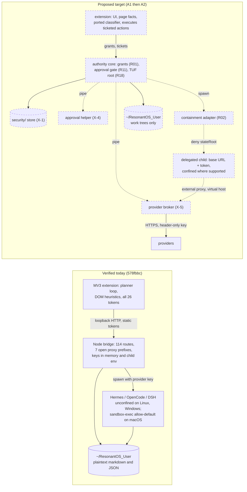
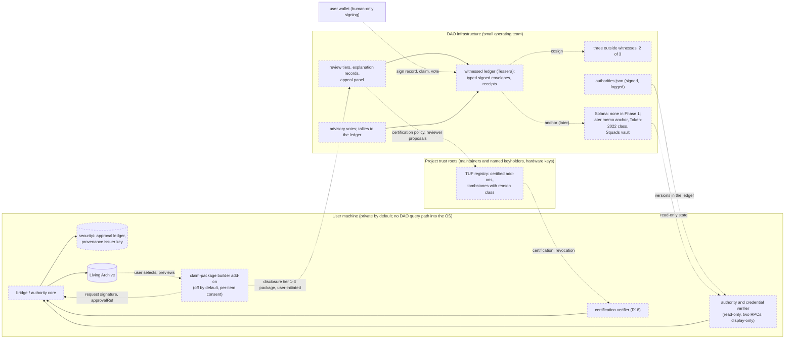

## 7. Architecture alternatives and the selected path

Full text: `research/architecture/decisions.md` (X-1, X-4, X-5) and `reference-architectures.md`. Every component below without a verified implementation is proposed, not shipped, and is drawn dashed.

### 7.1 Three substrate decisions common to every OS architecture

**X-1, the security-state store.** One directory, `<stateRoot>/security/`, where `stateRoot` is the per-OS state root the Alpha already computes (`harness-registry-store.mjs:6-10`: `%LOCALAPPDATA%\ResonantOS`, `~/Library/Application Support/ResonantOS`, `$XDG_STATE_HOME/resonantos`), never under `~/ResonantOS_User`. No bridge route reaches it (archive and memory paths are confined to the memory root today, and the helpers gain an explicit deny of the state root, so none of the eight `archive-write` routes in `memory-host-service.mjs:134-212` can); every delegation profile denies it to confined children (`readDenyRootsFor`, `delegation-isolation.mjs:175-209`, gains it). Records are HMAC-chained through the existing atomic writer (`harness-registry-store.mjs:23-70`) under a key in the OS credential store, with the head revision mirrored beside the key, so a restored older copy of the files fails closed with an alarm. Honest limit: on one OS account this is tamper evidence against other accounts, offline disk changes and confined children (level (a)). A same-user process, which includes every unconfined delegated child and so the Windows default today, can read the key from the credential store and rewrite records and head undetected; level (b) is not met. Only the separate-account core of A2, or a user-held external checkpoint written by `exportHead()`, closes this.

**X-4, the approval path.** A bridge-spawned helper process with no agent code, fed the canonical action over an inherited pipe, renders it, and returns a decision with the digest of what it rendered ("what you see is what you sign"); the bridge accepts only a matching digest and writes the R11 record before the handler runs. Residual: the helper runs as the user, so a same-user process, including an unconfined delegated agent, can drive its dialog with synthetic input; Phase 1 therefore relies on containment (R02) for delegated children and declares other same-user malware out of scope until A2. There is no approval route on the bridge, so no token can approve. Phase 1 uses the operating system's native dialogs from that helper; Phase 2 adds user verification (Windows Hello, Touch ID, polkit) with out-of-band enrolment. First gated: archive promotion (a new `archive-promote` capability split out of `archive-write`), delegation start with execution, provider credential writes, add-on grants, certification overrides, indeterminate-step decisions. Public submit, pay and grant classes in the browser are covered once the extension requests bridge-issued execution tickets (A2 seam 3); until then the worker-side gate ported from nanobrowser is the last line.

**X-5, the broker.** An Aegis-pattern reverse broker reimplemented in Node in its own process, holding provider keys only (passed on stdin), reached by the child as the containment layer's external HTTP proxy with one credential-injecting virtual host (`broker.resonantos.invalid`). The two static reads that settled it: sandbox-runtime's Linux backend relays an external `httpProxyPort` into the child's own network namespace through a host-side Unix socket (`linux-sandbox-utils.ts:1513-1529`) and an in-sandbox socat listener (`:1815-1819`; the namespace unshare and the proxy environment at `:3699, 3728-3735`; the external port passed in from `sandbox-manager.ts:1537-1580`), and its macOS profile allows outbound only to `localhost:<httpProxyPort>` and, when set, `localhost:<socksProxyPort>` (`macos-sandbox-utils.ts:1317-1343`); the design points the SOCKS port at a deny-all stub, so the bridge port stays out of reach on both. Windows uses the srt-win range when the opt-in install exists and is token-only unconfined otherwise, labelled. The broker strips client credential headers, injects header-only, forwards over HTTPS, redacts the key and its encodings from every relayed byte with a chunk carry-over, returns fixed error bodies, refuses `TRACE`, aborts open streams on revoke, and audits each call into the X-1 store. The sandbox library supplies containment only; its masking is never enabled and no MITM CA enters any child. What the broker does not do: it limits where a child's bytes can go, not what an allowed destination receives, so a hostile child can still upload the workspace to an allowlisted host under its own credentials; the per-delegation allowlist is therefore the virtual host only unless the task needs more, and every call is audited with byte counts.

### 7.2 A1, the hardened Alpha (minimal adapter)

Keep the extension and bridge; add the modules of section 5's first-PR column behind flags, on the X-1, X-4 and X-5 substrate. Migration risk low to medium (additive files, a few inverted assertions, the `archive-write` split). Fault model: bridge crash still manual (R04 has no candidate); helper or broker crash fails closed. Everything stays JavaScript and PR-sized. What it does not achieve: the bridge process still holds the tokens beside services that parse user data; the browser half stays in the extension's trust class; Windows stays unconfined by default.

### 7.3 A2, the neutral baseplate (extracted enforcement core)

Reached from A1 along the four seams of `os-map.md` section 17, in order: the grant model and store out of `authorizeBridgeRoute`; the Hermes proxy, process launch and runtime discovery out of `bridge-server.mjs:206-310, 739-1078` and the launcher into add-on-owned components (the isolation broker and provider broker are the first two); approval as a core-visible event with execution tickets for the browser's human-only classes; one promotion contract over the existing MCP surface. Then a supervisor per OS (systemd user unit, launchd agent, Windows service wrapper) that restarts the core and verifies a hashed baseline that excludes `security/`, and finally a separate OS account for the core and broker, which is the only local closure of same-user tamper evidence. This is the architecture the website describes; today it exists on paper. Migration risk is high if attempted at once (the launcher hard-wires about a dozen service factories and one extension id; the Hermes iframe depends on the open prefixes; 2,424 tests encode names) and medium seam by seam. What A2 does not achieve: it does not solve Windows no-admin confinement, which is a measurement (ranked test 1), and it does not make the DAO exist.

### 7.4 A3, the federated DAO (two systems, consent interfaces)

The DAO is not an OS layer (I1, I2). Phase 1 off-chain, no token, no program: a Tessera ledger on one Linux host with member-signed typed envelopes, signed submission receipts, three recruited outside witnesses under a 2-of-3 acceptance policy pinned in the member verifier, per-epoch member keys and typed per-epoch counts; SD-JWT claim packages built by a disabled-by-default OS add-on per item; membership as a signed registry record with revocation, appeal and re-binding at the registry level carrying the DR-06 fields; advisory votes off-chain and replayable with tallies committed to the ledger; a signed, logged `authorities.json` and a read-only authority verifier comparing two RPC endpoints; and, beside the DAO rather than inside it, a TUF add-on registry whose root (2-of-3 minimum, 3-of-5 target) and targets keys belong to the project's named keyholders on hardware tokens, with rotations logged. The DAO may set certification policy and propose reviewers (exchange E4); the keys belong to the project and the OS trusts keys, not DAO state (I2). A security revocation suspends an add-on at once with notice and a logged override, which is a deliberate trade against the DAO skeptic's objection that DAO state then removes capability without a per-item user act (TM-7). Phase 1 accruals are records of reviewed contribution with no promised conversion; any later conversion into a token is a Phase 2 decision under DR-54's migration rule, published before the pilot opens, and `paymentDecision` records in Phase 1 refer only to payments made outside the ledger (grants, bounties) by named people. Phase 2 after DR-54: a Token-2022 class behind a thin Resonant issuer program with no holder-and-issuer move instruction and governed re-binding with a veto window, lifetime cap and attester independence; authorities in a Squads v4 vault 2-of-2 over a custodian multisig and an outside multisig, `time_lock` at least seven days, `config_authority` null. Phase 3 only if binding member votes are adopted: a DAO-owned Realms instance from published, audited source, with delegation zeroed by a weight plugin and every electorate-defining authority under the protected governance. The governance checklist per key class, with holders, thresholds, delays and appeal routes, is `architecture/governance-checklists.md`; every row is designed, not yet tested, and the insider rule (insiders at most k-1; the appeal route never needs the approving quorum) is met today only by the witness row.

### 7.5 A4, rejected: a thin layer over Goose

Goose has no browser half (no counterpart for the Alpha's page context, inline assistant, overlays, Agent Control or evidence capture), its consent model defaults to Auto and has no principal, it provides no OS containment, and its extension surface is self-declared unstable. OpenClaw carries 722 advisories and disclaims multi-tenant isolation; DSH is already wrapped and unaudited. Goose survives as one wrapped runtime and MCP host inside A1 and A2.

### 7.6 Selection and justification

The alternatives actually weighed, with the evidence that decided each:

| Side | Alternative | Deciding evidence | Outcome |
|---|---|---|---|
| OS | A1 only: harden the Alpha and stop | leaves the bridge process holding tokens beside parsers of user data and the browser half in the extension's trust class; the Component surface property is never met | rejected as an end state; accepted as the first two cycles |
| OS | A1 then A2 by seams | os-map section 17 names four seams that the test suite tolerates one at a time; every A1 helper is A2's first component | selected |
| OS | A Chromium-family shell or fork (ADR-037's accepted Phase 2) or a Rust core | the Stage 1 map shows no part of the Alpha whose replacement would be cheaper than its extraction; a shell or rewrite leaves the Alpha unprotected while it is built; ADR-037's Phase 1 (extension plus authenticated bridge) is what A1 hardens | out of the next two cycles |
| OS | A4, a thin layer over Goose | no browser half, Auto consent default, no principal, no containment, unstable extension surface | rejected; Goose wrapped as one runtime |
| DAO | Off-chain witnessed ledger first (A3 Phase 1) | needs no token, program, audit or custody; the witnessed log and signed records give the A and B features (membership, claims, advisory votes) with public verifiability | selected |
| DAO | On-chain first (DAO-owned Realms and Squads, Token-2022 credential) | the one audited NonTransferable program moves the credential by co-signing; the shared Realms instance fails four clauses; no audit, custody policy or devnet test of the exact program exists | deferred to Phase 2 and 3 behind DR-54 |
| DAO | No ledger: a legal cooperative with Loomio or Belenios and signed minutes | covers membership and votes but not reproducible evidence packages (I7), reviewer-equals-signer or appeal records; both tools are AGPL separate services | kept as the voting component only |

The hybrid: A1 in the next two cycles, A2 by seams once the backlog has turned the store, broker and helper from "designed" into "tested", A3 as a separate programme with its own pilot. The evidence favours thin custom layers around proven upstreams over a rewrite; the security review's recurring defects are fixed once by substrate decisions; the Component surface property needs A2, but only after A1's helpers exist, because they are A2's first components; and the DAO's Phase 1 is a ledger and a review process, which needs neither token nor program. Not in the next cycle: a Rust core or the Chromium-family shell of ADR-037's Phase 2, any mint or binding vote, vendoring nanobrowser's debugger layer before add-on isolation (R21), adopting Aegis, Convira as a whole, DataLad, hypercerts-lexicon or Realms as dependencies, `goose serve`, srt credential masking, or any path where DAO state decides runtime authority.

Falsification conditions: the redactor cannot keep the key from an echoing upstream across encodings (ranked test 2, PoC 2); the helper cannot render reliably on one OS without a GUI toolkit and the extension-page fallback fails the no-agent-code test; Convira grants ACLs through junctions and srt-win's residuals make Windows confinement unusable (then the article's Windows story is "none"); the credential-store head mirror proves unreliable across the three stores (then level (a) is all that is claimed).

## 8. Implementation blueprints

Each blueprint names the boundary, the data, the Alpha files that change and the tests that lock names, from the dossiers' section 7 after review. Migration sequencing follows section 10.

### 8.1 Security-state store (X-1)

New `browser-first/host/security-state-store.mjs`: `open({stateRoot, keyStore})`, `append(file, payload)`, `writeState(file, payload)`, `read(file)`, `verifyHead()`, `exportHead()`. Record `{v:1, revision, payload, prevMac, mac}`; `security/HEAD.json` `{revision, lastMac, mac}`; key and head mirror in the OS credential store item `ResonantOS/security-state` (file-backed fallback labelled). `delegation-isolation.mjs:175-209` adds `stateRoot` to the deny roots; `browser-first-host-utils.mjs` `isInsidePath` and the archive and memory path helpers refuse `stateRoot`. First consumers: Biscuit revocations, TUF watermark, approval ledger, job DB, git directories, provenance keys, Goose template, broker audit. Windows: an explicit owner-only DACL on the directory. Tests: new `security-state-store.test.mjs` (MAC chain, head mismatch fails closed, credential store absent, Windows DACL), and `delegation-isolation.test.mjs:226-244` (the `readDenyRootsFor` test) gains the deny root.

### 8.2 Provider broker (X-5)

New `browser-first/host/provider-broker/` (child process) and `host/provider-broker-control.mjs` (bridge side, inherited pipe). Grant `{delegationId, principal, providerRouteId, allowedHosts, expiresAt, revokedAt}` keyed by the SHA-256 of the token; per request: token, grant, virtual host or allowlist, strip credential headers, inject `Authorization: Bearer <key>` only, forward, redact, audit. Listener `127.0.0.1:<random>`, one route, `CONNECT` only to allowlisted hosts. Alpha changes: `addon-delegation-service.mjs:1770-1782` (Hermes env: base URL and token instead of `OPENAI_API_KEY`), the OpenCode CLI env near `2221-2316`, and the two spawns that inherit the bridge's whole environment, `run-bridge-minimal.mjs:232` (`opencode serve`) and `opencode-client.mjs:281-285`, which must strip the key variables; `dsh-runtime.mjs:27` later; `provider-bridge-service.mjs` exports the forward helper; `bridge-server.mjs` only starts and stops the broker. Until DSH and `opencode serve` move to the reverse channel (risk register RR-12), they keep inheriting the bridge environment, and on an unconfined OS a child can in any case read keys from the bridge's or broker's process. Containment: `delegation-isolation-srt.mjs` passes `network.httpProxyPort` and `socksProxyPort` (deny-all SOCKS stub), rejects mask entries, validates with `SandboxRuntimeConfigSchema.parse()`, builds `denyRead: [home, stateRoot]` plus `allowRead: [workspace, toolchain]`. Tests: `addon-delegation-service-error-handling.test.mjs:1202-1203` and `:1429` invert; `bridge-route-capability-audit.test.mjs` asserts no `/broker` prefix on the main table; new `provider-broker.test.mjs` with the echo stub, stream revoke, listener enumeration.

### 8.3 Approval helper, ledger and gate (X-4, R11)

New `browser-first/host/approval-helper/` (per-OS native dialog child), `host/approval-ledger.mjs` (JSONL, `eventsDigest` with length prefixes, `signatureInput = sha256(prev || events || ctx)`, Ed25519 via `node:crypto`, signed head, `exportHead()`, tail-truncation and empty-ledger cases that fail against the head), `host/approval-gate.mjs` (`requiredApproval` route field; 428 `APPROVAL_REQUIRED` with `{approvalId, route, actionDigest, expiresAt}`; retry with `X-Resonant-Approval: <index>`; verify inclusion against the pinned checkpoint; consume-once; append-then-act). `bridge-server.mjs:1251-1255` gains the gate between `authorizeBridgeRoute` and `route.handler`; `archive-review-policy.mjs:18-36` replaces the client-asserted `actorType:"human"` with an approval reference; `bridge-capability-tokens.mjs` adds `archive-promote`. Tests: `bridge-server.test.mjs:108, 561, 708` gain 428 cases; `archive-review-policy.test.mjs:10, 18, 26` change; `bridge-route-capability-audit.test.mjs:240` keeps its tuple shape; new helper tests cover digest mismatch, missing helper, append failure.

### 8.4 Grants (R01)

`host/bridge-grants.mjs`: `mintGrant({principal, capabilities, ttlSeconds})` with a predicate allowlist (`principal`, `right`, `grant_id`, the expiry check; anything else, and any object produced by a credential verifier, refused), `attenuate`, `verifyGrant` (byte cap before `fromBase64`, Ed25519 root only, block count cap, `grant_id` and signature-id revocation checks, authorizer with `time()` injected), `revoke(id)` appending to the store and calling every registered stream terminator from `writeBridgeEventStream` (`bridge-server.mjs:360-401`). Dual mode in `isAuthorizedCapabilityRequest` (`:1201-1207`) and `scopedCapabilityTokenPayload` (`:1214-1236`); the extension's `bridge-client.js:646-656` keeps working unchanged. Per-run root key in memory by default. Dual mode means the 26 static tokens stay valid beside the grants until a later issue retires them (BL-26); until then OSC-02 is narrowed for new principals (children, add-ons), not for the extension. Tests: `bridge-capability-token-consistency.test.mjs` changes (the arg and env pinning contract needs a decision); `bridge-route-capability-audit.test.mjs` untouched; new `bridge-grants.test.mjs` cases a-m.

### 8.5 Add-on trust (R18)

`host/addon-trust-verifier.mjs`: one `Updater` per call; online `forceCache: false`; offline `forceCache: true` with a fetcher that always throws; lookups of both `certified/<id>/<v>/<f>` and `published/<id>/<v>/<f>` with equal non-empty hashes; watermark `{root, timestamp, snapshot, certified}` and revoked set in the store with a second copy in the harness registry record; torn `root.json` restored from the store; id rule `^[a-z0-9][a-z0-9._-]*$` re-checked on the verified `targets.json`; `recheckInstalled` at start and hourly; `revoked` suspends through `registry.setEnabled(id, false)` (fence and retire, `harness-registry.mjs:252-260`, `harness-boundary.mjs:61-75`) with reason, severity, appeal reference and a logged local override; policy tombstones warn for seven days. `harness-host-service.mjs:336-339` calls it when `registryRef` is present; `harness-registry.mjs:199-217` stores host-derived provenance; `packages/addon-sdk/src/registry.ts:53-76` stops reading manifest provenance as trust; the eight self-declared manifests change in a follow-up. Publisher side: tuf-on-ci with hardware keys and a KMS or manual online role.

### 8.6 Durable jobs (R10)

`host/durable-jobs.mjs` hosts one `OpenWorkflow` client and `Worker` with `concurrency: 1` on `BackendSqlite.connect(<stateRoot>/security/jobs/openworkflow.db)` (path from the caller); `host/durable-effect-journal.mjs` exposes `effect(name, action, {irreversible})`, writing `intent(job, step, action, key = run.id + ":" + step)` in a transaction before enqueueing, checking the outcome row before parking, marking `indeterminate` on replay without outcome and never re-issuing; irreversible steps `maximumAttempts: 1`; the decision route accepts only an X-4 record; panel reports are untrusted claims. Alpha changes when browser jobs move: `browser-job-store.js` becomes a cache, `side-panel-browser-job-controller.js:34-43` stops forcing `paused`, `side-panel-scheduled-browser-job-runner.js:241-247` resumes with bridge history, `agent-control-runner.js` honours the abort signal. Nine test files listed in the dossier change at that stage; the first PR changes none.

### 8.7 Memory promotion (R14, R13)

`host/memory-git-ledger.mjs`: one plain git repository per domain with `--git-dir=<stateRoot>/security/memory-git/<domain>.git --work-tree=<memory root>/<domain>`; every call with `-c core.hooksPath=<empty dir> -c core.fsmonitor=false -c core.sshCommand= -c gpg.ssh.program=<pinned>`, a minimal environment, `GIT_CONFIG_NOSYSTEM=1` and a bridge-owned global config; `core.fsync=committed`; a `[RESONANT DERIVATION]` record with DataLad-compatible keys and an inert `cmd`; promotion is a signed commit built by the X-4 helper against an allowed-signers file in the store whose SHA-256 is pinned at start; AI-verifier approvals under ADR-012's tier are signed with a key never in the human set. Fix the `archive-review-service.mjs:669-684` versus `archive-promotion-policy.mjs:11-25` mismatch and the `nextStatus` versus `toStatus` gate; retire the `autoApprove` branch of `runPortableMaintenanceCycle` (`examples/living-archive-portable-workflow.mjs:319-341`) or route it through the ledger. Atomic JSON writes and recover-from-HEAD for `CONFIG/memory-settings.json` close OSC-28.

### 8.8 Provenance and claim packages (R12)

`host/provenance-record.mjs` wraps `@sd-jwt/sd-jwt-vc` with an Ed25519 issuer key generated per boot in the bridge closure (persisted into the store only when R15 exists), a 16-byte salt generator, `issueProvenanceRecord({receipts, artifacts, attribution})` accepting only receipts from the in-process sink, computing `receiptRoot` itself, embedding each boot's receipt public key (`harness-host-service.mjs:149-150, 443`) and allowing only `method:'declared'`; `verifyProvenancePackage` always requires key binding (the holder's proof of possession, which the library skips when no nonce is supplied), checks `cnf`, distinguishes revoked from suspended, applies a maximum status age and accepts status-list tokens only with an inclusion proof. The builder add-on is disabled by default and previews every package (I3). DAO side: a second signer (reviewer attestation) before any human portion counts toward votes.

### 8.9 DAO ledger, verifier and lexicon (A3)

Operator side: a Tessera personality (about 200 lines of Go) on the POSIX driver, accepting only member-signed envelopes, issuing receipts `sign(origin || index || sha256(entry) || deadline)` with a separate receipt key, publishing `.state` tiles to a static host, cosigned under `group outside 2 EA EB EC`; a weekly memo anchor later, under a key held off the log host by a different custodian. Member side: `host/tlog-verify.mjs` (inclusion, consistency, checkpoint note, pinned policy, receipt deadlines, gossip across witnesses). Bridge side, as a disabled-by-default service running in a separate low-privilege child of the bridge that contacts RPC endpoints only when the user opens `/dao audit` (I1; the RPC operator is adversary V9 and its responses are parsed outside the process that holds tokens): `host/dao-authority-verifier.mjs` and `host/dao-credential-verifier.mjs` decoding `GovernanceV2`, `RealmV2`, `RealmConfigAccount`, Squads `Multisig`, Token-2022 mint extensions and ProgramData headers from two RPC endpoints, checking the published minimums (threshold at least 3 of 5, `time_lock` at least 604,800 s, non-single-key config authority, insider quorum at most k-1, veto window conditions, realm authority protected, pending electorate changes, PermanentDelegate mints labelled issuer-movable unless the program hash is allow-listed), with verdicts `meets`, `fails: <clause>` or `unverified`, display-only in `/dao audit`. Ledger records: a Resonant lexicon (claim, proposal, review, accrual, paymentDecision, appeal, correction, revocation, dimension) validated with `@atproto/lexicon`, reviewer = signer, one acknowledgement per contributor, per-epoch member keys.

### 8.10 Migration sequencing for the highest-value integrations

1. Store and deny roots (8.1): no user-visible change; unblocks every other module.
2. Broker and containment adapter (8.2): removes provider keys from the Hermes and OpenCode CLI environments; `opencode serve` and DSH keep inheriting the bridge environment until RR-12 is closed; confines Linux and macOS behind a flag; Windows children stay unconfined and labelled.
3. Helper, ledger and gate on `archive-promote` and delegation start (8.3), with the promotion fix (8.7) landing in the same change so that promote never executes behind the client-asserted actor alone: the first human-only route the host enforces.
4. Grants dual mode (8.4): per-principal, expiring tokens with the vocabulary unchanged.
5. Add-on trust (8.5): the first signed certification; the eight manifests corrected afterwards.
6. Durable jobs additive (8.6), then browser jobs move after the crash tests.
7. Provenance per boot (8.8), Goose adapter, classifier port.
8. DAO verifiers with fixtures (8.9); the ledger pilot when three outside witnesses are recruited.
