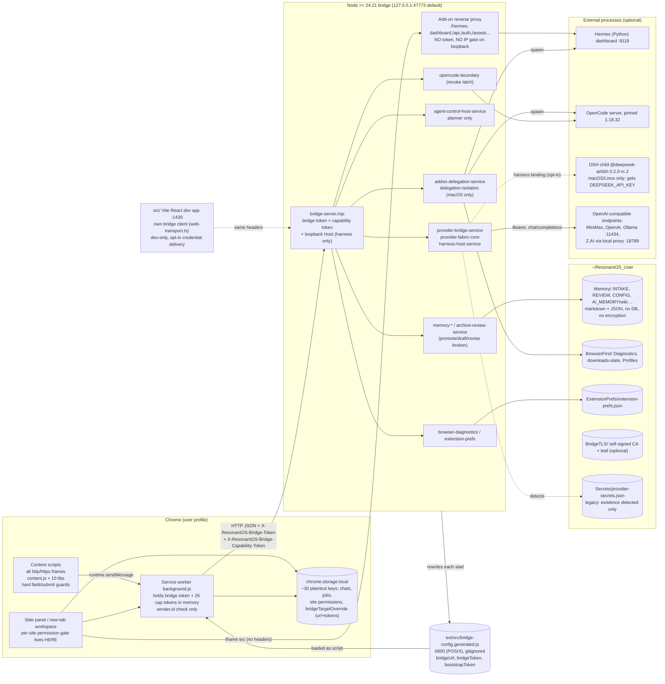

# ResonantOS 2.0.0 Alpha: code-level map

Repository: https://github.com/ResonantOS/2.0.0-alpha, branch `dev`, commit `578fbbc3c1c854b192318b3d2163b138fb45d8bd` (2026-10-18). Verification date: 2026-10-20. Method: static inspection of the read-only clone `research/_untrusted/resonantos-2.0.0-alpha` plus `gh api` reads of CI results. Nothing in the clone was executed. All path:line citations are at `578fbbc`; `ext/` abbreviates `browser-first/resonantos-side-panel-extension/`, `host/` abbreviates `browser-first/host/`.

Evidence labels: [inspected] = code read; [reported by CI] = GitHub Actions result read via API; [reported by authors] = docs; [hypothesis] = inference. Supporting notes with fuller line references: `stage1/sources/osmap/core-bridge-notes.md`, `providers.md`, `agent-control.md`, `memory.md`, `addons-delegation.md`, `browser-userdata-diagnostics.md`, `legacy-ci-ownership.md`, `host-routes-extracted.tsv`, and the saved CI logs. The bridge/auth/launcher/extension-bootstrap/CI core was read by the lead; the six area notes were produced by delegated static reads of the same clone at the same commit and are cited as [inspected by <area> agent].

## 1. Summary

1. What runs end to end today [inspected, high]: a Chrome Manifest V3 extension (`ext/manifest.json`, version 0.1.14, min Chrome 116) talking over loopback HTTP to a Node.js >= 24.21 bridge started by `node run-bridge-minimal.mjs` (-> `host/run-bridge-minimal.mjs`). The bridge exposes 114 capability-gated JSON routes, one bootstrap route and an unauthenticated reverse proxy (section 5).
2. Working, tested paths: provider chat through OpenAI-compatible endpoints (MiniMax, OpenAI, Ollama, a local Z.AI proxy) with routing strategies and visible fallback; page context, inline assistant, overlays; chat/project workspace; Agent Control safe click/type/scroll with a live Chrome certification lane; memory source registration, hashed file intake, audited move with rollback, keyword search; Hermes/OpenCode delegation with an opt-in execution toggle and a live revoke latch; diagnostics export; extension prefs.
3. Authentication: one static bridge token plus 26 static per-capability tokens minted at process start, delivered by a generated file and a bootstrap route. No expiry, no rotation while running, no per-principal binding; the extension requests all 26 at startup, so a single service worker holds every capability [inspected, high].
4. Default deny for routes without a declared capability is in code and tested (`host/bridge-server.mjs:125-126`); the roadmap still lists it as open (#373): documentation lag.
5. Disconfirmation 1 (bridge): on the default loopback bind the bridge reverse-proxies `/hermes-dashboard`, `/api`, `/auth`, `/assets`, `/fonts-terminal`, `/dashboard-plugins`, `/favicon.ico` to a Hermes dashboard on 127.0.0.1:9119 with no bridge token and no IP gate (section 5.3) [inspected, high].
6. Disconfirmation 2 (memory): Living Archive promotion, draft and revise cannot succeed through the bridge at this commit: the review service and the policy modules disagree on argument names, so `executeArchiveReviewArtifactPromote` always throws and `draft`/`revise` hit a TypeError; the human-approval gate in `archive-review-policy.mjs` is a no-op for the same reason. No test calls the service-level promote; policy tests pass because they call the policies with the names the service does not use [inspected by the memory agent, high; see `memory.md`].
7. Disconfirmation 3 (providers): Anthropic and Google/Gemini appear as presets in host and extension catalogs but no Messages or Gemini wire code exists; every upstream call is OpenAI-style `POST .../chat/completions` with a Bearer header. Unresolvable model strings fall through to MiniMax with the MiniMax key [inspected by the providers agent, high; see `providers.md`].
8. Disconfirmation 4 (browser): per-site permission modes are enforced in the side-panel page, not in the content script or background; `ask-before-action` and `trusted-for-safe-actions` behave identically for click/type/scroll (no confirmation ceremony); `blocked` does not stop navigation. The hard human-only boundaries that do hold are the content script's label/attribute heuristics for submit, credential, payment and destructive controls [inspected by the browser agent, high; see `browser-userdata-diagnostics.md`].
9. Add-on isolation is `sandbox-exec` on macOS only; on Linux and Windows the mode is `contract-only` (`host/delegation-isolation.mjs:61-68`); roadmap #326 "OS-level isolation" is open; the one live isolation test is skipped in CI (Ubuntu runners) [inspected, high].
10. MCP: a hand-rolled stdio JSON-RPC server (`examples/living-archive-mcp.mjs`) with 14 tools exists and its tests run in CI; it is not wired into the bridge or extension; ADR-029 marks it deferred. A2A and SKILL.md: no code. The website's "MCP · A2A · SKILL.md" claims describe the next architecture, not this code [inspected, high].
11. The Vite/React app in `src/` is a parallel dev-only client of the same bridge with its own bridge client (`src/core/web-transport.ts`), provider catalog and memory broker; `apps/augmentor` is an unrelated third MV3 extension vendored by git subtree in 2026-09 and tested nowhere [inspected by the legacy agent, high].
12. CI [reported by CI]: `alpha-build` on `578fbbc` passed every `verify:alpha` lane (browser-first 2424 tests, 2414 pass, 10 environment skips; vitest 724; others listed in section 15). The nightly `agent-control-live-certification` on `578fbbc` passed both jobs with real Chrome 155 under Xvfb and pinned OpenCode 1.18.32. No CI job uses provider secrets; no test reaches a real LLM.
13. Restartability: EADDRINUSE falls back to an ephemeral port; signals drain services in order; the extension re-fetches the generated config and re-mints tokens once on a 401 (`ext/src/background.js:118-134`). No `uncaughtException`/`unhandledRejection` handlers; a crash requires a manual restart [inspected, high].
14. Coupling: the UI, approval policy and job persistence are Chrome-only MV3 code; the bridge is Node-only and pins the extension id (`host/run-bridge-minimal.mjs:67`); POSIX-only file-mode hardening (0600) is ineffective on Windows [inspected, high].
15. Overall: a working single-user, single-machine, Chrome+Node runtime with careful token plumbing and strong deterministic test discipline, but with no multi-principal model, no grant expiry/attenuation/revocation, OS containment on macOS only, a broken trusted-memory promotion path, and several "implemented" claims whose enforcement lives in one browser page. Confidence in this summary: high for 1, 3-7, 9-13; medium for 2, 8, 14.

## 2. Runtime topology

Trust boundaries and what holds them: (1) web page -> content script: DOM is untrusted; guards are regex heuristics in `ext/src/content.js:448-532` and `content-field-safety.js:44-116` [inspected]. (2) content script -> service worker: `sender.id === chrome.runtime.id` (`background.js:288`), top-frame check only for context snapshots; `browser_control_handoff` navigates to an unvalidated URL string (`background.js:216-218, 354-360`). (3) extension -> bridge: bearer tokens, loopback bind; Host/Origin checks only for harness routes. (4) bridge -> child processes: fixed-root executable resolution (STATUS.md claim; `hermes-runtime.mjs`, `opencode-runtime.mjs`, `dsh-runtime.mjs`), sandbox only on darwin. (5) bridge -> LLM endpoints: keys stay in the bridge process (`provider-route-acceptance.test.mjs:117-128` asserts no key in responses). Marked unverified: whether Hermes/OpenCode children inherit provider env keys; DSH child use of `DEEPSEEK_API_KEY`.

## 3. Directory and module map

LOC are approximate line counts of .ts/.tsx/.js/.mjs/.json/.md/.html/.css files (node_modules excluded; `stage1/sources/osmap` script). "Owner" quotes the responsibility row in `docs/architecture/MODULE-OWNERSHIP.md:15-56` (a contract, not a person; no CODEOWNERS file exists).

| Path | Role | Key files | LOC | Coupling | Owner row (MODULE-OWNERSHIP) |
| --- | --- | --- | --- | --- | --- |
| `run-bridge-minimal.mjs` | Root launcher shim (3 lines) re-exporting the host launcher | | 3 | Node | composition root row (host) |
| `host/` (65 modules) | Node bridge: transport/auth, providers, planner, memory, delegation, OpenCode, diagnostics, harness | `run-bridge-minimal.mjs` 509, `bridge-server.mjs` 1671, `addon-delegation-service.mjs` 2941, `provider-bridge-service.mjs` 1479, `browser-first-self-test-service.mjs` 2280 | 22.7k | Node-only; extension id hard-coded (`run-bridge-minimal.mjs:67`); imports two TS files from `packages/addon-sdk` (`harness-adapter-contract.mjs:3-4`) | per-file rows: bridge-server = "HTTP transport ... bridge auth, capability checks"; run-bridge-minimal = "composition root"; provider-*, memory-*, archive-*, addon-*, dsh-runtime, harness-* each have a row |
| `ext/` (148 files) | MV3 extension: service worker, 11 content-script files, side panel, new-tab workspace, ~100 lib modules | `manifest.json`, `src/background.js` 378, `src/content.js`, `src/lib/bridge-client.js` 672, `browser-page-actions.js`, `approval-policy.js`, `site-permission-store.js` | 42.3k | Chrome-only: tabs, scripting.executeScript (incl. MAIN-world wallet probe), storage.local, history, sidePanel, webNavigation, windows, commands | background.js, content.js, side-panel, main-workspace, bridge-client, browser-page-actions/control-*, browser-job-store, resonant-context, trace-redaction rows |
| `browser-first/test/` | node:test suites: 206 `*.test.mjs` + 3 `*.live.mjs` + lane scripts and certification fixtures | `agent-control-live.mjs`, `live-sdk-lane.mjs`, `harness-swap-demo-bridge.live.mjs`, `agent-control-certification/` | 56.9k | per-file hand-rolled fake `chrome`; several load the real `content.js` in JSDOM | n/a |
| `browser-first/addons/`, `browser-first/docs/`, `browser-first/README.md` | small manifests, dev docs (opt-in React shell credential delivery) | | 0.5k | | n/a |
| `addons/resonant-browser-host/` | Separate controlled-Chromium host package; "not the active Alpha UI runtime" (README.md:41) | `test/*.test.mjs` (13 tests in CI) | 1.0k | Playwright | none |
| `packages/addon-sdk/` | TypeScript add-on/harness SDK contracts and manifest validation; imported directly as `.ts` by the host | `src/validation.ts`, `src/contracts.ts` | 1.8k | no tests of its own | referenced by harness-adapter-contract row |
| `src/sdk/addons/`, `public/addons/*.json` | Vite-app add-on validation/registry and 18 manifests | `validation.ts`, `registry.ts` | 1.4k + 3.1k | Vite app only | not Alpha runtime (`ALPHA_RUNTIME_BOUNDARY.md:144-148`) |
| `src/` (`core/`, `modules/`) | Vite + React 19 dev app at 127.0.0.1:1430; second bridge client, provider catalog, memory broker; many Tauri-era `invoke()` commands stubbed | `core/web-transport.ts`, `core/runtime.ts`, `core/defaults.ts`, `core/memory-provider.ts` | 9.8k + 16.1k + 36.2k | browser DOM; vitest (48 files) | `src/modules/*` listed in MODULE-OWNERSHIP:75-111; excluded from Alpha runtime |
| `apps/augmentor/` | Unrelated third MV3 extension "Augmentor Agent powered by DSH" 0.1.33 with `nativeMessaging` host, vendored by git subtree 2026-09-14 (`5550432`) | | 18.3k | Chrome + native host | absent from ownership, module map and runtime boundary; 14 test files run in no script or workflow |
| `examples/` | Living Archive MCP server, loopback memory service, portable workflow, 3 add-on manifests | `living-archive-mcp.mjs`, `living-archive-memory-service.mjs`, `living-archive-portable-workflow.mjs` | 4.0k | imports host memory modules | `examples/addons/openai-compatible-harness.json` row only |
| `scripts/`, `scripts/security-pipeline/` | verify-alpha (17 fail-fast commands), test runner, docs/hygiene/scope audits, static security checks, health check, engineer runner | `verify-alpha.mjs:10-38`, `run-browser-first-extension-tests.mjs` | 14.2k + 4.4k | Node | n/a |
| `docs/` | 38 ADRs, STATUS, ROADMAP, capability matrix, planning | `architecture/ALPHA_RUNTIME_BOUNDARY.md`, `reference/CAPABILITY_MATRIX.md` | ~29k | | n/a |
| `disciplines/`, `prompts/`, `AGENTS.md`, `llms.txt` | AI-assistant instruction material (untrusted for this research); `prompts/sdk-demo-prompt.md` points at a non-existent `examples/sdk-prototype/` | | ~0.3k | | n/a |

Activity since 2026-07-01 (git log): `browser-first/` 304 commits vs `src/` 38 (last `src/` commit 2026-10-15); `apps/` 7, `packages/` 8.

## 4. Entry points and control flow

Bridge [inspected]: `host/run-bridge-minimal.mjs` resolves the extension root (71-88) and user root `~/ResonantOS_User` or `RESONANTOS_BROWSER_FIRST_USER_ROOT` (90-92); constructs the provider host service (164-177), delegation service (179-203), OpenCode boundary with revoke-on-disable (224-244), memory/archive/intake services (246-374), diagnostics (376-390), the planner (392-401), extension prefs (403) and the harness host (407-413, bindings from `RESONANTOS_HARNESS_BINDINGS`); composes `bridgeRoutes` (415-424); mints tokens (426-430); an in-process self-test mode exits early (432-460); requires `manifest.json` (462-465); `startBridgeServerWithFallback` (468-477); `writeBridgeConfig` into the extension source tree (482-488); prints `browser.first.bridge_started` (490-500); ordered shutdown via `bridge-shutdown.mjs` (502-509).

Extension [inspected]: `background.js` resolves config (storage override -> generated file -> `http://127.0.0.1:47773`), probes loopback, builds the client, posts the full capability allowlist to `/api/capability-tokens`, hydrates prefs (53-110, 246-255); on 401 it re-fetches the generated config with cache-busting, re-mints and retries once (118-134; `bridge-client.js:261-299`). Content scripts run in all frames at `document_idle` and send typed messages on channel `resonantos.browser_first`. The side panel and new-tab workspace drive chat, Agent Control, memory and settings through `bridge-client.js`.

Vite app: `index.html:14` + `vite.config.ts:32-36` -> `src/` at 127.0.0.1:1430; receives bridge credentials only via the opt-in authenticated dev delivery (STATUS.md "Development Surface"; `scripts/vite-dev-bridge-config.test.mjs`, 34 tests). Only 16 commands are routable; the other ~24 Tauri-era commands throw "not available in the browser-first Chrome extension alpha" (`src/core/web-transport.ts:134-137`).

## 5. Message routes and authentication

### 5.1 Pipeline [inspected, high]

`host/bridge-server.mjs` `createBridgeRequestHandler` (1267-1365) -> `authorizeBridgeRoute` (114-137):

1. Client IP allowlist `RESONANTOS_BRIDGE_ALLOWED_IPS` (184-189, enforced at 1318); empty by default = allow all.
2. Reverse-proxy dispatch for mirror paths before authentication (1310-1313; see 5.3).
3. `X-ResonantOS-Bridge-Token` constant-time compare (195-204) -> else 401.
4. Route lookup `METHOD path` -> else 404.
5. `/api/capability-tokens` additionally requires `X-ResonantOS-Capability-Bootstrap-Token` (1209-1212, 1281-1289); it returns tokens for the requested capability names only (`scopedCapabilityTokenPayload` 1214-1236).
6. Route with no capability and no bootstrap flag -> 403 by default (125-126).
7. `X-ResonantOS-Bridge-Capability-Token` must equal the token minted for `route.requiredCapability` (1201-1207).
8. Harness routes (`loopbackHostOnly`, `errorFamily: 'harness'`) additionally require exactly one `Host: 127.0.0.1|localhost|[::1]:<port>` header (101-113) and an Origin equal to the extension origin or an allowed origin (130-133), body-shape validation and a 1 MiB cap (`harness-host-service.mjs:283-289`).

Origin is not an authorization input for non-harness JSON routes; CORS headers are emitted only for the extension origin or `RESONANTOS_BRIDGE_ALLOWED_ORIGINS` (312-355; test `bridge-server.test.mjs:733`). Tokens: `createBridgeToken` = 32 random bytes base64url (191-193); 26 capability tokens from `BRIDGE_CAPABILITY_TOKEN_SPECS` (`bridge-capability-tokens.mjs:23-50`), each pinnable by CLI arg or env var (62-73). Default bind 127.0.0.1 (1098-1100); `RESONANTOS_BRIDGE_HOST=0.0.0.0` exposes to LAN over plain HTTP unless the optional TLS pair is generated (`bridge-tls.mjs`, self-signed CA under `~/ResonantOS_User/BridgeTLS`).

### 5.2 Route table

Full extraction with file:line: `stage1/sources/osmap/host-routes-extracted.tsv` (101 declarative rows) plus 13 harness routes built by `host/harness-host-service.mjs:276-379`. Direction is extension -> bridge throughout (SSE routes stream bridge -> extension).

| Route family | Count | Auth check | Capability required | Declared at |
| --- | --- | --- | --- | --- |
| `POST /api/capability-tokens` | 1 | bridge token + bootstrap token | (bootstrap) | `bridge-server.mjs:1281-1289` |
| `GET /status`, `/workspace/inspect`, `/browser/downloads`, `/browser/launch-diagnostics`; `POST /browser/downloads/action`, `/diagnostics/report` | 6 | token + capability | `bridge-diagnostics-read`, `browser-download-action`, `diagnostics-report-export` | `browser-diagnostics-host-service.mjs:84-119` |
| `/providers/status|health|connectivity-test|diagnostics-history|routing-strategies|credentials|accounts|accounts/remove|model-preferences`, `/augmentor/chat`, `/augmentor/inline` | 12 | token + capability | `provider-diagnostics-read`, `provider-credential-write`, `provider-routing-write`, `provider-model-invoke` | `provider-host-service.mjs:49-120`, wrapped by `harness-host-service.composeProviderRoutes` (444) which governs `/augmentor/chat` only once a `primary-agent` slot owner exists (389-392) |
| `/augmentor/control-plan`, `/augmentor/next-action`, `/web/news` | 3 | token + capability | `agent-control-plan` | `agent-control-host-service.mjs:440-457` |
| `/memory/*` (20) and `/archive/*` (14) | 34 | token + capability | 9 memory/archive capabilities; a single `archive-write` covers browser intake and trusted-wiki promotion/restore | `memory-host-service.mjs:12-215` |
| `/addons/status|execution-settings|draft*|delegate*|uninstall-audit|running-work|user-data/*`, `/hermes/*`, `/opencode/status|delegation/*|web/url`, `/goals` | 29 | token + capability | `addon-runtime-read/control`, `addon-record-read/write`, `addon-execution-settings-write` | `addon-delegation-host-service.mjs:12-185` |
| `/opencode/session/*`, `/opencode/sessions/list`, `/opencode/agents/list` (1 SSE) | 13 | token + capability; fixed OpenCode public error vocabulary | `addon-runtime-read/control` | `opencode-session-host-service.mjs:67-80` |
| `/addons/registry|install|grants|enabled|remove|slots/assign`, `/agent/session|turn|dispose|cancel|events(SSE)|history|status|select-model` | 13 | token + capability + loopback Host + Origin + body shape | `addon-runtime-read/control` | `harness-host-service.mjs:335-379` |
| `GET/POST /settings/extension-prefs` | 2 | token + capability | `extension-prefs-read/write` | `extension-prefs-host-service.mjs:163-174` |
| Reverse proxy `/hermes-dashboard`, `/auth`, `/api`, `/assets`, `/fonts-terminal`, `/dashboard-plugins`, `/favicon.ico` (+ WebSocket upgrade) | 7 prefixes | token OR open prefix; on loopback all 7 are open | none | `bridge-server.mjs:228-236, 739-786, 1160-1167, 1431-1448` |

Extension mirror: `ext/src/lib/bridge-client.js:26-140` maps the same 114 keys to capabilities; `bridge-route-capability-audit.test.mjs:177-240` locks both tables together and requires every route to declare a capability or carry an allowlist rationale.

### 5.3 Findings [inspected, high]

- Static bearer tokens for the whole process lifetime; no expiry, rotation, nonce or replay protection. Loopback keeps the risk modest; a LAN bind without TLS is bearer-over-plain-HTTP.
- Capability scoping is not least privilege in practice: the extension requests every capability at startup (`bridge-client.js:141, 651`); one service worker holds all 26 tokens. The design separates the generated file from the raw tokens (as the comments state); it does not separate principals.
- Open proxy prefixes on loopback: `getBridgeOpenProxyPrefixes` returns all mirror prefixes when the bind host is loopback (1160-1167) and `createAddonProxyHandler` skips the token check for them (766-786); the IP allowlist is empty by default. Any local process, or a web page via a no-cors request to `http://127.0.0.1:47773/api/...`, reaches the Hermes dashboard when it is running; exact bridge route paths are reserved (1294, 1311) and stay gated. Intended and tested (`dashboard-proxy.test.mjs:120`).
- Credential propagation to operator-typed hosts: a Settings bridge-target override without tokens inherits the generated bridge and bootstrap tokens and persists them in `chrome.storage.local` (`bridge-server.test.mjs:411`; `ALPHA_RUNTIME_BOUNDARY.md:40-48`); `validateBridgeTargetUrl` (`bridge-client.js:173`) only checks URL shape.
- Manifest CSP `connect-src ... http://*:* https://*:*`, `host_permissions` for all sites, content scripts in all frames: the extension process is the real trust boundary.
- `background.js` `browser_control_handoff` navigates the sender tab to an unvalidated URL string (216-218, 354-360); `action_request` is advisory and has no caller (362-374).
- Comments reference a production launcher `resonantos-bridge-full.mjs` (`bridge-capability-tokens.mjs:9`) that does not exist in the repository.
- Provider error bodies are relayed to the extension unredacted (`provider-bridge-service.mjs:1294`) [reported by providers agent].

## 6. Providers (Provider Fabric) [inspected by providers agent, high; details in `providers.md`]

- Built-ins (`host/provider-fabric-core.mjs:1-28`): MiniMax (`api.minimax.io`), "Z.AI GLM" via a hard-coded local proxy `127.0.0.1:18789` (labelled cloud), OpenAI, and `desktop-local` Ollama (`127.0.0.1:11434`). Presets for Anthropic, Google, Cohere, AI21, Replicate exist (`provider-bridge-service.mjs:367-389`; `ext/src/lib/settings/provider-catalog.js:37-50`) but every upstream call is OpenAI-style `POST <base>/chat/completions` with `Authorization: Bearer` (`provider-bridge-service.mjs:1260-1274, 1099-1116, 1379-1396`; also `agent-control-host-service.mjs:300-306`, `memory-ingest-writer.mjs:117-121`). No Anthropic Messages or Gemini wire code exists; Claude/Gemini are reachable only through an OpenAI-compatible gateway. A developer LAN address `http://192.168.1.77:30004/v1` ships in presets (host 355, extension 237).
- Routing: 5 strategies (`provider-fabric-core.mjs:78-129`), primary + fallback chain; `providerRouteForWorkload` (349-397); `executeChat` (`provider-bridge-service.mjs:1205-1331`) preserves manual model selection (errors instead of swapping, 1209-1214, 1253) and flags fallbacks with `routeFallback`/`routeNotice` (1313-1326). No retries: one 90 s attempt per route, then the next route. Unresolvable model strings fall through to MiniMax with the MiniMax key (`provider-fabric-core.mjs:303-309`), reachable from inline and planner routes and from accounts saved with an empty endpoint.
- Allowed-model ("disabled") policy is enforced only in `executeChat`; inline (`:1354`), archive verifier (`:1036`) and planner (`agent-control-host-service.mjs:259-262, 330-333`) route by raw model string. The "archive-ingest" strategy with `hardStop: true` is never consulted; the verifier/writer use a hard-coded gpt-5.5 -> zai -> MiniMax chain (`providerRouteForArchiveVerifier` 1034-1049).
- Credentials: in-process `Map` (`provider-bridge-service.mjs:49`) plus env (`MINIMAX_API_KEY`, `OPENAI_API_KEY`, `ZAI_API_KEY`, `RESONANTOS_PROVIDER_SECRETS_JSON`; 50-54, 140-176). Keys are not persisted by this code; the legacy `~/ResonantOS_User/Secrets/provider-secrets.json` is only detected via `existsSync` (191). JSON files written with mode 0600 (498, 602, 850, 884, 980) hold accounts/routing/preferences, not key values. Keys never return to the extension (`credentialPreview` 660; asserted by `provider-route-acceptance.test.mjs:117-128`). Inline assistant returns canned text labelled `local-fallback` on any error (1403-1419).
- Harness/DSH (PR #534): `harness-host-service.mjs` governance is opt-in (`RESONANTOS_HARNESS_BINDINGS`, demo manifests need `RESONANTOS_HARNESS_DEMO=1`, 165). `dsh-runtime.mjs` spawns `node .../@deepseek-ai/dsh/lib/bin.js --profile web --no-open --host 127.0.0.1 --port N` (285), scrapes the `token=` line from stdout (160-192), exchanges it for a `dsh-auth-*` cookie (`harness-transport.mjs:73-98`), forwards `DEEPSEEK_API_KEY` to the child (27); macOS/Linux only (18), pinned to `0.2.0-rc.2` (87). Native DSH live lanes (`dsh-native*.live.mjs`) run in no CI workflow; deterministic tests use `dsh-native-fake-child.mjs`.
- Tests: all provider tests stub `globalThis.fetch`; `provider-host-service.test.mjs` is a route-table shape test; `harness-swap-demo.test.mjs` verifies self-generated fixtures (its own L207 says "not live proof"). No test reaches a real provider; CI has no provider secrets.

## 7. Agents and Agent Control [inspected by agent-control agent, high; details in `agent-control.md`]

- Architecture: a single-agent observe-decide-act-verify loop running in the side-panel page (`ext/src/side-panel.js:783-908`), not in the service worker. Planning: the panel POSTs `/augmentor/next-action` (`ext/src/lib/control-planning-service.js:87-97`); `host/agent-control-host-service.mjs:329-409` builds a prompt, calls an OpenAI-compatible `/chat/completions` endpoint (300-314) and sanitizes the JSON decision with a regex keyword blocklist (35-38, 119-177). `/augmentor/control-plan` has no extension caller. Execution: `control-step-executor.js:30-88` -> `browser-page-actions.js:322-354` -> `chrome.tabs.sendMessage` per frame (245-268, via `webNavigation.getAllFrames`); `chrome.scripting.executeScript` only re-injects the content script (282-289) and runs a MAIN-world wallet probe (589-600); no `chrome.debugger`. Loop: `agent-control-runner.js:458-875`, 12-step cap, fingerprint-based verification (130-163).
- Where blocking is really enforced: content script `isSubmitLikeElement` (`content.js:448-466`), `isHardRestrictedElement` (468-496), `clickElement` (507-559), `typeIntoPage` (796-871), field classifier `content-field-safety.js:44-116`. `userApproved` is accepted but never read in `content.js`, so the #240 public-submit handoff is genuinely non-bypassable from the panel. The runner executes first and treats any `approvalRequired/humanHandoff` result as terminal `blocked` (760-828); it never creates a pending approval (431, 815-819). Legacy approval-flow code ("Approve once", `approvePendingControlStep` 925-1078, `control-approval-actions.js`) has no current producer except hydration of old persisted jobs. `background.js:33-40` `APPROVAL_REQUIRED_ACTIONS` answers a message nobody sends.
- Human approval is therefore enforced by DOM heuristics inside the extension; there is no bridge-side approval checkpoint and no per-action "ask" ceremony (`browser-page-actions.js:333-338`; only a preflight for long goals, `control-preflight.js:5-10, 35-46`). Host and panel sanitizers are English keyword lists ("Place order", "Purchase", "Tweet" pass); plain `<a href>` links with commit words are explicitly clickable (`content.js:458-465`).
- Durable jobs: `chrome.storage.local` keys `augmentorBrowserJobs` / `augmentorActiveBrowserJob` (`browser-job-store.js:428-430`); on panel load `running|approval` -> `paused` (`side-panel-browser-job-controller.js:34-43`); page locks by tabId/siteKey/url (707-717); scheduler default 2 concurrent (`browser-job-scheduler.js:4`). Stop/pause/cancel are cooperative status polls at four points in the runner (461, 651, 656, 675, 722) plus store protection (775-778). Resume loses planner history: scheduled restart passes `history: []` (`side-panel-scheduled-browser-job-runner.js:241-247`); the history-seeding `runControlCommand` (877-923) is reachable only through `startControlCommand`, assigned at `side-panel.js:908` and never called.
- Freshness: fingerprint verification after each step in the runner (130-163); on the non-agent path none (a `MutationObserver` at `content.js:135-143` only schedules telemetry snapshots; cached snapshots are invalidated by tabId/URL only, `browser-page-actions.js:356-389`).
- Tests and lanes: default lane = `browser-first/test/*.test.mjs` only. `agent-control-certification/run-certification.mjs` (the #223 "gate") is wired into no workflow or npm script; it re-runs two jsdom test files and greps assertion titles (142-157). The LLM planner is never exercised: host tests stub `fetch`; the live lane (`agent-control-live.yml`) spawns the bridge with no provider key and scripts every decision through the production hook `globalThis.__resonantosNextActionOverride` (`control-planning-service.js:61-85`; `agent-control-live.mjs` 673, 1273, 1317, 1352). Public-submit live proof defaults to `public_submit_contract=auto` (yml:13); a #240 regression yields `gated` -> overall `passed-with-gates`, not failure (`agent-control-live-report.mjs:26-43`; live.mjs 1560-1562), which STATUS.md:59-64 overstates. CI run 39225094790 on `578fbbc` passed [reported by CI].
- No A2A, Agent Card or agent-to-agent mechanism anywhere (repo-wide grep, zero hits). `host/agent-runtime-endpoint.mjs` is a harness loopback connector (#444), not agent control.

## 8. Memory and Living Archive [inspected by memory agent, high; details in `memory.md`]

- Implementation: ~20 ESM modules in `host/` wired at `run-bridge-minimal.mjs:246-374`, 34 routes (`memory-host-service.mjs:10-215`). State is plain files under `~/ResonantOS_User/Memory`: markdown with regex-parsed pseudo-frontmatter for intake/review/wiki, JSON for `CONFIG/memory-settings.json` and `CONFIG/source-file-versions.json`, three capped history files, JSONL move ledgers. No database, no embeddings, no encryption, no fsync.
- Domain separation (ADR-013): `HUMAN_KNOWLEDGE/`, `EXTERNAL_KNOWLEDGE/`, `LOGS/`, `MANIFESTS/`, `AI_MEMORY/provenance/` are created empty (`memory-schema.mjs:7-22`); only move-on-import writes to domain dirs (`memory-source-move.mjs:89-93`); default copy-on-import writes `INTAKE/sources` and `CONFIG/source-file-history/blobs`; ownership lives in frontmatter only.
- Solid and tested: source registration/scan/native folder picker (`memory-source-settings-service.mjs`); hashed file intake with content-addressed snapshots and two-phase reserve/record/rollback (`memory-source-intake-host-service.mjs:252-415`, `memory-source-versioning.mjs`); audited move with confirmation phrase, preflight fingerprint and hash-verified ledger rollback (`memory-source-move.mjs`, 34 unit tests + in-process self-test); manifest repair (backup + reset to `{}`); keyword search (`memory-search.mjs:114-158`, substring + index bonus); wiki health/lint; promotion backup/restore paths.
- Broken at this commit (all in untouched commit `4098e28`, 2026-06-02): promotion always throws because `archive-review-service.mjs:669-684` passes `{draftPath, draft, verifier}` while `archive-promotion-policy.mjs:11-25` destructures flat fields; draft and revise throw `TypeError` because `buildDeterministicWikiDraft` returns a string (`memory-ingest-draft.mjs:97-131`) and the service reads `deterministic.crossLinks.map` (`archive-review-service.mjs:316-322, 363, 609`); the LLM writer's `content` is never read (354-366); the human-approval gate reads `nextStatus` while the service passes `toStatus` (`archive-review-policy.mjs:27-31` vs service 277) and `actorType:"human"` is client-asserted (`ext/src/lib/main-workspace-memory.js:546-556`). Extension tests for revise/promote use a hand-faked bridge (`main-workspace-memory.test.mjs:1251, 1351`). The only end-to-end test (`living-archive-continuity-acceptance.test.mjs`) stops at review-request creation.
- "Verification" is a token-overlap heuristic over 4000 chars (`archive-review-service.mjs:432-446`); the LLM semantic check is optional and `unavailable` counts as pass (464-466).
- Recovery: corruption tests exist for the version manifest (reset), snapshot blobs and the move manifest/ledger; no test simulates a crash or partial write; a corrupt `memory-settings.json` or history JSON makes every memory route throw (bare `JSON.parse`).
- MCP: `examples/living-archive-mcp.mjs` is a real hand-rolled stdio JSON-RPC server (protocol 2025-06-18, 14 tools, 217-388, 823-897) with a loopback HTTP twin (`living-archive-memory-service.mjs`, bearer-token writes, read-only default). Neither is wired into the bridge; ADR-029 says "Alpha applicability: Deferred" and cites a non-existent `src-tauri/src/memory_service.rs`. `living-archive-portable-workflow.mjs:94-308` is a second, independent promotion implementation with a static checklist and `autoApprove`; it is the only code in the repository that can actually write `AI_MEMORY/wiki`.
- Legacy: `src/core/memory-provider.ts` + `src/modules/archive/*` are the Vite/Tauri layer (`src/core/runtime.ts:1045-1050` invokes Tauri commands); no imports to/from `browser-first/`.

## 9. Add-on SDK and loading [inspected by add-on agent, high; details in `addons-delegation.md`]

- Three unrelated "add-on" systems; one is live for the extension+bridge Alpha. (a) SDK `packages/addon-sdk/src/*` (shimmed by `src/sdk/addons/*`, `"private": true`, "not yet published", `package.json:7,29`) + 16 `public/addons/*.json` manifests, consumed by the Vite app (`src/core/runtime.ts:150-162`, whose sideloading is dead code: `hasCommandHost = () => false`, `runtime.ts:105`) and by the bridge harness registry validator (`host/harness-adapter-contract.mjs:3-13`). (b) The bridge delegation service (`host/addon-delegation-service.mjs`, 2941 lines) hard-codes five add-ons with literal `grantedCapabilities` that no handler consults (2691-2760); its capability strings are not the SDK enum. (c) Extension `addon.json` files (resonator, resonant-context) use a third schema read by no code; those "add-ons" are content scripts statically declared in `manifest.json`, in-process with full extension privileges.
- Manifests are validated, not signed: the validator is shape/enum only (`packages/addon-sdk/src/validation.ts:303-1273`), provenance yields warnings (1242-1266); eight manifests self-declare `"signed": true, "tier": "curated-signed"` with no signature bytes, hash or verifier anywhere; the registry copies the self-declared tier (`packages/addon-sdk/src/registry.ts:61-69`; `src/sdk/addons/registry.ts` is a 7-line shim). Install/uninstall/update UI deferred (#136); "add-on disable is not uninstall" (RELEASE_NOTES_BETA1.md).
- Isolation: `resolveDelegationIsolation` -> `sandbox-exec` on darwin, `contract-only` (unconfined) elsewhere (`host/delegation-isolation.mjs:61-68`); the profile is `(allow default)` plus file-write deny and a small read deny, with no network or exec restriction (71-85). Hermes writable-root bounding runs only in sandbox mode (`addon-delegation-service.mjs:1299-1307`). Roadmap #326 open.
- Fixed-root discovery is real (`hermes-runtime.mjs:36-147`, `opencode-runtime.mjs:34-127`: absolute candidate roots, realpath containment, overrides honoured only when equal to a trusted candidate), matching STATUS.md; but `PATH` is still passed into the child env (1601-1604, 2222-2225).
- Grant and opt-in gates: the real boundary is the per-route capability token held by the extension. The persisted "local CLI execution" opt-in is bypassable per request via `payload.enableHermesExecution/enableOpenCodeExecution` (`addon-delegation-service.mjs:521-527`); the OpenCode proxy gate (474-482) is not. The harness registry is the only host-owned grant store: install zeroes `granted` (`harness-registry.mjs:214`), `setGrants` requires `consent: true` (242), `eligible()` checks grants (104-114).
- Spawn and boundary: Hermes runs a generated Python adapter calling `AIAgent(enabled_toolsets=[] ...)` (1655-1670) with a prompt-based "no tools" rule (1463-1485), regex rejection of tool-call markup (1487-1491) and an env allowlist (1599-1630), but the provider API key is injected into the child env (1770-1780) although the task packet text says secrets stay host-mediated (343). OpenCode CLI is similar (2221-2316). `opencode serve` is spawned with full `process.env` and no sandbox (`run-bridge-minimal.mjs:232`, `opencode-client.mjs:281-285`). DSH: reserved HOME, pinned PATH, Linux/darwin only (`dsh-runtime.mjs:150-156`). Artifacts go to `BrowserFirst/DelegationArtifacts/*` and never to memory INTAKE/wiki (1855-1859, 2412-2416).
- Revocation: real for the OpenCode proxy (`opencode-boundary.mjs:105-127`, triggered when execution settings are disabled, `run-bridge-minimal.mjs:240-242`); CLI delegations only time out and `cancel` rewrites status without killing the process (2061-2073); nothing revokes extension content scripts. No grant expiry.
- Tests: no test spawns real Hermes or OpenCode; smoke tests use the `deterministic` adapter, which is also selectable in production via payload/env (1900, 2460) and writes `completed` artifacts; `delegation-isolation-live.test.mjs` self-skips off macOS. ADR-015's OpenClaw/Codex/Claude Code runtimes are absent. `addons/resonant-browser-host` is a standalone Playwright package, not wired.

## 10. User data and storage [inspected; browser agent for extension side]

| Datum | Location | Format / protection | Retention / export |
| --- | --- | --- | --- |
| Bridge URL, bridge token, bootstrap token | `ext/src/bridge-config.generated.js` | JS, mode 0600 on POSIX (`bridge-server.mjs:1169-1199`), gitignored (.gitignore:77); meaningless on Windows (NTFS ACLs only) | rewritten each start |
| Same, when a bridge target override is set | `chrome.storage.local.bridgeTargetOverride` | plaintext | until override cleared |
| Chats, messages, attachments, site permissions + audit, prefs, jobs, context sessions | `chrome.storage.local` (~30 keys) | plaintext; redaction of traces via `trace-redaction-core.js` | per-chat delete only; no export, purge or retention |
| Provider keys | bridge process memory + env vars | not persisted by current code | lost on restart unless env |
| Provider accounts, routing strategies, preferences | JSON files under user root | 0600 (POSIX) | |
| Memory | `~/ResonantOS_User/Memory/...` | markdown + JSON, no encryption | knowledge export is roadmap #179 |
| Extension prefs | `~/ResonantOS_User/ExtensionPrefs/extension-prefs.json` | JSON | |
| Diagnostics, downloads state, profiles, delegation artifacts | `~/ResonantOS_User/BrowserFirst/{Diagnostics,downloads-state.json,Profiles}` | files | |
| TLS CA and keys (optional) | `~/ResonantOS_User/BridgeTLS/` | PEM, 0600 keys | |
| Add-on user data | via `/addons/user-data/list|delete` | | explicit delete route |

## 11. Browser control [inspected by browser agent, high; details in `browser-userdata-diagnostics.md`]

- Chrome APIs in the extension: `storage.local` (~59 refs), `tabs.query/update/create/sendMessage/get/reload`, `scripting.executeScript` (re-injection and a MAIN-world wallet probe, `browser-page-actions.js:589-615`), `webNavigation.getAllFrames`, `history.search`, `sidePanel`, `runtime`, `windows`, `commands`, `action`. Not used: `debugger`, `cookies`, `downloads`, `storage.session/sync`, `externally_connectable`.
- Mutations possible: navigate tab; click via synthesized pointer/mouse events and `.click()` (`content.js:507-559`); set field value and `requestSubmit` (796-860); scroll; inline-assistant insert into editables (1256-1287); DOM overlays and styles (`control-overlay.js`, `resonator.js`); `data-resonantos-control-ref` attributes; page `sessionStorage` trail.
- Hard human-only boundaries: submit-like controls, destructive/commit verbs, credential/payment/login/personal fields are refused in the content script regardless of `userApproved` (`content.js:448-532`, `content-field-safety.js:44-116`). They are label/attribute regex heuristics.
- Per-site modes `blocked | read-only | ask-before-action | trusted-for-safe-actions` in `chrome.storage.local.augmentorSitePermissions` (`site-permission-store.js`); enforced in the side-panel page (`browser-page-actions.js:322-338`) and, for `blocked` only, in the content script's inline UI (`content.js:1068-1078`). Background enforces nothing. Downgrades: `ask-before-action` and `trusted-for-safe-actions` are indistinguishable for click/type/scroll (`side-panel-browser-action-controller.js:87-100`); `blocked` does not stop navigation (`browser-page-actions.js:168-218`); `/dao` reads other tabs with `includeBlocked: true` (687); content-script handlers do no site check, so any `tabs.sendMessage` bypasses the gate; `setSitePermission` stores any string and unknown values act permissive (66); incognito exclusion exists only in `/history` (`app-command-handlers.js:372`), no manifest `incognito` key.
- Wire mismatch: background returns `contextSnapshot` (`background.js:318`) while the side panel reads `response.snapshot` (`browser-page-actions.js:380`); the unit test passes because its fake returns `snapshot` (`test/browser-page-actions.test.mjs:179-187`), a tautological test. Re-injection file list (`browser-page-actions.js:270-280`) omits `content-inline-action-surface-gate.js`.

## 12. Diagnostics

`host/browser-diagnostics-service.mjs` (505) and `browser-diagnostics-host-service.mjs` (routes 82-119): status, workspace inspect, downloads, launch diagnostics, redacted report export. Redaction is a home-directory string replace plus five secret regexes (`browser-first-host-utils.mjs:30-42`), narrower than the extension's redactors. `scripts/health-check.mjs` is static (parses `src/core/defaults.ts`; never contacts the bridge) despite the name. The launcher's self-test mode (`browser-first-self-test-service.mjs`, 2280 lines) evaluates routes in-process without a socket (`evaluateBridgeRequestForSelfTest`).

## 13. Permission and capability enforcement, revocation, human approval

- Host decision point: `authorizeBridgeRoute` (bridge token, bootstrap token, capability token, default deny). Tested: `bridge-server.test.mjs:108, 561, 708`; `bridge-get-routes-require-capability.test.mjs:153`; `bridge-auth-inprocess-self-test.test.mjs:11, 60`; `bridge-first-run-smoke.test.mjs:26-82`. [inspected + reported by CI]
- Granularity: 26 capabilities, one static token each, all held by the extension; requests carry no user, agent or add-on identity; a token holder has the whole capability, so there is no delegation attenuation. One `archive-write` capability covers raw intake and trusted-wiki promotion/restore.
- Revocation: restart the bridge (tokens regenerate unless pinned); OpenCode execution revoke latch; harness generation/epoch checks. No expiry anywhere.
- Human approval: extension-only (section 7 and 11). The Living Archive's host-side approval gate is a no-op at this commit (section 8). No route requires an approval proof.
- Default-deny for undeclared routes: in code and tested; roadmap #373 still open (documentation lag).

## 14. Interoperability (MCP, A2A, SKILL.md)

| Standard | Verdict | Evidence |
| --- | --- | --- |
| MCP | (C) partial, example only. Stdio JSON-RPC server `examples/living-archive-mcp.mjs` (14 `living_archive_*` tools, 217-388, 823-897) and loopback HTTP twin; 4 + 7 tests pass in CI (`test:living-archive-mcp`, `test:living-archive-memory-service`). Not wired into bridge, extension or add-ons; no MCP client anywhere; ADR-029 "Deferred". | inspected; reported by CI |
| A2A | (D) design mention only. No code; `examples/addons/recursive-mas.json` and ADR-030 text. | inspected |
| SKILL.md | (D) template only. `docs/architecture/ADDON_AUGMENTOR_SKILL_TEMPLATE.md`, `docs/architecture/addon-skills/`, a field in `public/addons/hermes.json`. | inspected |

The website (resonantos.com, fetched 2026-10-20) states "We adopt the standards ... MCP · A2A · SKILL.md" and "CDP · Wayland · JSON-RPC" for the baseplate; none of these integrations exist in the Alpha code (JSON-RPC only in the MCP example; CDP only in the non-runtime `addons/resonant-browser-host` via Playwright).

## 15. Test and CI evidence [reported by CI unless marked]

- Discovery [inspected]: `scripts/run-browser-first-extension-tests.mjs:11-12` runs every top-level `browser-first/test/*.test.mjs` (206 files) with `node --test --test-concurrency=1`; excluded: 3 `*.live.mjs`, 11 lane/helper scripts, two `run-certification.mjs` in subdirectories. Vitest covers `src/**` only (`vite.config.ts:51-54`; 48 files); `packages/addon-sdk` has no tests; `apps/augmentor` tests run nowhere. `verify:alpha` = 17 fail-fast commands (`scripts/verify-alpha.mjs:10-38`).
- `alpha-build` run 39097845387 on `578fbbc` (push, 2026-10-18): success. Lanes: test:docs 293; vitest 724 (48 files); dev-bridge-config 34; browser-first 2424 (2414 pass, 0 fail, 10 skipped); browser-host 13; living-archive-mcp 4; memory-service 7; health 30; engineer-runner 12; security-pipeline 96; module-ownership 2; build; pre-release scan. Log saved: `stage1/sources/osmap/ci-alpha-build-39097845387-verify-log.txt`.
- The 10 skips are environment-conditional `t.skip` calls: 1 macOS `sandbox-exec` isolation test (never runs in CI); 8 live-SDK OpenCode fault lanes (binary absent on that runner); 1 Chrome-required status-card lane. No `describe.skip`, `it.skip`, `.only` or `todo` exist; 13 runtime `t.skip` sites in total (symlinks, loopback denial, sandbox, Chrome path).
- `agent-control-live-certification` run 39225094790 on `578fbbc` (schedule, 2026-10-19): success. Job A (real Chrome for Testing 155 under Xvfb): settings-shapes check passed, `agent-control-live.mjs` passed (1 node test), harness swap demo passed. Job B (pinned `opencode-ai@1.18.32` installed from npm): 29/29 including all eight injected-fault detections and the raw-log credential scan. The workflow references no secrets, so no LLM is called; `live-sdk-lane.mjs:91` selects "ci" mode without a model. Logs saved beside this file.
- `security.yml` run 39097845328: four gating jobs pass (committed private key material, workflow allowlist hygiene, subprocess no shell-string) and the registry in observe mode with `continue-on-error`. Verdict [inspected by legacy agent]: `run-check.mjs --certify` requires 7 checks with no skip/warn, but only two checks inspect code (a regex subprocess scanner with documented evasions and a private-key grep); the four runtime-hardening checks score hand-written spawn records in `.github/security-pipeline/checks.yml` (`adapter-util.mjs:43-48`) with a test asserting only that source anchors still exist (`runtime-hardening-registry.test.mjs:943`). It is a lint/documentation gate, not a security test.
- `security-drift.yml` and `project-issue-sync.yml` are 6-hourly housekeeping and pass.
- Nature of the deterministic suites: every provider test stubs `fetch`; extension tests use per-file fake `chrome` objects (no shared helper); several load the real `content.js` in JSDOM/vm; bridge auth tests include a real-socket self-test (`bridge-server.test.mjs:708`); no test exercises `background.js`'s message router; `extension-prefs-host-service.test.mjs` checks route names only; `dsh-native-docs.test.mjs` asserts documentation wording.

## 16. Coupling analysis

- Chrome: UI, content mediation, job persistence and approval policy are MV3 code; the bridge pins the extension id and origin and writes its config into the extension tree. No abstraction layer over `chrome.*`.
- Node: `node:http/https/net/crypto/fs/child_process`, `AsyncLocalStorage`, `AbortSignal.any`, `getSetCookie` (Node >= 24.21 pinned, `package.json:43`); direct `.ts` imports from `packages/addon-sdk` rely on Node's type stripping. POSIX-only hardening (0600, `mode & 0o077`, `getuid`), POSIX-only DSH runtime.
- Providers: ~25 hard-coded vendor URLs; everything is OpenAI-compatible wire format; Z.AI depends on a local gateway on 18789.
- Stores: filesystem markdown/JSON under one user root; path helpers (`memory-source-paths.mjs`, `archive-promotion-paths.mjs`) centralize containment.
- Specific agents: bespoke runtime modules per agent (`hermes-runtime.mjs`, `opencode-*.mjs`, `dsh-runtime.mjs`, `dsh-typert.mjs`); the harness adapter contract (`harness-adapter-contract.mjs`, `agent-adapters/*`) is the start of a neutral interface but governs nothing in a stock install.
- Duplicates and which is live: provider catalog/routing (`src/core/defaults.ts`, `provider-service.ts`, `model-strategy.ts` vs host `provider-fabric-core.mjs`; host is live); memory broker (`src/core/memory-provider.ts` vs host; host is live); bridge client (`src/core/web-transport.ts` vs `ext/src/lib/bridge-client.js`; extension is live); legacy provider routes composed with harness routes (launcher 169/413; both live, harness governs only with a slot owner); two promotion implementations (service, broken; portable workflow, working but standalone); add-on registries (host harness registry is authoritative). `apps/augmentor` is an unrelated extension with its own DSH plugin.

## 17. Path to a neutral restartable core

Already separable: `bridge-server.mjs` transport/auth and `bridge-capability-tokens.mjs` (no domain policy, except the embedded Hermes proxy); memory source intake, versioning and move modules (pure filesystem with injected helpers); `harness-adapter-contract.mjs` + `agent-adapters/*` + `packages/addon-sdk` validation (declarative adapter contract); `delegation-isolation.mjs` (policy object with platform modes); `bridge-shutdown.mjs`; the MCP example proves the archive can be exposed over a standard protocol without the bridge.

Entangled: `run-bridge-minimal.mjs` hard-wires ten services and one Chrome extension id; `addon-delegation-service.mjs` mixes Hermes/OpenCode process management, settings, artifacts and goals; the Hermes dashboard proxy (with token exemption) is baked into the transport layer (`bridge-server.mjs:206-310, 739-1078`); approval policy and site permissions live only in extension pages; `archive-review-service.mjs` couples review state, LLM calls and promotion policy with mismatched contracts.

Seams that matter most (in order):
1. Principal and grant model in `authorizeBridgeRoute`: replace static per-capability tokens with per-principal, expiring, attenuable grants and a revocation check, keeping the route/capability vocabulary (the audit tests lock it). This single seam addresses revocation, delegation attenuation and multi-principal isolation.
2. Lift the Hermes proxy, process launch and runtime discovery out of `bridge-server.mjs` and the launcher into add-on-owned components with a containment mode per OS (extend `delegation-isolation.mjs` beyond darwin), so the core holds "no content and no component logic" as the website claims.
3. Make human approval a core-visible event: a host-side approval ledger that privileged routes (public submit, promotion, delegation start) can require, replacing the extension-only gate and the no-op archive gate.
4. One memory contract: fix or replace `archive-review-service.mjs` so the service, policies and the portable workflow share one promotion path with provenance, and expose it over the already-written MCP surface.

Risks: breaking 2424 deterministic tests that encode current names; the extension's startup dependence on static tokens; the Hermes iframe's dependence on open proxy prefixes; Windows parity (0600, PATH, sandbox) is currently absent, so a "neutral" core must define containment per OS rather than inherit POSIX assumptions.

## 18. Open questions

1. Does Hermes' `run_agent.py` actually honour `enabled_toolsets=[]`, and what are the exact `opencode run` arguments and permission handling?
2. Where does the extension obtain manifests for `/addons/install`, and does the Vite app ship at all?
3. What does the DSH child do with `DEEPSEEK_API_KEY`; is the one-time credential POST protected in transit on a LAN bind?
4. Can the proxy token exemption be narrowed to `/hermes-dashboard` only without breaking the SPA's absolute `/api` paths?
5. What does a bridge restart on a fallback port do to a Settings-override target that stored the old URL and token? (hypothesis: user must re-enter)
6. Possible race: `opencode-client.mjs:406-424` installs its own immediate-exit signal handler alongside `bridge-shutdown.mjs`.
7. Is `apps/augmentor` a predecessor, a parallel product or dead code?
8. Were PR #534's "13 live observations" for DSH recorded anywhere in-repo?
9. Git history of the `contextSnapshot`/`snapshot` mismatch and of the `4098e28` archive policy contract mismatch: were these ever working?
